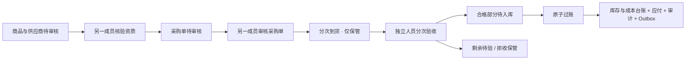

# ADR 0003：主数据审核与采购验收入库

状态：已实现开发增量 0.3；2026-10-10。适用于常温、非特殊管理、按批号管理的普通商品采购。完整 P0 和生产上线验收尚未完成。

## 业务边界与数据模型

本增量沿用 Python / FastAPI 同步业务入口、SQLAlchemy、PostgreSQL、控制库与业务库分离，以及 Vue 管理端。增加 `catalog` 和 `procurement` 模块；不引入独立采购微服务。

业务迁移 `b0003` 扩充商品资质字段，增加以下 10 张表。全部使用强制 RLS，业务库现有表合计 37 张；跨表引用带租户键。

| 表 | 职责 | 重要约束 |
| --- | --- | --- |
| party | 主体内供应商 / 客户档案 | 主体内编码唯一，经营类别和资质日期，审核版本 |
| purchase_order / purchase_order_line | 采购审批与累计收货 | 供应商和仓库属于同一主体；累计到货不超过订购数量 |
| receipt / receipt_line | 每次到货与在库保管记录 | 累计合格 + 拒收 ≤ 到货；累计入库 ≤ 合格 |
| inspection / inspection_line | 每次部分验收的原始事实 | 不可更新、不可删除；每行验收数量合计大于零 |
| receipt_posting | 每次验收合格部分的入库单元 | 一次验收最多一个，支持独立过账及永久去重 |
| payable_obligation | 过账产生的供应商应付 | 每次过账唯一；含税 = 未税 + 税额；事实不可变 |
| accounting_period | 当前主体期间是否开放 | 主体 + YYYY-MM 唯一；CLOSED 拦截新过账 |

商品档案是租户共享资料，供应商 / 客户、采购单和库存按经营主体授权。当前创建商品同时创建一个 SKU，只录入基本单位，尚无多包装换算与多 SKU 编辑界面。

## 状态和职责分离

- 档案：`DRAFT → APPROVED / SUSPENDED`，停用后可由符合条件的审核者重新审核通过；每次都有凭据编号、理由、审核人和版本。
- 采购单：`DRAFT → APPROVED / CANCELLED`；审批状态与到货状态 `OPEN / RECEIVED` 分开。当前只允许取消草稿。
- 到货不创建可用库存、不计成本、不产生应付。供应商送到的货物先进入 `receipt_line` 保管数量。
- 本次验收可以只处理部分数量；全拒收只创建验收记录，不创建入库单元。
- 有合格数量时生成 `receipt_posting(APPROVED)`；正式过账转为 `POSTED`。验收记录不随过账修改。
- 建档人不得审核通过本人档案；采购制单人不得审核本人单据；收货人不得验收本人到货。所有角色，包括 OWNER，均受此约束。验收员可以执行对应合格入库。

| 角色 | 主数据建档 / 制单 / 收货 | 主数据审核 / 采购审核 / 验收 / 入库 | 库存与采购查询 |
| --- | --- | --- | --- |
| OWNER / ADMIN | 是 | 是，仍遵守人员分离 | 是 |
| OPERATOR | 是 | 否 | 是 |
| QUALITY（新增） | 否 | 是 | 是 |
| VIEWER | 否 | 否 | 是 |

## 校验与不可变量

采购创建、审批、到货、合格验收及过账依次检查相应前置条件；正式入库时再次查询当前资质与批次状态，不依赖定时任务提前修改状态。

1. 主体启用，供应商已审核且类型允许供货，资质在上海日期的有效区间内。
2. 商品已审核、资质有效、属于供应商经营类别、未标记特殊管理、未启用序列号管理，主体商品门控未冻结。
3. 收货库位必须属于采购仓库；采购仓库必须属于订单主体，当前只支持物理仓库。
4. 批次自然键为租户 + SKU + 厂家标识 + 批号。同键的生产日期与效期必须一致，否则整个到货事务回滚。
5. 到货支持同订单行拆成多个批次 / 货位；按订单行汇总本次全部数量，检查累计超收。
6. 效期录入为到期日，按上海时区转换为次日零点的排他边界。生产日期不能晚于收货日。过期 / 冻结批次可以记录到货和拒收，不能判定合格或过账。
7. 待验 = 到货 − 已判合格 − 已判拒收；未入库保管 = 到货 − 已入库。后者包含待验、拒收和合格未入库，不能等同待验。
8. 新过账要求当前会计期间开放；开发阶段第一次入库自动建立当前月份 OPEN 记录，不提供关账入口。后续关账服务必须协调主体锁及期间锁。
9. 库存、成本池、过账批次 / 行、库存 / 成本流水、应付、单据版本、审计、Outbox 与投递状态在同一业务数据库事务内提交。任何失败都回滚，避免只增库存或只增应付。

资质字段和核验凭据目前由人员录入；尚未接入证照附件、监管数据核验、许可类别细分和法规规则引擎。系统不能自动识别未被标注的冷链或特殊品种，不能把本增量视为完整药械合规产品。

## 金额与成本口径

API 的数量、单价、税率和金额使用十进制字符串。SKU 数量精度 0–6 位；后端使用 Decimal，禁止二进制浮点参与业务计算；前端只录入和展示服务端结果。

当前策略版本 `RECEIPT_NET_V1`：以每条本次合格验收行为计价单位，含税金额 = 数量 × 含税单价，四舍五入到分；未税金额 = 已量化含税金额 ÷ (1 + 税率)，四舍五入到分；税额 = 含税 − 未税。整次过账应付汇总这些行金额，入库存货成本使用未税金额，币种固定 CNY。成本池维度为主体 / 货主 / SKU / 批次，库存额外包含仓库 / 货位 / 质量状态。

例如合格 6 个，单价 13 元，税率 `"0.13"`：应付 78.00，成本 69.03，税额 8.97。不同验收拆分可能产生分位舍入差，当前尚无按完整采购单分摊尾差、税额抵扣资格策略、采购费用分摊或发票差额调整。正式财务模块应版本化这些策略，不能回写既有成本事实。

台账 API 中 `gross_amount / tax_amount` 属于整次过账，在多行库存记录中可能重复出现。管理端只在关联过账详情显示这两个数，不将它们当成行金额加总。

## 幂等与并发

所有新增写入要求不透明会话、匹配 Origin、CSRF、上下文代次及 `Idempotency-Key`。请求体禁止额外字段，租户由服务器会话决定。更新操作使用字符串 `expected_version`，旧版本返回冲突，客户端应刷新核对。

- 通用命令记录以租户、操作者、命令、目标和幂等键哈希去重，保存请求指纹及成功响应。同键不同请求拒绝。前端在组件内按上下文 / 路径 / 请求体保留失败重试键；成功后释放，不把身份令牌写入浏览器持久存储。
- `receipt_posting` 和 `posting_batch` 同时提供业务永久去重。已过账单元即使换幂等键，相同原始请求仍返回第一次结果；不允许第二次增加库存、成本和应付。
- 初版采购写入先取得主体行排他锁，再锁供应商 / 商品 / 门控与单据，过账期间继续锁验收、期间、批次、余额与成本池。它会把同主体采购写入串行化；旧库存预占也持有主体共享锁，因此两者互斥协调。该选择优先保证本增量正确性，尚未验证大企业吞吐量。
- 锁等待 / 死锁 / 序列化失败使用已有有限重试及原幂等键；不能通过重新创建入库单元解决不确定结果。

后续细化锁粒度之前，应一起评审销售、质量冻结、期间关闭的全局锁序，不能局部移除主体锁。列表每页 50 条，采购单上限 50 行，每次到货 / 验收最多 100 行，选项最多 200 项，单订单详情最多 200 次到货；超限返回明确错误。大目录远程搜索和长单据分页尚未实现。

## 控制库授权锁与故障边界

控制迁移 `c0004` 增加 `control.lock_business_session`，仅赋予核心运行角色 EXECUTE。函数使用固定 `pg_catalog` 搜索路径和完整表名，通过 SECURITY DEFINER 获取租户、成员和会话共享锁；核心角色仍无控制表更新权。

新增主数据及采购写入在持锁的同一控制连接上验证权限，并将该事务保持到业务事务提交之后。退出、成员撤权、企业切换必须等待该命令完成，或在后续请求中使旧上下文失效。业务 UOW 提交前探测同一控制连接，若连接已失效则回滚业务写入。控制锁等待 2 秒，空闲事务超时 15 秒；过长业务处理可能因此回滚，而不是继续无锁提交。

这不是两个数据库的分布式原子提交。提交前探测与业务 COMMIT 之间仍存在控制连接刚好丢失的窗口；不能宣称在所有网络分区下实现撤权与过账的严格线性一致性。生产启用前需要故障注入、容量测量，并按正式威胁模型决定使用同库授权版本 / 写租约等更强提交栅栏。旧预占写入口仍保持默认关闭，不因本次采购开放自动对外启用。

## HTTP 接口

实际运行的 `/openapi.json` 包含 18 条路径。原 5 条库存 / 上下文路径保留，新增如下（前缀 `/api/v1`）：

| 方法 | 路径 | 权限 |
| --- | --- | --- |
| GET / POST | `/catalog/products` | catalog.read / catalog.write |
| POST | `/catalog/products/{id}/review` | catalog.review |
| GET / POST | `/catalog/parties` | catalog.read / catalog.write，主体范围 |
| POST | `/catalog/parties/{id}/review` | catalog.review，主体范围 |
| GET | `/purchasing/options` | purchase.read，主体范围 |
| GET / POST | `/purchase-orders` | purchase.read / purchase.write，主体范围 |
| GET | `/purchase-orders/{id}` | purchase.read，主体范围 |
| POST | `/purchase-orders/{id}/approve` | purchase.approve |
| POST | `/purchase-orders/{id}/cancel` | purchase.write |
| POST | `/purchase-orders/{id}/receipts` | purchase.receive |
| POST | `/receipts/{id}/inspections` | purchase.inspect |
| POST | `/receipt-postings/{id}/post` | purchase.post |
| GET | `/inventory/ledger` | inventory.read，主体范围 |

写入响应沿用 `{data, request_id}`；错误沿用 `{error: {code, message, retryable}, request_id}`。新增请求 DTO 合并到原 OpenAPI 组件，避免原契约覆盖后出现断开的 `$ref`；新增操作显式列出请求头及错误结构。原规划中的验收入库请求 / 响应契约继续复用。

入库事件为 `inventory.receipt_posted`，schema_version=1，聚合为 receipt_posting，载荷是当前过账结果（过账单号、版本、流水 ID、事件 ID 和时间）。它作为本增量内部事件落库；尚未启动 Outbox 投递工作器，不视为外部追溯上报或已发布平台事件契约。

## 验收与继续开发

真实数据库测试覆盖部分验收、分次到货、同批号资料冲突、行汇总超收、并发收货、换键并发重复过账、资质 / 冻结 / 效期 / 期间拦截、成本溢出回滚、提交前授权探测失败回滚、跨租户 / 主体不可见、只读权限和职责分离。真实 Keycloak + Edge 测试通过两个身份在页面中完成全流程并核对库存与成本应付。

本增量没有实现：已录资料编辑 / 证照附件、包装换算、采购变更与退货、拒收品实物退回、已过账冲销、付款核销、批发销售出库、零售、调拨盘点、追溯上报。不得通过直接改表绕过这些未完成的工作流。

下一开发入口为批发销售：客户资质复核 → 订单审批 → 真实来源需求 → FEFO 预占 → 拣货复核 → 出库数量与成本扣减 / 应收原子过账。对接现有库存预占之前，先实现真实来源审批和销售成本一致性测试，再开放对应写入口。随后补退货、结算和零售场景。
