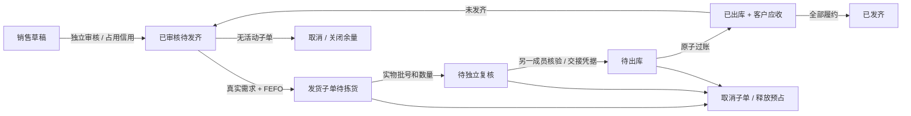

# ADR 0004：批发销售、客户信用与出库过账

状态：已实现开发增量 0.4；2026-10-10。范围为常温、普通批次商品的批发销售。沿用 Python 3.14、FastAPI、SQLAlchemy、PostgreSQL 和 Vue 管理端；完整 P0 及生产部署尚未完成。

## 数据模型与模块

新增 `modules/sales`，分为 DTO、查询、订单与信用、履约、出库过账。销售在同一个业务事务中复用库存分配与释放逻辑，不通过内部 HTTP 或嵌套事务完成预占。采购模块中的日期、金额编码和单据帮助函数暂为共享依赖，后续可抽到独立公共模块。

业务迁移 `b0004` 新增 6 张表，合计 43 张强制 RLS 的业务表。控制迁移 `c0005` 扩充内置角色权限并撤销旧权限版本会话。所有业务表包含租户键，关联外键包含租户；经营主体范围另由业务授权检查。

| 表 | 内容 | 约束与用途 |
| --- | --- | --- |
| credit_account | 主体、客户、额度、订单敞口、应收余额、有效期、版本 | 主体 + 客户唯一；金额非负；修改额度不能低于已占用与应收之和 |
| sales_order | 客户、仓库、地址、最低效期、账期、金额、未出库敞口、审批快照 | 客户及仓库需属于所选主体；保存审批时客户与信用政策快照 |
| sales_order_line | SKU、数量、含税单价、税率、整行含税 / 未税金额 | 数量为正；创建后不可更新、删除；真实需求行沿用同一 ID |
| shipment | 每次发货、库存预占、状态、拣货人、复核人、交接凭据、过账号 | 每个预占对应一个子单；保存永久操作编号、请求指纹与创建响应 |
| shipment_line | 预占分配行、实拣数量、实物批号 | 分配行唯一；禁止凭前端任意指定库存扣减 |
| receivable_obligation | 客户、发货子单、过账、含税 / 未税 / 税额、到期日、政策版本 | 发货子单及过账各自唯一；含税 = 未税 + 税额；不可更新、删除 |

原 `inventory_demand` / `inventory_demand_line` 由销售审批在服务器端创建，分别使用销售单与销售行 ID。前端不能通过销售接口伪造 SKU、需求数量或已审核来源。原始库存预占 HTTP 写接口继续默认关闭。

## 状态与职责



- 订单：`DRAFT → APPROVED → FULFILLED`。草稿或已审核订单可关闭；无已出库记录记为 `CANCELLED`，部分已出库记为 `CLOSED`。先取消全部未出库子单，才能关闭订单余量。
- 子单：`ALLOCATED → PICKED → VERIFIED → POSTED`；出库前可以取消。已出库子单不能直接撤销，后续通过退货或受控冲销处理。
- 制单人与审批人不同；拣货人与复核人不同。管理员也不能绕过这两条职责分离。出库操作人可以是复核人。
- 拣货和复核都要求全部分配行的实物批号、数量完全一致。前端输入为空，必须实际填写；服务端独立检查。暂不支持拣货时修改批次或短拣，需取消子单后重新分配。

| 角色 | 销售权限 |
| --- | --- |
| OWNER / ADMIN | 读取、制单、关闭、分配、拣货、审批、复核、过账、信用设置 |
| OPERATOR | 读取、制单、关闭、分配、拣货、取消未出库子单 |
| QUALITY | 读取、审批、复核、过账 |
| VIEWER | 读取 |

客户额度配置仅所有者 / 管理员可操作，留存调整依据与审计。当前没有单独的授信双人审批流。

## 客户信用

没有信用账户时，额度视为未配置，审批失败；不自动授予无限额度。金额统一人民币，前后端以十进制字符串传输。

`可用额度 = 授信额度 − 已审批未出库敞口 − 应收余额`。

审批时整单含税金额加入敞口；发货出库时将该次含税金额从敞口转入应收，避免重复释放可用额度；关闭未发余量时仅释放剩余敞口。取消发货子单只释放库存预占，订单信用继续保留，直到发货或关闭订单。

创建、审批、分配、拣货、复核、出库按适用阶段检查客户资质、商品资质、主体状态和冻结状态。审批及后续履约检查额度有效期和逾期应收，防止审批后情况变化仍然发货。客户范围目前仅区分药品 / 器械，不能替代更细的经营资格规则。

应收到期日 = 出库业务日期 + 订单账期，业务日期采用北京时间。`到期日 < 当天` 才算逾期；到期当天尚不算逾期。当前没有收款 / 核销，因此所有正金额原始应收都视为未结清，不能把本版本作为完整信用与结算系统使用。零金额应收不触发逾期。

## 批次、库存和有效期

采用 FEFO：先筛选有资质、合格、未冻结、未过期、非特殊管理、非序列号管理且满足最低剩余效期的库存，再按到期先后分配。最低效期按当前时刻加 N 个 24 小时计算，而不是按自然日期差；过账时再次检查。

数量必须符合 SKU 基本单位精度。需求未完成量、在途预占和实物可用量同时参与约束，多订单竞争不能重复占用。当前只支持一个经营主体自有货权的实物仓库。

预占默认有效 900 秒，可由 `MED_RESERVATION_TTL_SECONDS` 配置为 60–3600 秒。暂未实现自动清理工作器，过期后不能出库，但仍保留占用；必须取消子单释放后重新分配。前端显示服务端返回的截止时间和过期提示，提交时仍由服务端作最终判断。人工流程、仓库规模或生产吞吐不同，需要评估合适的时长与自动回收策略。

## 原子过账与成本

`POST /api/v1/shipments/{id}/post` 在一个业务数据库事务内执行：

1. 验证租户主体权限、版本、独立复核、有效预占、客户与商品资质、冻结及效期、客户信用；锁定开放会计期间。
2. 锁定真实来源需求、库存分配、库存余额和批次成本池，验证未履约数量与已预占数量。
3. 创建不可变过账批次、商品和基本单位快照；扣减实物库存及预占量，增加需求累计履约，消耗预占分配。
4. 结转成本，追加负数量库存流水和负金额成本流水。
5. 插入唯一客户应收，将订单信用敞口转为应收；更新子单、订单和预占状态。
6. 写入审计与 Outbox，再经授权连接探测提交。任何失败均回滚本次库存、成本、应收及单据变更。

成本池维度为主体 + 货权 + SKU + 批次。同一池按 `池金额 × 本次数量 / 池数量` 结转，保留 8 位小数、四舍五入；最后一次发出全部余量时取完整剩余金额，消除池内尾差。没有成本基数或成本数量不足则拒绝出库，不能将旧演示快照当作零成本库存。销售毛利分析暂未开发，页面显示的是成本原始精度，不是财务凭证过账结果。

销售金额按订单行累积分摊，政策版本 `SALES_CUMULATIVE_V1`：

```text
整行含税 G = round(订单数量 × 含税单价, 2)
整行未税 N = round(G / (1 + 税率), 2)
累计含税 g(q) = round(G × 累计已发数量 q / 订单数量, 2)
累计未税 n(q) = round(N × g(q) / G, 2)；G = 0 时取 0
本次含税 = g(本次后) − g(本次前)
本次未税 = n(本次后) − n(本次前)
本次税额 = 本次含税 − 本次未税
```

这确保分批及跨批次累计金额等于原订单行金额，极小金额分次发出时税额仍非负。未税与税额按累积分摊，可能与每个子单单独重新计算税额差一分；发票、折扣、运费和更复杂税务策略另行实现。

## 并发、幂等与授权

当前以经营主体行排他锁串行化同主体销售和采购。原始库存分配 / 释放获取主体共享锁后操作需求与库存。该设计优先保证跨模块一致性，会限制单主体并发吞吐；尚未做容量基准，不宣称高并发生产性能。

请求要求 Cookie 会话、`X-Context-Generation`；写入另需 `X-CSRF-Token`、匹配 `Origin`、`Idempotency-Key`。控制库授权共享锁持有至业务命令结束，并在业务提交前探测连接。两库不是分布式事务，探测与实际提交之间的网络故障窗口仍存在，不能将此机制描述为完全消除跨库撤权竞态。

普通命令复用共享幂等组件；创建发货子单另用客户端永久 `client_operation_id`、请求指纹、创建响应去重。子单出库已完成后可用原请求版本和新幂等键重放，返回原过账响应；修改请求内容则冲突。同一子单 6 个并发过账请求只产生一组流水和一笔应收。前端相同失败命令保留幂等键供重试；页面刷新后应先查单据状态。

## 实现接口

| 接口 | 用途 |
| --- | --- |
| GET `/api/v1/selling/options` | 主体下有效客户、可售商品、实物仓库 |
| GET / POST `/api/v1/customer-credit/{id}` | 查询 / 设置客户额度，参数含 entity_id |
| GET / POST `/api/v1/sales-orders` | 分页列表 / 创建销售单 |
| GET `/api/v1/sales-orders/{id}` | 单据、累计履约与发货明细 |
| POST `/api/v1/sales-orders/{id}/approve` | 独立审批、占用信用、建立真实需求 |
| POST `/api/v1/sales-orders/{id}/close` | 取消未履约单 / 关闭部分履约余量 |
| POST `/api/v1/sales-orders/{id}/shipments` | 按实际发货需求进行 FEFO 分配 |
| POST `/api/v1/shipments/{id}/pick` | 实物拣货 |
| POST `/api/v1/shipments/{id}/verify` | 独立出库复核和交接凭据 |
| POST `/api/v1/shipments/{id}/cancel` | 取消未出库子单，释放库存预占 |
| POST `/api/v1/shipments/{id}/post` | 库存、成本、应收原子过账 |
| GET `/api/v1/receivables` | 主体内应收分页查询及关联成本 |

运行中的核心 OpenAPI 共 30 条路径，完整 DTO 以 `/docs` 为准；原规划契约仍含未实现接口。本增量实现的原契约出库接口保留 `PostingResultResponse` 结构，运行权限标记为 `sales.post`。

## 验证与未完成项

新增 23 项真实 PostgreSQL 销售集成测试：部分 / 全量发货、同客户额度竞争、同库存竞争、操作编号永久幂等、并发出库、实物核验与职责分离、过期 / 冻结 / 停用 / 无成本拦截、关闭部分订单、FEFO 与最低效期、金额尾差、多行共用成本池、逾期与关账、授权探测回滚、租户主体权限和 HTTP 过账响应契约。新增两项真实 Keycloak / 浏览器测试覆盖双人销售闭环和只读权限。

销售写开关 `MED_SALES_COMMANDS_ENABLED` 默认关闭，本机 `scripts/dev.py` 启用。列表 50 条 / 页、选项上限 200、单销售订单最多 50 行、单次分配明细最多 500 行、库存候选最多 2000 条；订单详情最多展示 200 个发货子单，超过则返回明确错误。目前这些边界需要后续分页与更大规模负载验证。

尚未完成：订单修订、多包装、预收款与现金销售、收款核销、退货 / 冲销、物流接口与温控、自动预占回收、完整会计凭证、零售 POS、处方医保、外部追溯、消息投递工作器。资质为人工录入与核验记录，不能代替完整经营合规审查。上述项目继续纳入后续主体进销存开发。
