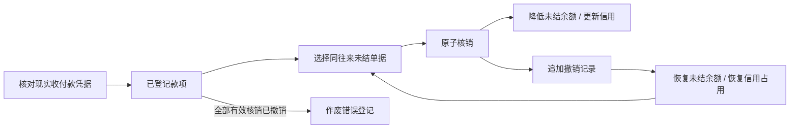

# ADR 0005：收付款登记、核销与反向更正

状态：开发增量 0.5 已实现；2026-10-11。承接 0.4 采购应付、销售应收，采用同一 Python / PostgreSQL 业务事务。此增量覆盖经营往来结算，总账、银行直连与税务另行实现。

## 业务范围

分开记录“实际已经发生的收付款”和“将款项用于结清哪笔义务”。登记款项本身不冲减应收应付，也不释放客户额度；只有有效的收款核销才降低客户应收。款项可以分次核销，一次请求可以核销同一往来单位的多笔应收 / 应付。

当前仅人民币、同租户、同主体、同往来单位、兼容方向：收款对 AR，付款对 AP。供应商兼客户也不自动互抵。未核销余额保留在款项中，不纳入预收抵扣信用；UI 从已有应收 / 应付选择往来并登记，独立预收预付业务及其信用政策尚未开放。

人工登记必须确认实际发生，填写账户、正金额、实际日期、凭据编号和核对说明。实际日期不能晚于北京时间当天，对应期间必须开放。系统不请求银行或支付平台，不把人工核对描述成平台验证成功。财务结算允许处理已停用或资质到期往来单位的既有债务；原销售资格规则继续独立生效。

## 数据结构和迁移

`b0005` 新增 6 张表，业务表总计 49 张 FORCE RLS；`c0006` 扩充权限并撤销旧会话。新增表全部含租户键，关联外键包含租户；现金单的主体与往来、资金账户通过复合外键约束。业务服务另外校验核销的主体、往来和方向。

| 对象 | 用途与约束 |
| --- | --- |
| cash_account | 主体下现金 / 银行账簿；主体内编码唯一，不保存网银凭据，不代表实时账户余额；当前只能新增和读取 |
| cash_document | 人工确认的收付款原始事实，金额、账户、日期、凭据、往来不可由运行角色修改；仅核销余额、状态、版本允许更新 |
| settlement_allocation | 款项与一笔 AR 或 AP 的核销，金额为正；原始核销不可更新、删除 |
| settlement_reversal | 指向原核销的完整反向记录，保留原因、操作人及时间；一笔原核销最多撤销一次 |
| cash_void | 错误款项登记的作废凭据；款项无有效核销时才允许作废，不删除原始记录 |
| settlement_operation | 永久客户端操作编号、请求指纹、操作人、命令及响应，用于款项登记 / 核销 / 撤销的重试去重 |
| settlement_item 视图 | 统一 AR / AP 原始金额、有效已核销、未结余额和版本；使用 `security_invoker=true`，执行者的源表 RLS 继续生效 |

视图直接读取原始 `receivable_obligation` / `payable_obligation` 及核销事实，因此旧版既有应收应付自动纳入，不需要绕过租户隔离做全量回填，也不修改原始义务。视图不是新的可写结算总账。

```text
有效已核销 = 所有未被反向记录撤销的 allocation 金额之和
未结余额 = 原始义务金额 − 有效已核销
义务版本 = 1 + 原核销记录数 + 反向记录数
款项可核销 = 实际金额 − 当前有效核销金额（作废款项不可再使用）
```

版本在撤销后继续增加，避免金额恢复后旧版本请求重新通过。款项版本以更新投影的方式递增。视图聚合会随着租户历史数据增多而增加成本，尚未做容量压测；后续可以加可校验的余额投影和对账任务。

## 状态和纠错



撤销按原核销完整金额，不支持部分撤销一条记录；需要部分更正时，可撤销后按正确金额重新核销。撤销登记在当前开放期间，保留原始操作时间，不回写历史核销金额。

作废用于错误登记修正，不是现实退款。必须先撤销该款项全部有效核销，再填写作废原因。作废记录及原始事实永久保留。已经作废的款项不能再核销。

有效收付款凭据按租户 + 主体 + 账户 + 方向 + 凭据编号防重，编号按规范化后的完整字符串精确匹配。相同凭据、新操作号不会自动当作另一笔款项。作废后可以用新操作号重新登记同一凭据，以更正原错误；原作废记录仍可查。当前没有凭据附件、银行回单验证或模糊重复识别。

## 核销事务和信用联动

核销命令在一个短业务事务内执行：

1. 验证 Cookie、CSRF、来源、企业上下文、主体范围和 `finance.allocate`；按客户端操作编号加事务锁，检查永久结果。
2. 获取主体排他锁，锁定当前开放期间和款项；验证款项状态、版本、可核销金额。
3. 按义务 ID 顺序读取并核对全部目标版本、主体、往来、币种、方向及未结余额。任一行失败则整次请求不保存。
4. 追加核销事实，更新款项已核销金额与版本。AR 收款核销同时锁定客户信用账户，将应收余额减少相同金额；AP 付款不改变客户信用。
5. 同事务保存审计、Outbox 和永久操作响应，提交前执行既有控制库授权连接探测。Outbox 的财务事件指向 `settlement_projection`，投递工作器尚未实现。

撤销核销按相同主体锁和期间约束追加反向事实，减少款项有效核销，AR 场景同时增加客户信用应收。即使后来降低了额度，也必须真实恢复风险，允许可用额度变为负值；后续销售审批按现有规则阻止超额新增订单，而不是丢失债务。

销售逾期检查改为 `settlement_item.kind='AR' AND due_date<当天 AND outstanding_amount>0`。应收核销结清后不再因这笔原始应收阻断履约；撤销后重新出现逾期余额则恢复阻断。销售查询页面保留原始金额，新增已核销 / 未结余额，不改变销售税额、成本或库存。

## 并发和幂等

同主体销售、采购、结算继续通过主体行排他锁串行化。义务是不可变事实，核销和撤销都在主体锁内，因此不对聚合视图执行行锁；未来降低锁粒度时必须同时增加稳定的结算余额行或等效并发控制，不能仅删除主体锁。

一般命令继续使用 `Idempotency-Key`。款项登记、核销、撤销另使用永久 `client_operation_id`，指纹包括目标、请求内容和命令，保存原始响应；更换 HTTP 幂等键重试仍只记一次。不同操作人或请求内容复用该编号会冲突。款项凭据唯一索引和单次撤销唯一约束提供额外保护。

前端确认登记后才进入核销，两阶段分别提交。后续核销失败不丢失真实收款事实，也不要求重复登记款项。原操作号重放返回历史响应，界面随后加载最新详情。

控制库授权持锁与提交前探测沿用前版。业务数据事务原子，但控制库与业务库不是跨库原子提交；探测后网络故障窗口仍是生产加固项。当前主体串行锁及视图查询仅通过功能和并发正确性验证，没有生产容量承诺。

## 权限和接口

OWNER / ADMIN 可管理资金账户、登记、核销、撤销、作废和读取；新增 FINANCE 角色可登记、核销、更正及读取，不能管理资金账户或用户。OPERATOR / QUALITY / VIEWER 只读结算。管理员可在成员页分配财务角色，现有演示管理员即可体验，无需新建演示密码。

| 接口 | 用途 |
| --- | --- |
| GET / POST `/api/v1/settlements/accounts` | 主体资金账户列表 / 新增 |
| GET `/api/v1/settlements/items` | AR / AP 分页查询，可按往来及未结筛选 |
| GET / POST `/api/v1/settlements/cash-documents` | 收付款分页查询 / 登记已发生款项 |
| GET `/api/v1/settlements/cash-documents/{id}` | 款项详情、分页核销历史、作废原因 |
| POST `/api/v1/settlements/cash-documents/{id}/void` | 作废无有效核销的错误登记 |
| POST `/api/v1/settlements/allocations` | 一笔款项核销 1–50 笔义务，保留原规划 `AllocateRequest` / `AllocationResultResponse` |
| POST `/api/v1/settlements/allocations/{id}/reverse` | 完整撤销一条核销 |

核心运行 OpenAPI 共 37 条路径。新命令开关 `MED_SETTLEMENT_COMMANDS_ENABLED` 默认关闭，本机 dev.py 开启；普通库存命令仍默认关闭。列表及核销历史每页 50 条，账户选项上限 200，金额精确到分；不接受浮点数、科学计数法、负值、零金额或超精度金额。

往来列表与核销历史显示销售发货子单号或采购收货单号。采购来源经应付的过账批次、入库分段、验收记录关联收货单；同一收货单分次验收入库可产生多笔应付，核销选择页同时显示记账时间，保留各笔独立余额。

## 验证和后续

新增 15 项真实 PostgreSQL 集成测试及 7 项金额边界单元测试，覆盖分次 / 多单核销、AP 与 AR 分离、单行失败全批回滚、并发同操作去重、多款争用同义务、凭据防重、撤销及作废约束、逾期解除与恢复、提交前授权失败回滚、不可变事实、视图租户隔离、权限边界、原 OpenAPI 契约、不同往来拦截、降额后撤销恢复风险。

新增两项真实登录浏览器测试，覆盖账户创建、收款 80 元分次核销 60 元、撤销重做、应收结清与信用恢复、付款 130 元核销应付，以及只读用户页面和 HTTP 越权拦截。完整结果见开发记录。

后续继续：采购 / 销售退货与红字义务、退款、预收预付及信用抵扣、往来对账、凭证附件、期间管理、账户修订、目录检索与余额投影、零售 POS。账户无期初与实时余额，不能将未核销款项列表当作现金流量表或银行余额。
