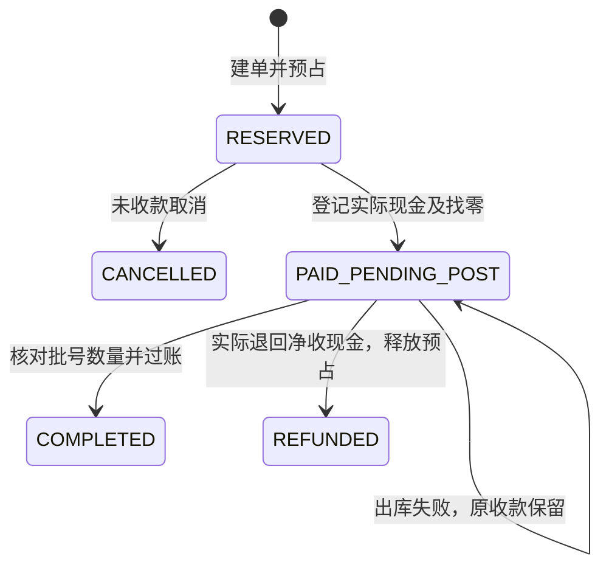

# ADR 0008：零售现金交易主链

状态：已实施于 0.8 开发验证版。日期：2026-10-12。

## 目标与范围

按照“主体架构和进销存闭环优先”的开发顺序，接通匿名顾客的现金零售，复用现有租户隔离、权限、库存分配和成本台账。已完成的采购、批发、往来结算及批发退货继续保留。

本轮支持已审核普通器械、已明确核定为 OTC 的药品；只开放批次管理、非序列号商品。现金收款为人工确认的实收记录。已完成零售单退货、处方审核、电子支付、医保、会员、促销、打印及报表不在本轮范围。

## 状态与事务边界

1. **建单事务**：校验主体、仓库、商品资质与药品分类，按 SKU 精度和逐行价格计算金额；建立零售明细、库存需求、FEFO 预占及审计。一项失败全部回滚。普通预占有效期为 15 分钟。
2. **现金事务**：验证单据版本、有效预占、同主体现金账户、开放记账期间和实收金额；写入不可变收款事实，记录顾客交付现金、净收款及找零，将单据置为 `PAID_PENDING_POST`，需求置为 `PAID_PROTECTED`，预占进入付款保护。
3. **交付事务**：校验实际交付清单与全部分配逐行一致，再次验证商品、批次质量及效期、预占和成本；同时生成过账批次、逐行金额快照、库存流水、成本流水、审计和 Outbox，消费预占并置为 `COMPLETED`。无需客户档案，不生成应收、授信占用或虚拟往来单位。
4. **待交付退款事务**：有退款权限的人员确认现金已实际退还，按原现金账户记录等于净收金额的退款，释放预占并置为 `REFUNDED`。不生成库存及成本出入库。仅适用于 `PAID_PENDING_POST`，不代替已完成零售单的退货。

现金实际交接是系统外行为，数据库无法与实物现金原子提交。前端要求核对确认；网络异常应使用同一表单重试或查阅详情，不再次收钱 / 退款。待交付单刷新页面仍可恢复。付款保护沿用现有 `protected_until` 字段，使用 9999 年末标记持续保护；没有自动超时解锁，必须完成出库或退款。

## 模块和数据

- `retail` 模块负责零售单、现金事实和交付编排；组合使用现有销售资质校验、库存分配、结算期间及永久操作幂等服务。
- `retail_sale`：主体、仓库、预占、单号、状态、金额、版本、原过账编号。
- `retail_sale_line`：不可变商品、数量、价格、税率及商品 / 包装快照。
- `retail_payment`：不可变收款 / 退款、原账户、现金与找零、确认说明及操作人。每张零售单至多一笔收款和一笔待交付退款。
- `product.drug_sale_class`：`UNKNOWN / OTC / RX`；旧药品默认 `UNKNOWN`，不自动判为 OTC。新药品建档时分类，随原有商品独立审核流程确认。旧档案的分类修订尚未实现。
- 库存过账来源 `RETAIL_SALE`，动作 / 库存事件 `RETAIL_SOLD`；共用 `posting_batch / posting_line / stock_ledger / cost_ledger`，不另建一套库存余额。
- 零售现金记录通过原零售单详情查询，尚未合并至往来单位的收付款列表或形成现金日结报表。

业务迁移 `b0008`，控制迁移 `c0008`。三张新增业务表均开启 FORCE RLS；现金和明细事实禁止更新、删除。应用写入继续按经营主体串行化，复用业务事务及提交前授权检查。此方式尚无生产容量基准，也不消除控制库与业务库之间的网络故障窗口。

## 金额、成本与防重

数量、单价、税率及金额使用十进制字符串；后端以 Decimal 计算，禁止以浮点数记账。原行含税金额、未税金额保留两位；批次拆分使用累计分摊，拆分后的合计必须等于原行、原单。成本按当前批次加权成本扣减，最后出尽时取余额尾差。

建单、收款及退款均具有 `client_operation_id` 永久事实幂等，复用现有 `settlement_operation` 存储与 UUID 事务锁；HTTP `Idempotency-Key` 继续作为请求幂等入口。重复出库通过原过账快照和请求摘要恢复结果。不同内容复用操作编号拒绝；重复收款、退款与出库竞争不能形成两份资金或库存事实。

公共库存预占不能直接创建零售分配，公共释放入口不能取消零售预占。只能通过零售单命令推进对应状态，避免单据、付款与库存脱节。

## API 与权限

当前 API 使用 `/api/v1/retail` 命名空间，避免将开发中的现金接口冒充规划契约中的完整支付接口。已实现契约由运行服务导出到 `contracts/openapi/implemented-core-openapi.json`，原规划契约不覆盖。

| 路径 | 方法 | 用途 / 权限 |
| --- | --- | --- |
| `/retail/options` | GET | 仓库及现金账户，`retail.read` |
| `/retail/catalog` | GET | 可售商品搜索、分页，`retail.read` |
| `/retail/sales` | GET / POST | 分页查单 / 建单，`retail.read / sell` |
| `/retail/sales/{id}` | GET | 原行、分配、收退款及过账结果，`retail.read` |
| `/retail/sales/{id}/cash` | POST | 实收现金及找零，`retail.sell` |
| `/retail/sales/{id}/complete` | POST | 核对并出库，`retail.sell` |
| `/retail/sales/{id}/cancel` | POST | 未收款取消，`retail.sell` |
| `/retail/sales/{id}/refund-pending` | POST | 未交付退款取消，`retail.refund` |

表内省略公共前缀 `/api/v1`。所有写入要求会话、CSRF、Origin、上下文版本及幂等键，主体必须在授权范围内。

OWNER / ADMIN 可完成全部流程；OPERATOR 可售卖及取消未收款单；FINANCE 可退款；QUALITY / VIEWER 只读。零售现金交付不套用批发的双人拣货复核，现金退款权限独立。零售写开关 `MED_RETAIL_COMMANDS_ENABLED` 默认关闭，本机开发启动脚本开启。

## 验证与后续

新增集成场景覆盖：正常记账、批次冻结失败恢复、付款后过期预占继续保护、取消与退款、永久付款幂等、实收不足、错误批号、并发超卖、出库 / 退款竞争、提交前撤权回滚、不可变事实、租户和角色隔离、OTC / RX / UNKNOWN、多批次及同 SKU 多行金额成本。

浏览器使用真实身份中心，完成采购入库后现金零售 3 件、100 元实收 / 40 元找零、刷新恢复、错误批号拦截及纠正出库；再次建单收款后退还 60 元并取消，核对最终库存 7 件、预占为零。

后续主线：已完成零售单的按原单退货与退款 → 盘点及调拨 → 质量处置和基础资料修订。待这些主流程跑通后，再推进报表、体验细节及 AI / 外部集成。
