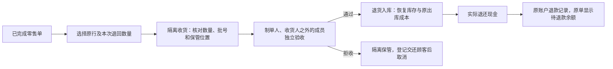

# ADR 0009：零售退货复用退货工作流，现金退款关联原实收

状态：已实施于 0.9 开发验证版。日期：2026-10-13。

## 决策

在现有 `returns` 模块增加 `RETAIL` 来源，复用采购 / 批发退货的原过账行追溯、剩余数量、累计金额及成本分摊、隔离保管、独立复核和库存过账。零售售后与批发共用一套库存及成本事实；匿名顾客不建立虚拟客户，不产生应收、授信或核销。

已收款未交付单继续使用 0.8 的“退款取消”流程。本轮处理 `COMPLETED` 零售原单：实物按原批次分次退回，完成退货入库后再登记现金退款。

## 数据变化

业务迁移新增 `b0009`，控制迁移仍为 `c0008`；本轮不扩充角色权限。

- `return_document.kind` 增加 `RETAIL`，增加 `retail_sale_id`。零售必须没有 `party_id / receivable_id / payable_id`，采购 / 批发仍强制具有原往来和对应账款来源。
- 外键同时绑定原零售单、主体及原过账编号，防止把另一主体或另一原单的过账当作该零售来源。零售退货统一采用流程版本 2。
- `return_line / return_custody / return_custody_close`、原有一个未结申请的唯一约束、`posting_batch / posting_line / stock_ledger / cost_ledger` 继续共用。
- 新增不可变表 `retail_return_refund`：退货单、原零售单、原现金收款、原账户、金额、退款编号、说明、操作人和时间。复合外键保证退货、原单、主体、收款及账户关联；每张退货申请至多一笔现金退款。
- 新表 FORCE RLS，仅授予运行角色 SELECT / INSERT，禁止更新、删除。业务表共 59 张。

`retail_payment` 原始现金实收与找零保留；不修改原收款金额，不将售后退款伪装成 0.8 的未交付退款，也不触发采购 / 批发的往来核销服务。

## 工作流与事务

建单时只累计已过账退货数量；原单存在未处理申请时拒绝再建。原来源行包含批次、原库存 / 成本效果及金额快照，部分退货沿用累计分摊与末次尾差规则，累计不能超过原行数量或原收款。

收货仅记录客户实物隔离保管，不计自有库存、成本或可售量。验收通过后，过账再次检查商品资质、批次冻结与效期、合格库存维度、开放期间，恢复原出库分摊成本，写入 `RETAIL_RETURNED` 库存事件及成本流水，同事务关闭隔离保管记录。失败则全部回滚。

退款只接受已过账的 `RETAIL` 退货。金额取本次退货的含税金额，账户取原现金收款；客户端不能另填金额或换账户。零金额行允许正常退货入库，无需现金退款。每张退货按其全部金额登记一次现金退款，不支持同张申请分笔付款；多次退货申请可分别退款。

退款事务持有经营主体、退货单及原零售单锁，检查单据版本、唯一退款事实、开放期间，以及该原收款已经累计退还的金额。新增不可变退款事实、推进退货单版本、审计和财务 Outbox 同事务提交。`client_operation_id` 永久幂等与 HTTP 幂等键复用原有机制；同一操作重试返回原结果，不同操作竞争同一退货只能成功一次。

退货入库和退款登记为两个独立事务。入库完成后即使退款未登记、网络失败或期间关闭，已接收的库存不会丢失；原单显示“待退现金”，可在原因排除后继续退款。实际现金交接不能与数据库原子提交，操作者应先核对原记录再重试，不重复交接。

## API 与页面

原退货 API 接受 `RETAIL` 来源：`GET /api/v1/returns/sources?kind=RETAIL`，以及既有创建、详情、隔离收货、独立复核、过账和交还接口。

新增 `GET / POST /api/v1/returns/{id}/retail-refund`：读取原账户、待退金额和已有退款；登记本次现金退款。POST 使用 `RetailCashConfirmation`（永久操作编号、预期退货版本、实际现金确认及说明）。写入受 `MED_RETURNS_COMMANDS_ENABLED` 开关和 `retail.refund` 权限控制；旧往来退款写入口显式拒绝零售来源。

页面从“零售收银 → 原单详情 → 办理原单退货”直接进入原单申请，也可在“退货与退款 → 零售退货来源”选择。隔离、验收及退款均在统一退货详情内处理；零售不展示往来核销。原零售详情增加已退货金额、已退现金和待退现金。

原单仍保留 `COMPLETED`，表示原销售履约已完成；售后通过独立退货和退款事实表达，不重开销售或覆盖原金额。已实现契约导出到 `contracts/openapi/implemented-core-openapi.json`，不覆盖原规划契约。

## 权限、验证及边界

`returns.write` 负责申请、收货和交还，`returns.review / post` 负责独立验收与过账；只有 `retail.refund` 可登记现金退款。财务可以退款，业务操作员与质量员不能越权退款，查看仍受租户和经营主体范围约束。

测试覆盖分次退货和成本恢复、隔离未验收不能上架、职责分离、拒收交还、冻结 / 停用品拦截、超退、并发申请、重复及并发退款、提交前撤权回滚、期间关闭、零金额行、不可变事实、租户 / 主体 / 角色限制，以及完整真实登录页面流程。

当前整张申请只支持通过或拒收；不支持部分行不同质量结论、销毁、过期品转自有不合格库存、换货、直接撤销已过账退货、售后现金退款作废或改额。现金仍为人工登记，不执行银行转账或支付平台退款。生产容量、同主体串行锁、普通预占手工回收与两库授权故障窗口沿用既有边界。

下一阶段按优先级推进盘点、盘盈盘亏审批过账及同主体仓库调拨，继续完善主进销存闭环；报表和体验细节保持后置。
