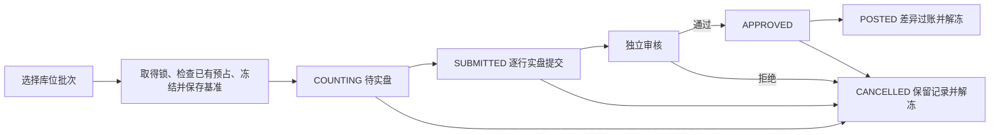

# ADR 0010：按主体批次冻结盘点，差异进入统一库存及成本台账

状态：已实施于 0.10 开发验证版。日期：2026-10-13。

## 决策与范围

在现有 inventory 模块增加盘点应用服务，复用业务事务、主体权限、期间、幂等、过账批次、数量 / 成本流水及 Outbox。盘点是库存业务，不产生客户应收、供应商应付或现金收付款。

操作者选择一个实体仓库中的已有普通合格批次，最多 200 个库位批次；仅这些余额的差异参与调整。由于成本池按主体、商品和批次共享，盘点期间冻结所选**主体批次的全部库存和成本写入**，覆盖其他库位及其他仓库，直到过账或取消。其他商品 / 批次可以继续办理业务。

当前不是整仓全量盘点，也不是盲盘：页面展示账面数量，实盘输入保持空白，操作者必须逐行明确填写，包括零数量。新发现但未建档、从未入库或缺少成本记录的商品 / 批次暂不能用本入口直接补入。

## 数据与状态

业务迁移 `b0010` 增加三张表，`b0011` 增加冻结触发器和基准流水计数；业务表共 62 张，全部 FORCE RLS。控制迁移 `c0009` 增加盘点权限并撤销旧权限版本的会话，升级后需重新登录。

- `stock_count`：主体、仓库、单号、原因、状态、版本、制单 / 实盘提交 / 审核人员及时间、过账编号。一个仓库最多一张未完成盘点，不同仓库也不能同时盘点同一成本池。
- `stock_count_line`：不可变账面快照，包括库存余额、成本池、两者版本、账面 / 预占 / 冻结数量、成本数量 / 金额、商品和包装快照、基准数量流水和成本流水计数。
- `stock_count_measurement`：不可变实盘记录，包括实盘数量、数量差异、按统一规则计算的成本差异、零成本数量批次盘盈时核定的单位成本、差异依据及录入人。每一快照行恰好提交一条记录。

制单人与实盘录入人可以不同，但二者都不能审核或过账本单。提交后不能修改实盘记录；错录、审核拒绝或异常维护导致基准失效时，取消原单并重新实际盘点。取消保留快照、实盘和审核记录。

## 冻结、并发与提交

创建盘点在统一业务事务内按主体锁、SKU 稳定闸门锁、相关余额锁及成本池锁的顺序执行；所选成本池的全部库位必须没有预占或冻结数量。已付款零售预占也必须先完成交付或按原流程退款，不允许盘点强行释放。

`stock_count_line` 与未结束的 `stock_count` 构成持久冻结范围。`stock_balance` 的 INSERT / UPDATE / DELETE 和 `cost_balance` 的 UPDATE / DELETE 使用数据库触发器检查该范围，包括向同批次新增库位。触发器以调用者权限和租户 RLS 执行，返回专用 SQLSTATE `PZ001`；统一命令层转成 `COUNT_FROZEN`，整个命令回滚。

库存查询将冻结批次标为不可分配，可售量为零。FEFO 分配跳过这些余额；可分配量不足且存在盘点冻结时返回明确提示。数据库触发器继续保护采购、退货、成本更新及其他绕过页面的写入。

实盘提交、审核通过及过账再次核对余额版本、数量、成本和不可变流水计数。异常维护绕过冻结后也不能直接覆盖新数据，返回 `COUNT_STALE`。冻结只控制系统写入，现场仍须停止相关实物移动；快照不代表系统已经自动核实实物。

过账前检查开放期间和人员分离，盘盈再次检查商品资质、批次冻结、效期与普通商品范围。不可变过账批次、差异行、数量流水、成本流水、盘点完成状态、审计及 Outbox 同事务提交。事务内先将盘点标为 POSTED，再执行自身数量和成本调整；外部事务仍受未提交状态及锁保护，失败全部回滚并继续保持冻结。

永久操作编号保护建单重试；后续命令使用 HTTP 幂等和版本检查。已过账再次请求返回原过账结果，并发过账只产生一套库存及成本效果。没有差异时保留完成过账批次和审计事件，不制造零数量流水。

## 成本规则

1. 盘亏：按快照中的主体批次加权成本，累计分摊到各库位；扣尽成本数量时结清全部尾差，金额精度为 8 位。
2. 盘盈且成本池有数量：沿用该快照均价，不允许客户端覆盖已有成本单价。
3. 盘盈且成本池数量、金额均为零：必须填写正数核定单位成本并记录依据，由独立审核人员确认。
4. 同成本池多个库位统一汇总最终数量和金额，避免多行更新相互覆盖。过账校验非负、数据库精度上限和“零数量对应零金额”。

例如采购 10 件、成本 115.04 元：实盘 8 件，盘亏成本 23.008 元，余额 92.032 元；随后实盘 10 件，盘盈成本 23.008 元，余额恢复 115.04 元。原采购应付保持不变。

## API 与权限

| 接口 | 权限 | 用途 |
| --- | --- | --- |
| GET `/api/v1/stock-counts/options` | counts.read | 主体实体仓库选项 |
| GET `/api/v1/stock-counts/candidates` | counts.read | 按仓库、商品 / 批号查询可选余额，50 条分页 |
| GET / POST `/api/v1/stock-counts` | counts.read / write | 列表 / 建单并冻结 |
| GET `/api/v1/stock-counts/{id}` | counts.read | 快照、实盘、审批和过账详情 |
| POST `/api/v1/stock-counts/{id}/submit` | counts.write | 全部行实盘及依据提交 |
| POST `/api/v1/stock-counts/{id}/review` | counts.review | 独立通过或拒绝 |
| POST `/api/v1/stock-counts/{id}/post` | counts.post | 差异过账并解冻 |
| POST `/api/v1/stock-counts/{id}/cancel` | counts.write | 取消未过账单并解冻 |

OWNER / ADMIN 具有全部盘点权限，但仍受人员分离限制；OPERATOR 建单、录入和取消；QUALITY 审核、过账；FINANCE / VIEWER 只读。写接口受 `MED_COUNT_COMMANDS_ENABLED` 控制，生产默认关闭，本机 `dev.py` 启用。沿用上下文版本、CSRF、Origin 和幂等键校验。

规划中的独立 `/freeze` 已并入建单，`/approve-adjustment` 拆为 review 与 post，未提供这两个规划地址。当前已实现接口以运行 OpenAPI 和 implemented 快照为准。

## 验证与剩余边界

测试覆盖盘盈 / 盘亏 / 零差异 / 全盘亏损、零库存盘盈成本、同成本池多库位尾差、逐行数量精度与批号、人员分离、期间关闭、租户和主体权限、不可变事实、冻结与预占竞争、取消 / 过账解冻、基准异常变更、授权提交失败回滚，以及真实双人浏览器操作。

尚未实现盲盘、复盘轮次、实盘中途暂存、全仓自动圈选、新发现批次接收、不合格库存盘点、报损审批的独立单据、已过账盘点撤销或库存自动重算。主数据质量和实物依据仍需人工核查。生产容量与跨库授权故障窗口沿用既有上线门槛。

下一主线为同主体仓库调拨，建立调出、在途、收货和库存成本一致的完整流程。
