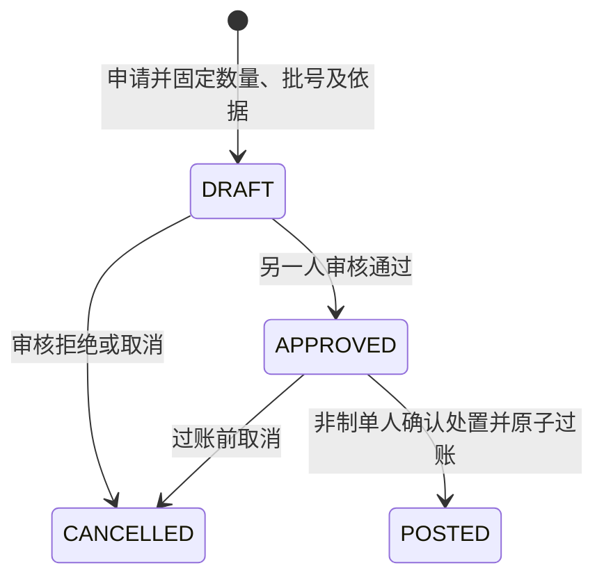

# ADR 0012：自有隔离库存质量处置

日期：2026-10-13。版本：0.12。状态：已实现。

## 问题和范围

0.11 调拨可以隔离收货，数量已属企业且计入批次成本，却没有后续放行或报损入口。本轮在同一库存账内完成异常收货闭环，不增加独立质量库存账。

每张处置单固定一个已有实体仓库 / 库位 / SKU / 批次 / 来源质量余额；按基本单位处置部分或全部未占用数量。支持普通自有 `QUARANTINE` 和 `UNQUALIFIED` 库存。仅 `QUARANTINE` 可以申请 `RELEASE`；两种来源都可以 `WRITE_OFF`。不处理 `RECALL`、在途损失、第三方货主、特殊类别、序列号库存或退货接收前的保管实物。

`return_custody` 是接受退货前的实物保管，不生成自有库存与成本，不能通过本入口提前确认所有权。正式销毁见证、附件和监管上报仍未实现；本轮报损记录实际处置依据并扣除库存及成本。

## 状态和职责

- `quality.read`：所有当前角色可按授权主体读取。
- `quality.write`：所有者、管理员、操作员可申请或取消。
- `quality.review`、`quality.post`：所有者、管理员、质量审核员；服务端均禁止制单人审核或过账。审核人可继续过账，不要求第三个人。
- 申请后内容不能修改，错误申请在过账前取消并重建。已过账、已取消是终态；无直接撤销过账。
- 申请和审核不预占。多张申请可以引用同一余额，但过账按剩余库存竞争，不能重复处置已消费数量。
- 本功能写开关 `MED_QUALITY_COMMANDS_ENABLED` 默认关闭，本机 `dev.py` 开启。

## 数据模型

业务迁移 `b0013`，控制迁移 `c0011`。

| 表 | 关键字段 | 约束 |
| --- | --- | --- |
| `quality_disposition` | tenant / id / entity、number、kind、reason、evidence、state、version、创建及审核人和时间、review_note、posting_id、cancel_note | 租户复合主外键、单号唯一；POSTED 当且仅当有 posting_id；通过及已过账必须独立审核；触发器禁止修改申请内容和终态记录 |
| `quality_disposition_item` | disposition_id、balance_id、qty、source_quality、lot_no、product_snapshot、package_snapshot、created_by / at | 一个单据恰一条来源明细由应用事务保证；数据库限制每单至多一条；数量为正，明细不可更新或删除 |

两表启用 FORCE RLS。运行角色对明细只有 SELECT / INSERT，对单头仅另授 UPDATE，禁止 DELETE。单头创建与明细保存处于同一事务。`evidence` 是最多 200 字的复验或处置依据及记录编号，不是附件上传功能。

放行和报损共用 `posting_batch / posting_line / stock_ledger / cost_ledger / audit_event / outbox_event`。`stock_movements.py` 提取原调拨的商品锁、余额定位和双边数量移动，实现调拨与质量放行共享原子数量写入规则。

## 过账事务

1. 校验会话、租户、角色和主体范围；锁定经营主体，要求主体有效。
2. 锁处置单；已有 POSTED 返回持久化原结果，未过账校验期望版本、APPROVED 状态和非制单人。
3. 使用 Asia/Shanghai 当日会计期间，期间必须开放。
4. 锁当前商品 / SKU / 质量闸门及批次，再锁来源余额和共享批次成本池。重新核对来源所有权、实体仓、普通品类、来源质量、实物批号、剩余未占用数量及成本数量。
5. 放行另行校验：来源仍为隔离待验、商品审核通过且资质有效、批次有效期有效、SKU 闸门与整批质量冻结均未开启。不会清除任何全局冻结标记。不合格批次不能直接转合格。
6. 放行：在原仓原库位向 QUALIFIED 余额转入，隔离余额等量扣减；一个 posting_line 写负 / 正两条库存流水，不写零值成本流水，成本池数量、金额和版本保持不变。
7. 报损：来源库存扣减，按过账时共享批次成本分摊 8 位小数金额；最后一笔扣尽成本尾差。同步减少成本池数量和金额，写一条库存流水和一条成本流水；即使成本为零仍因数量非零保留真实成本流水。
8. 更新单据 POSTED，写审计及 Outbox，提交前执行现有授权守卫。任何失败整体回滚，单据保持可处理状态。

现有数据库盘点冻结覆盖同主体 SKU / 批次的所有质量与库位，放行和报损均不能绕过。冻结下连目标余额插入也会被阻止。锁顺序沿用同主体串行写入架构，未宣称生产并发容量达标。

报损不会因过期或整批冻结而强制放行；它允许在保持冻结标记的情况下扣除未占用实物。已 blocked / reserved 的数量必须先通过对应业务解决，不能由处置单直接解除。

## 数量与成本

令当前成本池数量为 Q，金额为 A，本次报损 q：扣减成本为 `round_half_up(A × q / Q, 8)`。q = Q 时扣尽 A；多笔先后发生时每笔以当时剩余池计算，最终尾差收敛为零。不会采用申请时的过时成本估值。

例：10 件、成本 115.04 元全部隔离。放行 6 件后：合格 6、隔离 4，成本池仍 10 / 115.04；报损剩余 4 件扣 46.01600000 元，最终合格 6、隔离 0、成本池 6 / 69.02400000。供应商应付、客户应收及现金都不因质量处置改变。

## 防重、契约与失败

创建的 `client_operation_id` 绑定租户、操作者、目标余额和规范化请求，保存在现有永久业务操作记录中；同编号改内容拒绝。HTTP `Idempotency-Key` 是短期传输防重。过账以单据及 posting 唯一业务键永久防重，过期后重试原请求仍返回同一凭证。

全部接口前缀 `/api/v1/quality-dispositions`：

| 方法 / 后缀 | 权限 | 请求或结果 |
| --- | --- | --- |
| GET `/candidates` | quality.read | entity_id、search、offset；自有待处置余额，每页 50 |
| GET 空后缀 | quality.read | entity_id、offset；处置单，每页 50 |
| POST 空后缀 | quality.write | client_operation_id、entity_id、balance_id、kind、qty 字符串、lot_no、reason、evidence |
| GET `/{id}` | quality.read | 单头、不可变来源明细、已过账结果 |
| POST `/{id}/review` | quality.review | expected_version 字符串、decision APPROVE / REJECT、reason |
| POST `/{id}/cancel` | quality.write | expected_version、reason |
| POST `/{id}/post` | quality.post | expected_version、reason；返回 posting_id、qty、loss_cost、cost_delta |

6 条新路径、7 个操作；POST 保留同源、CSRF、上下文版本及幂等头要求。数量与金额通过十进制字符串交互，严格 DTO 不接受额外字段。

关键错误：`QUALITY_SOURCE_INVALID`、`QUALITY_RELEASE_INELIGIBLE`、`QUALITY_LOT_MISMATCH`、`QUALITY_SOURCE_CHANGED`、`QUALITY_COST_INVALID`、`QUALITY_NOT_APPROVED`、`QTY_SCALE_INVALID`、`INSUFFICIENT_STOCK`、`MAKER_CHECKER`、`COUNT_FROZEN`、`PERIOD_CLOSED`、`OPERATION_CONFLICT`；版本及角色等沿用平台错误。

## 验证和后续

真实 PostgreSQL 覆盖部分放行后报损、批次末笔成本尾差、独立审核与过账、终态及明细不可变、全局冻结和过期拦截、并发争用、防重复、盘点冻结、关闭期间、提交撤权回滚、租户 / 主体 / 角色范围。真实 OIDC 浏览器流程串联采购、调拨隔离收货、质量处置和后续零售预占。

下一主体任务是未收齐调拨的在途差异审批，随后是必要主数据修订、库位与包装、普通预占回收。详细报表与 AI 不在本次范围内。
