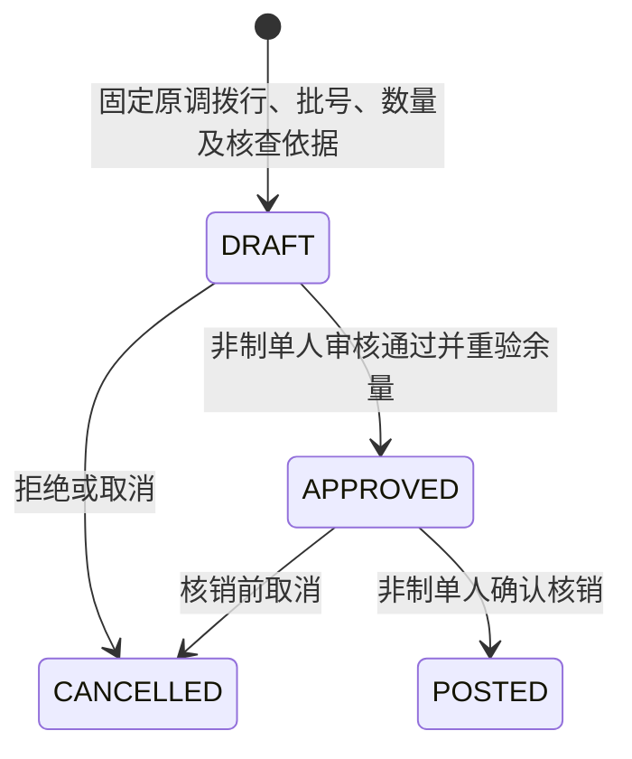

# ADR 0013：调拨在途损失核销

日期：2026-10-14。版本：0.13。状态：已实现。

## 范围与数量事实

调拨部分实收后，核实丢失的余量需要结清；不能以虚构收货消除在途。本轮在原调拨详情增加损失申请、独立审核和核销，复用库存、成本和过账基础设施。每张损失申请固定一条原调拨行及其部分数量，限定普通自有批次，不允许任意选择其他在途库存抵扣。

原调拨行的三个派生数量分别来自不可变实收记录、已核销损失记录及原申请数量：

`剩余在途 = 原调拨数量 - 累计实收数量 - 累计已核销损失数量`

只有原单完成一次性发出后，才允许申请或核销损失。未发出的申请数量不是在途事实。损失申请不预占在途数量；审批也不改变库存。实际到货仍可正常收货，在审核通过和核销时均重验剩余量。延迟到货使已批准数量失效时，核销整笔拒绝，需取消并按实际差额重新申请。

父单剩余量为零且有损失时为 `CLOSED_WITH_LOSS`，页面显示“已结清（含损失）”；全部实收到货为 `RECEIVED`。有剩余且已实收为 `PART_RECEIVED`，没有实收则仍为 `IN_TRANSIT`。核销不会新增收货记录。父单已结清后，遗留的未核销申请仍能取消或拒绝。

## 状态、职责和防重

所有者、管理员、操作员可申请和取消；所有者、管理员、质量审核员可审核和核销，但申请人不能审核或核销自己的申请。审核人可以继续核销。读取沿用 `transfers.read`；新增 `transfers.loss.write`、`transfers.loss.review`、`transfers.loss.post`。角色授权与租户、经营主体范围同时生效。

同一调拨行同时最多一张 `DRAFT / APPROVED` 申请，由数据库部分唯一索引保证。申请后不能修改业务内容，错误申请须取消重建；已核销、已取消记录不可变。创建使用永久 `client_operation_id`，核销按单据和持久化凭证永久防重，HTTP 幂等记录清理后仍不会重复扣减。嵌套接口把父调拨 ID 纳入命令摘要，禁止借相同幂等键跨父单重放。

## 数据与迁移

业务迁移 `b0014`，控制迁移 `c0012`。新增 `med.transfer_loss`，业务库共有 69 张 FORCE RLS 表。

| 字段组 | 约束 |
| --- | --- |
| tenant_id、id、transfer_id、line_id | 租户复合主键；租户 / 原行 / 父调拨复合外键，禁止跨单引用 |
| number、qty numeric(20,6)、lot_no、reason、evidence | 租户单号唯一；数量为正，应用校验 SKU 精度；原因和依据各最多 200 字 |
| state、version、created_by / at、reviewed_by / at、review_note、cancel_note | 状态 CHECK、版本为正、批准及核销须独立审核；触发器保护申请事实与终态 |
| posting_id | 租户复合外键及唯一约束；POSTED 当且仅当凭证非空 |

不复制商品、包装或批次事实，引用已经不可变的原调拨行快照；核销的 `posting_line` 保留对应商品及包装快照，来源指向损失单。运行角色仅有 SELECT / INSERT / UPDATE，没有 DELETE。数据库索引支持父单历史查询与逐行已核销数量聚合。

迁移同时扩展原调拨状态及独立审核约束。控制迁移更新现有角色权限和权限版本，撤销旧会话；升级后重新登录。复用默认关闭的 `MED_TRANSFER_COMMANDS_ENABLED`，本机 `dev.py` 启用。生产升级须暂停写入并统一迁移和服务版本，不混跑旧收货逻辑。

## 原子核销事务

1. 校验会话、角色、租户及主体；顺序锁定经营主体、父调拨、损失单，沿用主体写入串行化策略。
2. 已核销返回原持久化结果；否则检查损失单版本、APPROVED 状态、非制单人及父单仍有在途。
3. 验证当日会计期间开放，重算原行已收、已损与剩余量，禁止超量。
4. 锁商品、SKU、闸门和批次，再检查当前序列号 / 特殊类别限制及数量精度。锁父调拨指定专属在途仓与库位的自有余额，然后锁主体 / SKU / 批次的共享成本池。
5. 核对未占用库存与成本数量。使用当前共享成本 `round_half_up(金额 × 本次数量 / 数量, 8)`；扣尽成本数量时同时扣清尾差。冻结、过期或资质失效不要求先解冻或放行，已核实损失仍可扣除；不会清除全局冻结，也不会强占 reserved / blocked 数量。
6. 原子保存 TRANSFER_LOSS 过账批次及明细，扣减在途余额和成本池，写一条库存流水及一条成本流水。零成本仍保存数量变动。
7. 更新损失单 POSTED 和父单派生状态 / 版本，写审计和 Outbox；提交前执行授权守卫。任何失败全部回滚。

共享 `stock_writeoffs.py` 从原质量报损提取数量 / 成本扣减逻辑，两条业务路径均受数据库盘点冻结约束。收货与核销竞争相同父单锁，不能同时消费同一余量。多个来源库位同 SKU / 批次在在途库位合并后，原行剩余限制仍单独执行。

正常调拨及实收不改成本总量；损失核销确实减少资产数量和成本。例如发出 10 件、总成本 115.04 元，实收 8 件后核销 2 件，损失成本 23.00800000 元，最终成本池 8 件 / 92.03200000 元。不产生客户应收、供应商应付、现金或承运索赔。

## 接口契约

前缀 `/api/v1/transfers/{id}/losses`，共 5 条新增路径、6 个操作。实际完整 DTO 见已实现 OpenAPI。

| 方法 / 后缀 | 权限 | 契约 |
| --- | --- | --- |
| GET 空后缀 | transfers.read | offset 分页，每页 50 条 |
| POST 空后缀 | transfers.loss.write | client_operation_id、父调拨 expected_version、line_id、qty、lot_no、reason、evidence |
| GET /{loss_id} | transfers.read | 原申请、审核信息、版本及已核销结果 |
| POST /{loss_id}/review | transfers.loss.review | 损失单 expected_version、decision APPROVE / REJECT、reason |
| POST /{loss_id}/cancel | transfers.loss.write | 损失单 expected_version、reason |
| POST /{loss_id}/post | transfers.loss.post | 损失单 expected_version、reason；返回 posting_id、qty、loss_cost、cost_delta、父单状态与版本 |

数量、成本及命令版本为十进制字符串；严格 DTO 禁止额外字段。写入仍要求上下文代次、CSRF、同源 Origin 和 Idempotency-Key。新增错误包括 `TRANSFER_LOSS_STATE`、`TRANSFER_LOSS_PENDING`、`TRANSFER_OVER_LOSS`、`TRANSFER_LOSS_NOT_APPROVED`、`TRANSFER_LOSS_UNSUPPORTED`；批号、精度、权限、版本、期间及盘点错误沿用平台规则。

## 验证与边界

19 项真实 PostgreSQL 集成场景验证收货与核销两种顺序、末笔尾差及零成本、同批次多原行、重复 / 并发核销、收货竞争、延迟到货、不可变事实、独立审核、租户 / 主体 / 角色范围、期间关闭及提交撤权回滚。浏览器覆盖实收 8 + 损失 2 的双人流程、延迟到货取消以及只读成员直接 HTTP 越权拦截；完整结果见开发进度和验证记录。

本轮不提供核销后的逆向恢复、找回货物更正、索赔结算、在途改道、分次发出、附件上传、运输温控、跨主体、第三方货主、特殊类别或序列号调拨。依据为人工核查文字及记录编号。主体写入容量及双库授权故障窗口仍属上线前工作。
