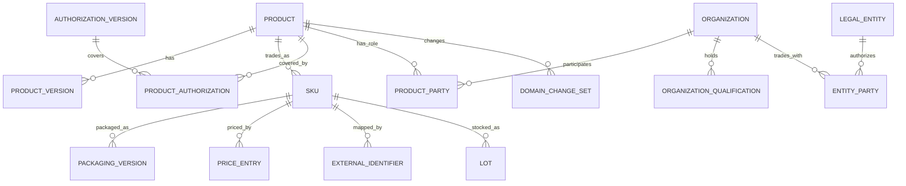

# 商品与服务 MDM 主数据设计

设计版本：1.0，基准日：2026-10-18，中国大陆。面向多租户 SaaS 的药械批发、药店及诊所；本轮交付字段与实施设计，不改变正在运行的业务库和接口。

## 1. 采用的参考与交付物

以用户提供的《药店诊所商品与服务字段字典_20261018.xlsx》为字段覆盖基线。保留其 449 个逻辑字段、24 个模板条目、297 条名称映射、36 条参考校验规则和原始依据，不把参考内容直接当作已执行的程序规则。

本项目补充 44 个逻辑字段，共 493 项。补充内容主要是现有经营功能、机构往来关系、医保/平台映射细项和资料治理。24 个模板条目实际包含 **21 个基础模板及 3 个叠加属性**，不能做成一个全部互斥的商品类别下拉。

- [字段实施表](../../outputs/mdm-20261018/商品与服务MDM字段实施表_v1.0.xlsx)：筛选查看字段含义、适用类别、卡片、维护部门、审核方式、实施阶段及旧系统对应关系。
- [设计目录 JSON](../../contracts/mdm/product-master-catalog.v1.json)：完整保留参考定义、类别矩阵转换结果、名称映射、来源、规则、补充字段及项目适配信息。`DESIGN_ONLY` 表示尚未作为运行时配置加载。
- 本文：明确对象关系、字段语义、资料治理、接口边界及迁移步骤。

参考中 A 类公共同义字段 149 项、B 类共用异名字段 12 项、C 类专属字段 288 项。这里的“共用”仍受适用矩阵限制，并不表示每一类商品都需要填。参考中的批次、库存和追溯事实已有 34 项在本项目明确分流到业务记录。

## 2. 总体模型：一个可信档案，多个部门视图

资料的唯一身份、维护责任、来源证据和生效版本统一管理。基本、经营、质量、价格、医保、追溯及平台卡片读取同一档案的不同领域。供应商、客户、生产企业和注册人共享机构身份，但各自的角色及经营关系独立。

继续采用 Python 模块化单体、PostgreSQL、现有租户隔离与审计机制。MDM 是当前 `catalog` 模块的演进方向，近期不拆成独立微服务，也不搭建通用数据中台。

| 对象 | 管什么 | 关键边界 |
| --- | --- | --- |
| 商品/服务主档 | 身份、监管分类、模板、名称、规格及生命周期 | 当前一档一个初始 SKU 的操作方式继续使用；不同真实规格不得仅作为别名合并 |
| SKU | 库存/交易引用、基本单位、数量精度 | 保留现有 UUID；不用新编码替换历史外键 |
| 包装版本 | 盒、袋、箱等交易单位、换算及包装标识 | 包装换算与成分强度、净含量不是同一数值 |
| 产品证照及覆盖关系 | 注册、备案、批准、覆盖规格型号、版本、期限 | 一证可覆盖多规格；一个商品可关联多份资料；生产许可证另归机构 |
| 机构/场地/角色 | 持有人、注册人、备案人、生产者、进口商、服务机构等 | 同一机构可以多角色；不同角色不互作缺省替代 |
| 本企业与往来单位关系 | 供应商/客户准入、经营主体、结算和联系政策 | 一个租户内多个主体可与同一机构分别建立关系；跨租户不自动合并 |
| 商品经营政策 | 推荐、ABC、可经营主体及渠道、数量限制 | 内部经营分类不能代替监管类别或法定经营范围 |
| 价目与税务政策 | 参考价、计价单位、币种、含税口径、生效期 | 成交价、成本、发票税务结果属于业务事实，不由改档案回写 |
| 外部标识 | 医保、UDI DI、追溯平台、美团等编码和绑定范围 | 国家标准编码与平台账号编码分开；DI 与 PI 分开 |
| 批次/追溯/库存/履约 | 实际生产日期、产地、效期、单品码、库存及服务结果 | 从主档引用政策与版本，不回填成所有商品共用的静态属性 |

资料权威范围为租户内。公共参考库、监管库、供应商资料及 OCR 均作为来源候选，不能直接覆盖已审核档案。采购价、经营评级、交易关系不跨租户共用。

## 3. 类别设计

页面仍以“商品类别”为第一个字段；选择时同步确定以下维度，避免让操作员重复填写：

1. 实物或服务 `product.kind`。
2. 监管大类 `product.regulatory_type`。
3. 基础模板 `product.profile_code`。
4. 可叠加的监管属性，如特殊管理药品、IVD、儿童化妆品。
5. 企业自己的经营分类，多级目录，可用于运营统计及货架安排。

| 大类 | 基础模板 | 专属重点 |
| --- | --- | --- |
| 药品 | 成品药品 | 通用名、剂型、成分强度、处方/非处方、上市许可持有人、批准资料、说明书及储存要求 |
| 中药 | 中药材、中药饮片 | 基原、药用部位、炮制标准与方法、批准适用性、允许产地；实际产地和采收/生产事实随批次 |
| 特殊药事用途 | 配方颗粒、医疗机构制剂 | 备案/批准、来源标准、当量、获准使用机构与调剂路径；不开放为普通药店商品 |
| 医疗器械 | I、II、III 类 | 管理类别、分类目录、注册/备案、型号、预期用途、无菌/一次性/植入、UDI适用规则；IVD为叠加属性 |
| 食品 | 普通食品、保健食品、特医食品、婴幼儿配方乳、其他特膳 | 食品销售形态、配料、过敏原、营养信息、生产主体资质；特殊类别增加产品注册备案、适宜人群和警示 |
| 化妆品 | 普通、特殊 | 备案/注册、成分、功效、使用部位、人群、标签及宣称证据；儿童属性可叠加 |
| 牙膏 | 独立模板 | 备案人、备案编号、功效、含氟及儿童提示、分类目录版本 |
| 消毒产品 | 独立模板 | 目录类别、风险类别、产品责任单位、新产品许可或安全评价路径；其“一二三类”不是器械风险分类 |
| 日用品 | 日用品 | 材质、规格、生产者、适用标准；食品接触、CCC等按适用子类附加 |
| 服务 | 非医疗服务、医疗服务 | 项目内容、计量、服务机构、准入条件；服务本身不生成库存，耗材另关联 |
| 其他 | 待明确归属的扩展模板 | 先识别监管归属及经营授权；不能用“其他”跳过已有监管规则 |

“中药饮品”暂按中药饮片理解；实际属于饮料、代用茶等食品的，应按真实产品准入与用途进入食品模板，不能仅凭原料名称套药品路径。

## 4. 共用、异名与专属字段的处理

### 4.1 真正共用的字段

身份：租户、内部ID、商品编码、实物/服务类型、监管类别、模板、资料状态、版本。

基础描述：规范名称、简称、别名、助记码、品牌、规格展示文本、原产属性。具体必填范围按模板确定，服务不强制制造商或实物包装。

关系与治理：机构引用、证照引用、标准引用、附件、来源、审核记录、变更原因。多份证照、多个生产地址、多个条码、多个成分等采用子记录，不能用逗号拼接成一个字段。

经营：经营分类、推荐级别、ABC及第二维、备注、采购/销售启用政策。价格、医保和平台映射通过关联对象共用。

### 4.2 共用抽象，但必须保留角色或类型

| 共用抽象 | 各类别显示名称示例 | 存储与展示原则 |
| --- | --- | --- |
| 规范名称 | 药品通用名称、饮片名称、产品名称、服务项目名称 | 统一查询字段；药品商品名与品牌另存，不能三个名称相互覆盖 |
| 产品许可编号 | 药品批准文号、器械备案编号/注册证编号、保健食品注册号/备案号、特医食品注册号 | 统一证照对象，但每条必须带类型、版本、范围、来源；普通食品/服务可不适用 |
| 产品责任主体 | 上市许可持有人、注册人、备案人、消毒产品责任单位 | 统一机构关系模型，保留准确role；不把生产企业当作默认替代值 |
| 生产/提供主体 | 生产企业、生产者、服务提供机构 | 共用机构目录；对应角色、场地及业务含义独立 |
| 标示期限 | 有效期时长、保质期时长、使用期限规则 | 共用期限结构时保留期限类型；证照到期、库存效期、保修、开封期限和服务权益不能混为一项 |
| 成分/配料 | 药物有效成分、辅料、食品配料、化妆品成分 | 可共用子记录结构；成分角色、顺序、单位基准、词表及领域规则独立 |
| 使用与人群原文 | 用法用量、食用方法、使用方法、适宜人群 | 统一文档引用与检索能力；不把不同含义压缩为同一个临床可执行规则 |

单品页面可按模板显示领域名称。混合商品列表保持“商品/服务名称”“相关主体”等通用表头，在单元格旁标示真实角色；不能根据当前一页的数据临时改变整列含义。

### 4.3 看似相近但不合并

- 药品适应症、器械预期用途、食品保健功能、化妆品功效、服务内容各有独立语义和依据。
- 产品注册/备案与企业生产/经营许可分开。
- 生产企业、受托生产企业、注册人、供货商及服务机构分开。
- 包装数量、净含量、成分强度、库存基本单位、处方剂量及颗粒饮片当量分开。
- 生产日期、库存效期、证照期限、开封使用期、器械使用寿命及服务权益期限分开。
- 商品条码、UDI DI、UDI PI、药品单品追溯码、平台商品ID及医保编码分开。

专属字段完整定义见实施表和 JSON；不在正文重复 493 项。

## 5. 部门卡片与维护权限

| 卡片 | 主责 | 保存方式 |
| --- | --- | --- |
| 基本信息 | 资料管理员，关键身份由质管确认 | 类别、规范名称、规格等影响身份的变更审核；条码与包装按其作用和审核策略维护 |
| 经营信息 | 运营/采购/销售 | 推荐、ABC、助记码、经营备注直接保存并审计；涉及经营准入的范围/渠道限制仍由质管维护 |
| 质量管控 | 质管/医疗负责人 | 证照、标准、经营范围、储存、特殊管理、标签及准入证据按领域审核 |
| 价格信息 | 采购/运营/财务 | 保留三类参考价直接保存能力；可按权限增加价格审批，不触发整档质量重审 |
| 医保信息 | 医保专员 | 国家编码、目录版本、地区映射、支付条件及生效期独立核对 |
| 追溯信息 | 质管/对接管理员 | 产品级标识、UDI DI、包装关联及适用政策；实际扫码明细跳到业务记录 |
| 第三方对接 | 对接管理员 | 美团、饿了么、淘宝、旺店通、其他系统统一卡片，按系统/账号分组 |
| 变更记录 | 授权人员查看 | 聚合各领域变更、依据和审核；系统事实只读 |

“卡片归属”不等于“审批归属”：基本卡中的标签名称也可能要求质量审核，经营卡中的联系信息通常直接维护。卡片位置可以配置，但审批依据稳定字段代码和规则，不依据当前画面位置。

普通建档先展示类别、编码、名称、规格、基本单位及该模板的关键身份/资质字段。营养成分、功效证据、特殊使用规则等按组展开；未适用字段隐藏，但隐藏不能绕过服务端必填。

## 6. MDM 治理与审核流程

### 6.1 值与证据

每个可治理字段可记录来源系统、来源记录键、原件版本、定位、取得时间及人工核对结果。规范化值与原文分开保存。AI字段定位沿用同一证据结构，AI只提出建议。

字段状态区分已知值、未填、未知、不适用、原件未载明及依法豁免。对强类型关键字段，值保留在实体列；状态/证据放关联表，不把所有值塞进通用EAV表。`0`不代表未知，空日期不替换成2099年。

### 6.2 版本与发布

近期兼容现有整档质量审核，新增经营/价格领域按原规则独立保存。随后引入领域版本及变更集：编辑基于明确版本，提交生成差异与证据，审核人批准准确快照。并发冲突返回差异，不用后提交者覆盖前者。

新版本待审时保留旧批准版本供历史查询。是否还能继续交易由“变更影响”判断：普通补充资料可以继续使用有效旧版本；身份错配、证照撤销、召回或质量风险须立即冻结相关能力，不能借“旧版本仍有效”放行。

状态至少区分资料草稿、审核中、已批准、停用，以及每个经营主体的可采购、可销售、可履约资格。它们不能压缩为一个`enabled`布尔值。

### 6.3 重复与合并

商品编码在租户内唯一；批准号通常不是SKU唯一键，条码也必须核对包装及历史范围。用类别、名称、规格、真实主体、证照覆盖、包装及来源形成候选，显示差异，人工确认。

合并保留旧ID、编码、来源和合并指向。新检索可定位目标档案，历史单据继续引用原对象及快照。不能自动合并不同租户、不同监管用途或不同实际规格的商品。

机构按法定标识及国家地区产生候选。境外机构、个人零售客户不强制填写中国企业信用码；患者资料进入后期HIS/客户隐私域，不塞进商品MDM。

## 7. 字段元数据与规则

运行期字段定义建议包含：稳定代码、语义域、对象层级、基础类型/精度/长度、单位、字典及版本、适用模板、重复关系、维护领域、审批策略、展示别名、排序、必填阶段、校验、证据要求和生效时间。

租户可增加受Schema约束的扩展字段。平台法规底线、系统身份键和库存关键约束不可由租户或个人偏好取消。字典采用稳定编码与可变名称；停用不改历史值，严格必填字段必须存在可用且符合格式的选项。

联动表达式只允许受控运算符（比较、集合、存在、与/或），不执行任意Python、SQL或JavaScript。发布前检查循环依赖、未知引用、互相矛盾的必填和隐藏规则。前端用于即时提示，后端最终执行同版本规则。

示例：器械I类提交审核要求关联类型为`DEVICE_FILING`的有效产品备案；II/III类要求对应注册资料。通过明确证照关系校验，而不是把一个“批准号”输入框改名后就认为模型已支持多类别。

规则需要区分：法规明示信息、法规转化校验、行业实践及系统设计。法规要求某项标签/记录存在，不意味着数据库必须增加一个同名列；可通过结构化资料、子记录及关联原件满足信息管理需要。

个人设置的显示、拖动排序、宽度、名称、格式和Tab停留只影响交互。导入/导出带模板版本及稳定字段代码，避免用户改显示名后破坏接口。

## 8. 法规核对与生效边界

本轮针对结构设计的关键条款核验；参考表其他来源按原记录保留，未宣称83项外部来源全部重新逐条核验。工作簿“法规版本”明确区分已核对关键条款、仅核对公告及沿用参考。来源为空但标注行业实践/系统设计的条目，不自动赋予法规必填属性。

| 事项 | 本设计处理 | 依据 |
| --- | --- | --- |
| 饮片与配方颗粒 | 饮片批准文号按是否实施审批判断；颗粒单独模板与业务准入 | [2026年药品管理法实施条例](https://www.mee.gov.cn/zcwj/gwywj/202601/t20260128_1142757.shtml)，第39、40条，2026-05-15施行 |
| 器械 | I类备案、II/III类注册；参考来源标题需反映2024修订文本 | [医疗器械监督管理条例](https://www.samr.gov.cn/zw/zfxxgk/fdzdgknr/fgs/art/2023/art_70607fc4160041a383e68ff6bfb2826f.html) |
| UDI后续范围 | 保留已有实施范围；后续按生产日期及类别判断，不在2026年直接要求所有I类必填 | [2026年第21号公告](https://udi.nmpa.gov.cn/toDetail.html?CatalogId=2&infoId=80) |
| 婴配液态乳 | 与乳粉分别记录形态；均纳入配方注册路径 | [2025年修正的婴幼儿配方乳粉产品配方注册管理办法](https://www.samr.gov.cn/zw/zfxxgk/fdzdgknr/fgs/art/2025/art_d1f3f84582f24b2497e58e12c8e27843.html)，第52条 |
| 食品标签新规 | 2011/2025标准版本并存，按生效和产品生产时点处理 | [国家卫健委GB28050—2025问答](https://www.nhc.gov.cn/sps/c100087/202509/470fa4ff5de14dd38619223cce9da4e7.shtml)，2027-03-16实施 |
| 牙膏目录 | 目录版本与生效日单列；不每年建立新的物理字段 | [2026年第100号公告](https://yjj.sh.gov.cn/qtgzwj/20261015/7251f7bc9dec430ab15c4bbc97ff9ce0.html)，2027-05-01施行及既有备案过渡 |
| 药品追溯 | 产品级标识与业务扫码分层，异常及排除范围单独处理 | [2026年第85号公告](https://yjj.sh.gov.cn/qtgzwj/20260901/ad6710acfa03492f9c2e4048476f9d89.html) |
| 跨省饮片 | 建标准地区、目的地区、差异判断和备案证据；具体细则需核对附件后发布 | [2026年第34号通告](https://yjj.sh.gov.cn/qtgzwj/20261009/b28fe8ce03724601b3190920e216def0.html)，本轮仅核对公告正文 |

属地经营范围、炮制规范、医疗服务收费、医保协议及特定品种标准应形成带地区与版本的资料。没有实际依据时标“待核实”，不生成臆测的准入编码、支付比例或临床用量。

## 9. 与现有系统的差距与迁移

当前运行代码仍只接受DRUG/DEVICE；新建API对制造商、批准号和资质起止日期统一要求必填。仅扩展类别枚举会导致普通食品、日用品和服务被迫填写假资料，必须先改共同对象和类别约束。

| 现有位置 | 目标处理 |
| --- | --- |
| product.category | 保留DRUG/DEVICE兼容；增加监管分类、基础模板和叠加属性，不靠改一个枚举完成全部扩类 |
| product.code / sku.code | 新档案继续只录一个可见码；历史不同码作旧码映射，不重编号 |
| product.name / generic_name | 保留原值，核对法定名称与展示名；冲突列待核任务 |
| product.trade_name | 当前“商品名/品牌”混合，拆为两种语义并人工确认，不复制猜测 |
| approval_number / valid_from / valid_until | 建类型化产品证照与版本；旧值先标`LEGACY_UNCLASSIFIED`，原始日期保留，语义未核实不映射成签发日 |
| manufacturer / holder / registrant 文本 | 建机构与角色关系，保留历史文本快照；同名不直接合并 |
| party.entity_id / kind / license_no | 渐进拆分机构身份、本主体往来关系、多份资质；旧ID继续被单据引用 |
| packaging / catalog_code | 复用包装版本、比例和编码；补绑定范围及来源；保持旧单包装快照 |
| sku_reference_price / 经营字段 | 原功能原值保留；补价目与领域元数据，继续支持免整档审核保存 |
| product_field_rules / dictionaries | 扩展为模板绑定和版本化字典；保留原显隐、必填和历史值规则 |

推荐“增加新结构→复制原始值并保留来源→适配读写→人工核对关键差异→按租户启用→观察回退”的扩展迁移。迁移脚本禁止直接改库存、历史单据及已使用包装换算。回退以关闭新入口和恢复旧读路径为主，不删新审核证据。

API继续使用现有catalog入口，逐步提供模板解析、按领域PATCH、提交/审核、证照子记录和外部映射资源。响应带稳定字段代码、显示标签、适用状态、规则版本及证据引用；保留现有客户端适配层，不在本设计中声明新接口已存在。

## 10. 分期实施和验收

| 阶段 | 完成内容 | 验收重点 |
| --- | --- | --- |
| M0 基础改造 | 稳定身份与单码兼容、模板元数据、机构/证照关系基础、领域审核与版本 | 旧药械档案可读写；租户/主体隔离；经营保存不撤销质量审核；未知与不适用分开 |
| M1 分类建档 | 先药品/饮片/器械，再普通食品/特殊食品/化妆品/牙膏/日用/消毒/基础服务模板；部门卡片按需显示 | 各类能按真实资料建档，所需资质条件正确；多包装/多证照可维护；不要求虚构批准号 |
| M2 业务联动 | 机构经营范围、编码映射、导入去重、批次证据、购销准入及对接核验 | 不越范围开单；按发生时间校验；历史单据快照不变；国家编码与平台/地区映射不混用 |
| M3 后续预留 | 临床规则、颗粒调剂、院内制剂、服务履约、设备维护及进一步AI提取 | 对应业务流程独立设计后再启用，不将全部参考P0视为近期开发范围 |

原有功能不删除，零售工作区暂不改版。资料字段定义先覆盖需求，再按阶段实施；尚未完成合规业务流程的特殊类别只保留设计能力，不因为已有模板就开放销售。

开发时至少覆盖以下场景：器械I与II/III证照联动；饮片批准例外；普通食品无产品批准号；保健/特医/婴配资料区分；儿童化妆品叠加；牙膏生效日；消毒评价与许可分开；服务无库存；经营免审；质量变更冻结影响；外部编码跨账号/包装隔离；领域并发冲突；旧码/历史快照；批次日期精度；草稿与启用分阶段。

本设计基线交付时仅完成目录结构与来源引用核对及工作簿检查，不以文档检查替代以上功能验收。

2026-10-18字段实施增量：当前药品/器械已接入`DRUG_BASE`/`DEVICE_BASE`兼容模板、`catalog.product.<wire key>`稳定标识、卡片/部门/审核元数据及企业显示别名。建档、修订、详情和经营检索按同一规则展示，器械注册人/备案人名称动态解析；规则写入不能修改系统治理属性，经营保存仍免质量重审。此增量不加载DESIGN_ONLY目录，也未将旧DRUG推断为成药，更未将现有混合字段冒充拆分后的目标语义；新增类别和完整模板绑定继续按M1实施。数据结构仍为b0034/c0017，配置新增JSON属性`display_name`，不改写旧记录。

2026-10-18实施增量：b0034已增加独立商品证照档案及核验流程，采用最新记录加审计快照保留前后版本；原有证照字段只读呈现为未分类参考，不自动核验。此阶段仍是商品补充资料，尚未切换交易准入，尚未完成多类别模板、机构多证照或多商品证照覆盖关系。详见[证照使用及边界说明](../development/基础资料与对接编码.md)；最新验证结果以[开发进度](../development/开发进度.md)为准。
