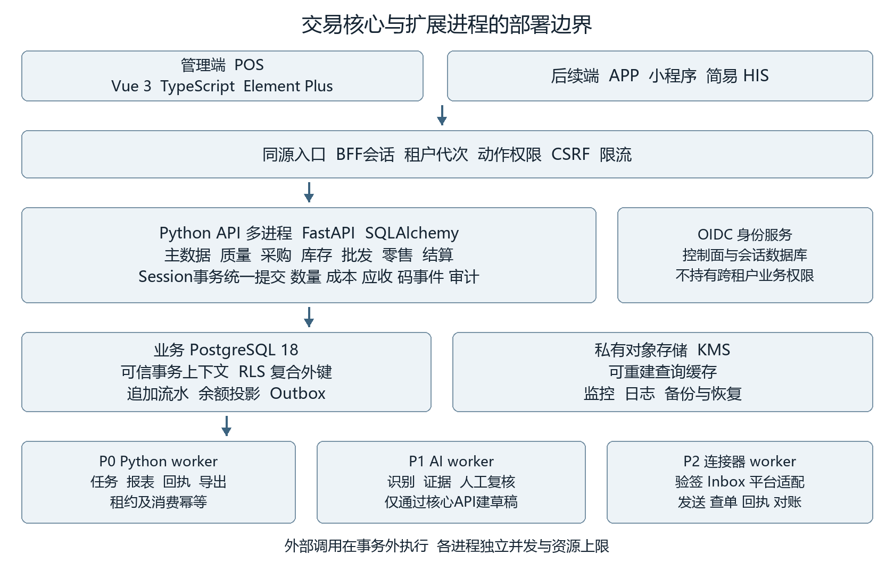

# 药械进销存 SaaS Python 技术设计文档

版本 Python 1.0　基线日期 2026 年 10 月 9 日　适用人员 后端 前端 测试 运维 实施 技术负责人

本技术设计承接已确认的产品规划，面向同时经营批发与零售的多企业 SaaS。首期实现主体进销存及必要的质量控制；AI、原生平台连接器、多端及简易 HIS 按原规划分期建设。技术实现统一采用 Vue 3、TypeScript、Python 3.14、FastAPI、SQLAlchemy 2.0 和 PostgreSQL 18，以模块化单体构建交易核心。

开发必须守住四项不变量：任何数据访问都有可信租户上下文；任何库存变动都有可追溯且不可改写的流水；同一业务动作重复提交只产生一份事实；收款、审方、质量验收与库存过账各自保留独立证据。所有入口均执行相同规则。

本文给出模块职责、事务算法、数据规范、接口协议、故障恢复和交付标准。配套目录包含数据字典、关键数据库参考脚本、可机读的核心 OpenAPI 契约、事件 Schema、测试矩阵及部署运行手册。数据库脚本覆盖库存一致性的核心切片，OpenAPI 覆盖首批联调命令，其余 P0 对象与接口在字典和接口登记表中完整列出；各模块开发前应按同一标准扩充迁移与契约。参考脚本不能替代完成业务校验的应用服务。

建议阅读顺序：技术负责人先审第 01 至 06 章；后端重点审第 07 至 16 章、第 23 章及 SQL 和 Python 参考附件；前端从第 15 和 17 章建立类型与交互；测试及运维使用第 20 至 24 章、性能压测方案和配套手册。性能数值是验收目标，示例配置是压测起点，均不代表已上线实测结果。

## 01 范围和技术决策

### 1 继承的业务边界

P0 覆盖租户和组织、账号权限、药械商品和往来资质、采购收验、库存和成本、批发、零售 POS、线下处方留存与药师审核、退货、应收应付、质量、追溯采集与回执台账、报表及站内提醒。首期在同一法律主体内闭环，跨主体一律按购销处理。未完成专门验证的特殊品种、疫苗、完整冷链、复杂拆零、寄售、医保结算及断网销售默认关闭。

线上开方、最终审方、监管上传责任不由功能开关自动豁免。P0 的必需上传路径可以连接已验证的外部系统，但必须完成事件导出、关联、回执及差异核对。具体适用法规和保存期限沿用主规划的规则来源，由试点质量负责人确认；本文仅定义执行这些规则的技术机制。

### 2 决策记录

| 编号 | 决策 | 后果和复审条件 |
| --- | --- | --- |
| ADR01 | 模块化单体 多进程部署 | 交易共享本地事务；AI和连接器可独立扩容；实测瓶颈后再拆服务 |
| ADR02 | PostgreSQL为交易事实源 | Redis与报表投影均可重建；余额不能只保存在缓存 |
| ADR03 | SQLAlchemy Core显式SQL加受控ORM | 库存锁与条件更新可审查；表映射和查询维护由模块负责 |
| ADR04 | 应用作用域加RLS | 应用租户隔离和数据库防线同时实施；RLS不替代对象权限 |
| ADR05 | 库存流水追加 余额投影 | 更正用反向事实；不采用完整事件溯源框架重建全部业务 |
| ADR06 | Outbox和Inbox起步 | 至少一次投递加业务幂等；暂不部署Kafka或分布式事务 |
| ADR07 | 浏览器BFF会话 OIDC身份 | 令牌保存在服务端；APP和开放接口以后使用独立OAuth客户端 |
| ADR08 | P0人民币单币种 | 金额定点数；跨币种与复杂会计后续单独设计 |
| ADR09 | 库存按SKU和批次管理 | 包装换算在入账前完成；FEFO与成本计算分离 |
| ADR10 | AI仅产生可复核建议 | 模型没有交易库写凭证；确认后仍走核心命令和审批 |

### 3 文档和代码优先级

业务边界以主规划及已批准变更为准；字段和约束以本包数据字典为设计基准；对外可机读契约以版本化 OpenAPI 为准；实际部署结构以经评审的 Alembic 迁移为准。发现矛盾时先提 ADR 变更，再同时更新字典、契约、迁移和测试，禁止用临时接口行为覆盖设计。文档版本 Python 1.0 不表示应用已实现或依赖已完成锁定。

## 02 技术栈和版本管理

### 1 选型基线

首期采用Python模块化单体。核心业务使用同步数据库访问和明确事务；异步HTTP调用只用于适合等待外部I/O的路径；高耗时工作进入独立进程。选择FastAPI是为了显式控制API、权限和事务边界，不依赖管理后台自动生成关键交易操作。P0不同时引入Django ORM或第二套数据库事务框架。

| 层次 | 采用方案 | 实施约束 |
| --- | --- | --- |
| 管理端及POS | Vue 3 TypeScript Element Plus 2 | 共享组件 独立路由 严格类型 |
| 前端工程 | Vite pnpm Node.js 24 LTS | 与所选Vue模板兼容 冻结锁文件 |
| Python运行时 | CPython 3.14标准GIL构建 | 锁定受支持补丁 不依赖JIT或自由线程获得容量 |
| Web服务 | FastAPI Uvicorn | Starlette随FastAPI兼容范围锁定 每进程独立资源 |
| 请求与配置 | Pydantic 2 pydantic-settings | DTO拒绝未知字段 金额必须为字符串 |
| 核心数据访问 | SQLAlchemy 2.0 psycopg 3同步驱动 | 写入优先Core及参数化SQL 普通档案可受控ORM |
| 业务数据库 | 托管PostgreSQL 18 | RLS 复合外键 条件更新 追加事实 |
| 数据迁移 | Alembic 1系列 | 业务库与控制库独立版本链 手工审查DDL |
| 身份与会话 | Keycloak Authlib 服务端SessionStorePort | OIDC加PKCE CSRF 单点登出与撤权 |
| 后台作业 | Python独立进程 PostgreSQL任务表 | 有界并发 租约 fencing token 至少一次处理 |
| 缓存与文件 | Redis兼容服务 私有对象存储 KMS | 不承担库存事实 不保存唯一任务状态 |
| 契约 | REST JSON OpenAPI 3.1.1 | 契约优先 DTO与生成结果双向核对 |
| 依赖与质量 | uv Ruff mypy import-linter | uv.lock入库 严格检查核心代码依赖边界 |
| 测试 | pytest Hypothesis Testcontainers Python | 同版本真实PostgreSQL pytest隔离并行测试 |
| 前端验收 | Vitest Playwright | POS扫码 键盘操作 故障恢复及跨租户测试 |
| 观测与发布 | OpenTelemetry Prometheus OCI Linux容器 | 显式埋点 低基数指标 镜像digest固定 |

Python官方版本状态页列出3.14为受支持分支，本项目以3.14为新建工程基线；补丁号在依赖验证后冻结。生产统一Linux镜像，本地Windows用于开发和文档，不以本机环境作为生产容量依据。[R01](https://devguide.python.org/versions/)

PostgreSQL 18、Vue、Node和组件库继承原方案。具体驱动、验证库、密码学库以及第三方监控组件须在同一Python补丁和目标Linux镜像上完成兼容测试。官方文档说明的是单个工具行为，不代表本项目组合已验证。[R02](https://www.postgresql.org/support/versioning/) [R03](https://vuejs.org/guide/quick-start.html) [R04](https://nodejs.org/en/about/previous-releases)

### 2 同步与异步边界

库存、成本、采购、POS完成和结算的HTTP入口默认使用普通def函数；路由在受限线程池内执行，一个应用命令从创建Session到提交均在同一线程完成。不要在async def内直接调用同步数据库、文件解析或CPU密集函数。若异步入口必须调用同步逻辑，只把整个短业务单元一次性交给受限线程池，不能逐条SQL在线程间搬运Session。[R14](https://fastapi.tiangolo.com/async/)

OIDC回调、未来连接器及外部模型调用可以使用兼容客户端的async接口，但外部等待期间不得持有库存事务。CPU密集处理通过独立进程或经过验证的原生库执行。async只是等待期间的并发机制，不是CPU加速开关。禁止在同一Session上执行asyncio.gather或并发线程查询。[R12](https://docs.sqlalchemy.org/en/20/orm/session_basics.html)

API进程不启动任务调度器，不用FastAPI BackgroundTasks承担过账、付款、监管上传、导入或需恢复的报表。P0不强制引入Celery、RabbitMQ或Kafka；后续队列可以替换传输层，不能移除Outbox、Inbox和业务幂等。

### 3 依赖冻结与构建

backend/pyproject.toml定义依赖与工具配置；uv.lock记录完整解析版本并进入代码仓库；.python-version固定Python补丁，基础镜像固定digest。前端使用pnpm-lock.yaml。首次开工交付toolchain.lock.md，逐项登记版本、许可证、维护期、Linux架构、原生wheel或构建方式与升级负责人。

设计基线只固定技术家族和主分支。本包不虚构uv.lock，不把未验证版本组合标记为可部署应用。首次建仓执行uv lock、uv sync --locked及完整测试，CI只接受锁文件与声明一致的安装。禁止自动升级所有依赖后直接发布。[R15](https://docs.astral.sh/uv/concepts/projects/sync/)

FastAPI、Starlette、Pydantic及认证客户端有耦合版本关系，升级时先验证OpenAPI、异常处理、会话、取消和线程池行为；不要独立随意提升底层Starlette。AI进程使用自己的锁文件及镜像，避免GPU、模型SDK或图像库升级牵动核心交易运行时。

生产镜像只安装运行依赖，构建环境负责生成SBOM和扫描。运行用户非root，容器根文件系统只读，临时上传目录有配额并定时清理；配置启动时由Pydantic Settings验证，秘密缺失或数据库角色不合要求时拒绝就绪。

## 03 进程和部署结构

浏览器访问同源静态前端和BFF。负载均衡终止公网TLS并转发到至少两个核心API实例。core-api包含所有P0业务模块；business-worker处理站内通知、导入导出、报表、内部事件和追溯台账。两者共享业务库但使用不同权限、不同连接池和独立并发上限。

control-api负责租户开通、套餐、支持授权以及OIDC会话桥接的管理操作，控制数据使用control数据库；身份提供方使用独立的身份数据库。控制面不获得业务库的跨租户查询账号。平台可见资源用量与健康摘要，不能依靠平台管理员账号直接读取客户订单。

P1新增ai-worker，P2新增connector-worker。AI只访问经授权的对象和专用草稿API；连接器通过核心应用命令创建订单或回写回执。工作进程不能通过共享数据库绕过模块边界。外部请求在数据库事务提交后执行，所有结果通过独立短事务落库。

网络划分为公网入口、私网应用、数据服务和出站代理。数据库、缓存、身份管理控制台、监控和对象存储管理接口不得直接对公网开放。生产不同环境使用独立账号、密钥、数据库与存储桶。前端源映射上传到受控错误平台，不公开含内部路径的调试资源。

## 04 代码目录和模块边界

### 1 仓库结构

采用单仓库。apps/admin-web和apps/pos-web为前端入口；packages/ui、api-client及domain-types共享。backend/pyproject.toml与uv.lock管理核心依赖，backend/src/medinv下分entrypoints、platform和modules；entrypoints含core_api、control_api和business_worker；modules包含下表领域。backend/migrations/business和control分别维护独立Alembic版本链。contracts、deploy、docs/adr、tests/acceptance位于仓库根。workers/ai及workers/connectors按后续阶段单独建立锁文件与镜像。

后端模块分api、application、domain、infrastructure。Router只解析DTO、取得可信Principal并调用应用服务；application组织授权、事务和跨模块端口；domain使用标准库dataclass、Enum、Decimal表达状态与规则，不依赖FastAPI、Pydantic、ORM或网络；infrastructure实现Repository及外部Port。Pydantic DTO、领域值对象、SQLAlchemy映射三者分开，避免数据库懒加载或字段变化泄露到API。

模块通过公开的api/ports.py提供命令和查询，禁止导入其他模块内部Repository。使用import-linter和AST检查验证依赖方向；Ruff检查格式与基础错误，mypy严格模式检查核心业务与基础设施类型。纯计算函数可单元测试；数据库规则使用真实PostgreSQL测试，不能以Mock替代。完整目录和编码约束见Python开发规范.md。

### 2 模块所有权

| 模块 | 主责及数据 | 对外提供 |
| --- | --- | --- |
| tenancy与identity | 租户上下文 成员权限 支持授权 | TenantContext AuthorizationService |
| catalog与party | 商品包装 编码 往来资质 | ProductQuery QualificationCheck |
| quality | 首营 验收决定 冻结 召回 规则快照 | QualityGate InspectionDecision |
| procurement | 采购 到货 采购退货 | ReceiptPostingCommand |
| inventory | 批次 余额 预占 流水 在途 | Reserve Consume Receive Transfer |
| costing | 成本余额 成本流水 补差 关账 | CostIn CostOut OriginalCostReturn |
| wholesale | 销售订单 信用 履约 发货 | AllocateOrder PostShipment |
| retail与prescription | POS 交班 处方审核 用量 | CompleteSale RxUsageCheck |
| settlement | 应收应付 收付款 核销 | CreateObligation AllocatePayment |
| traceability | 码身份 包装树 流转 上报台账 | BindCodes RecordTraceEvent |
| integration与jobs | Outbox Inbox 连接 重试 水位 | Enqueue Dispatch Reconcile |
| reporting与notification | 指标 投影 导出 规则任务 | MetricQuery Export TaskAssign |
| audit与files | 审计 文件元数据 留存 | AppendAudit AuthorizeDownload |

一次发货的数量、成本、应收义务、追溯事件、审计和Outbox须在同一个数据库事务内提交。因此应用编排服务可以调用多个模块公开命令，共享当前事务；只有外部调用及报表更新异步。不得通过异步事件补写本应原子提交的关键成本或应收事实。

公共内核仅保留ID、金额、数量、时钟、错误、上下文和事件信封，禁止把所有领域实体堆入common。报表使用模块公开的只读视图或专用查询服务，不向上游表反向写入。

## 05 身份 租户与权限

### 1 登录和会话

PC使用OIDC Authorization Code流程，由FastAPI BFF与Authlib OIDC客户端处理回调，严格校验state、nonce、issuer、audience、签名和有效期，启用PKCE S256。默认身份提供方为Keycloak，平台域与客户域使用不同客户端和管理权限。身份仅提供稳定subject和认证强度，租户成员、岗位资格与数据范围在本系统管理。[R07](https://www.keycloak.org/securing-apps/oidc-layers)

浏览器只持有HttpOnly、Secure、SameSite=Lax会话Cookie；访问令牌和刷新令牌存服务端加密会话记录，禁止写localStorage。由SessionStorePort在控制数据库保存服务端会话，使API多副本共享会话；会话账号只可访问受限会话数据。Cookie只含高熵随机session_id，数据库保存其哈希，刷新令牌封装加密。不能把令牌放进Starlette默认签名Cookie会话。OIDC临时state、nonce及PKCE verifier也在服务端保存，单次使用并短期到期。默认闲置30分钟、绝对8小时为建议配置，药师和质量关键操作要求最近15分钟内完成合适强度的认证，按试点调整。

所有Cookie写请求校验CSRF令牌，登录跳转校验来源和回调白名单；API响应只允许同源或显式白名单CORS，不使用带凭据的通配符。通过专用CSRF端点获取令牌，前端发送X-CSRF-Token。FastAPI不会替项目自动提供完整CSRF策略。安全模块实现与服务端会话绑定的随机同步令牌、恒定时间比较、Origin及必要Referer校验，并限制JSON写入的Content-Type。仅验签的第三方回调走独立认证入口，不用全局关闭CSRF。[R08](https://cheatsheetseries.owasp.org/cheatsheets/Cross-Site_Request_Forgery_Prevention_Cheat_Sheet.html)

租户切换只能选择当前用户有效成员关系。服务端更新会话绑定、权限版本和上下文代次context_generation，旋转会话标识，客户端清空查询缓存、草稿选择和旧WebSocket连接。每个业务请求携带当前代次，服务端拒绝旧代次请求，避免其他标签页在租户切换后误把旧草稿写进新租户。过账还须校验草稿归属主体。移动端后续使用独立公开客户端加PKCE，开放平台使用带租户范围的机器身份，不复用浏览器会话。

### 2 授权表达

权限码采用resource.action，如inventory.reserve、receipt.post、quality.release、prescription.review、finance.allocate、cost.read。授权结果取成员有效、角色动作、主体/门店/仓库范围、岗位资格、单据状态、数据敏感级别的交集；功能套餐仅控制可用能力，不能授予质量资格。

后端先授权再查询对象；查询列表下推范围条件，不能先读全量再在内存过滤。成本字段采用单独DTO或查询投影，患者字段另设权限。详情、导出、打印、文件下载、后台任务与订阅事件使用同一AuthorizationService。审核人不能审批自己制作的单据时，通过规则中的maker_checker强制执行。

平台支持使用support_grant，关联工单、租户批准人、资源范围、动作、理由、到期时间；默认只读，有效期建议不超过2小时。数据库连接仍设定单一tenant_id，不能把支持人员映射成超级管理员。平台支持不得替代药师审方或质量审批。

### 3 RLS的具体执行

业务库runtime角色不得拥有SUPERUSER、BYPASSRLS、表所有权或DDL权限；owner为NOLOGIN角色，迁移账号仅在发布作业使用。所有租户表启用ENABLE ROW LEVEL SECURITY和FORCE ROW LEVEL SECURITY；策略同时包含USING和WITH CHECK，缺少上下文时无可读行且拒绝写入。超级用户和特定角色存在绕过行为，必须检查实际角色属性。[R09](https://www.postgresql.org/docs/18/ddl-rowsecurity.html)

每个数据库业务单元由TenantUnitOfWork创建全新Session并开启事务，在同一连接上执行参数化的set_config('app.tenant_id', tenantId, true)，再运行Repository。true表示事务局部；提交或回滚后不把上下文遗留给连接池。读请求也必须开启只读事务。禁止先在一个连接设置上下文，再让另一个连接执行SQL；禁止以SQL拼接tenantId。

业务SQL仍显式带tenant_id。复合外键包含tenant_id；主体、仓库、SKU等需要更强关联时继续包含entity_id或sku_id。RLS不能防止持有应用数据库凭证的任意SQL恶意切换自定义上下文，它是隔离误查询的防线；参数化SQL、网络隔离、凭证控制、可信上下文和对象授权都必须成立。

后台调度从仅含租户路由与作业类型的受限控制队列取得租户，逐租户事务领取业务任务；不授予worker跨租户SELECT以方便扫描。权限判断不能永久缓存，撤权后短缓存失效，关键过账读取当前岗位和资格版本。

## 06 数据规范和约束

### 1 通用字段

主键统一UUID，由应用生成；API均为字符串。租户业务表使用复合主键tenant_id加id，所有子表外键带tenant_id。tenant_id来自可信上下文，JSON请求schema不接收tenant_id。法律主体用entity_id，P0owner_id等于entity_id并显式校验；后续货权扩展再放开。

可变实体包含created_at、created_by、updated_at、updated_by、version；不可变事实只需创建时间、操作者、request_id和关联来源，不伪造updated_at。timestamp使用timestamptz，序列化RFC3339，存储统一UTC；业务日期为date并按Asia/Shanghai计算。定时任务保存其时区和预定发生日，避免重启后重复执行。

| 数据 | 数据库类型 | API和算法规则 |
| --- | --- | --- |
| 数量及基本数量 | numeric(20,6) | JSON十进制字符串；商品精度0至6；禁止自动截断 |
| 单价及单位成本 | numeric(20,8) | Decimal计算；局部上下文精度50位有效数字；入账按字段小数位量化 |
| 原币金额 | numeric(20,2) | 人民币分；ROUND_HALF_UP；负数只允许指定红冲类型 |
| 成本账金额 | numeric(24,8) | 保留尾差；报表显示再舍入至分 |
| 税率 | numeric(9,6) | 0至1；税率来自税务配置，未知不能用0替代 |
| 包装换算 | bigint分子与分母 | 都大于0；结果必须满足SKU精度 |
| 批号及追溯码 | text或varchar | 保留前导零；扫码原始字节另存bytea与base64 |
| 版本 | bigint | 每个成功状态转换加1；API字符串避免JS精度问题 |
| 可选值 | NULL加适用策略 | 区分未知、不适用和确有数值0 |

### 2 快照和字典

产品、包装、证照和规则均有版本。单据行保存product_snapshot、package_snapshot和定价快照；这些JSON是历史展示证据，计算必须同时落结构化数量、单位、单价、金额及税率。已过账原始快照不可回写。法律主体和业务日期进入单据头，提交后改变主体需作废草稿并重建。

规则采用带生效区间的配置对象，不允许租户提交可执行SQL或任意脚本。RuleResult包含rule_id、version、severity、reason、evidence_refs和action；过账保存评估快照。新业务重新校验当前规则，既有批准不是永久通行证。

### 3 索引和生命周期

常用索引以tenant_id、entity_id等值过滤开头，再接状态、业务日期或排序字段。列表采用稳定排序created_at加id的游标；关键词搜索使用受控前缀、标准化编码和必要的专用索引，不对每个字段使用全表模糊匹配。慢查询以EXPLAIN ANALYZE在测试数据上优化。

P0库存与幂等业务键不分区，保留全局唯一性；审计和原报文可按日期分区但仍保留租户策略。若未来对流水分区，必须先建立不分区的过账键登记表，防止跨分区重复过账。归档从只读快照执行，热库删除前满足留存期限与legal_hold规则，且能定位归档。

数据库检查约束负责非负量、精度范围、互斥状态和引用一致性；跨多行合计、岗位资格、有效期及流程条件由事务服务执行。不能把跨表SUM校验写进普通CHECK并认为已具备并发安全。

## 07 主数据和质量入口

### 1 商品和包装

product记录批准后的经营商品身份，drug_profile或device_profile一对一扩展；sku定义基本单位、数量精度及批次/序列策略；packaging定义版本化换算；product_code记录码制、用途、发行者、包装映射和有效期。公共目录数据先复制为租户草稿再审批，不直接引用可被公共更新改变的交易字段。

创建商品必须校验category、生产主体、规格和批准信息。批号相同但生产日期或产品身份不一致返回LOT_IDENTITY_CONFLICT，进入核查；同批采购价不同仍可属于同批成本池。lot的expiry_kind采用DATE、MONTH、NOT_APPLICABLE、UNRESOLVED；可销售前UNRESOLVED必须解决。expiry_exclusive为首个不可使用的时间边界，比较以当前业务时区解释，保留原标签和规则版本。

扫码适配器产生ScanResult，包含raw_base64、display_text、symbology、parser_version、candidates、warnings。编码匹配可能一对多，不能默认选第一条。GS1的分隔字符必须保留；父包装和子包装混扫时构建覆盖集合后再计算数量，不能简单累计扫码次数。

### 2 往来资格

party为法人或自然人档案，party_role按供应商、批发客户等区分；自然人会员单独扩展。credential以版本保存有效期、范围、附件哈希、核验方式及审核人。first_trade_review可指向企业或产品，提交后锁定证据快照；到期扫描产生任务，实际下单和过账都实时校验。

质量入口返回明确ALLOW、WARN或BLOCK。BLOCK包含负责岗位及处理入口；客户端不能通过force=true绕过。允许的人工例外使用独立审批实例，附适用依据，且仅覆盖指定业务和期限。限制商品分类在导入、草稿创建、审批、过账各入口均检查。

## 08 库存数量和并发算法

### 1 余额维度和占用

stock_balance的唯一维度为tenant_id、entity_id、owner_id、warehouse_id、location_id、sku_id、lot_id、quality_status。lot_id可空的非批次商品使用NULLS NOT DISTINCT唯一约束；quality_status仅采用互斥质量状态，冻结不再重复作为一个互斥质量状态。

on_hand为已取得货权并完成入账的在库数量，reserved为有效预占，blocked为尚未被排除且已取消冲突预占的额外冻结数量，要求on_hand≥reserved+blocked≥0。资格、效期或整批质量禁用时可分配量直接为0；其余A=on_hand-reserved-blocked。待验实物使用receipt和custody记录，不进入stock_balance。未验收退回同理。拥有货权的不合格品以非合格质量桶入账，仍计成本但A为0。

质检冻结以quality_hold记录原因和范围。为避免同量重复冻结，P0将冻结规范化为互不重叠的hold_slice；重复原因引用同一片段，解除一项原因不解除仍被其他原因覆盖的片段。整批冻结先生效，立即阻断交易；在同事务使相关预占进入INVALIDATED并释放reserved，按实际在库量设置blocked。复杂任意重叠部分冻结首期限制为可标识的库存片段或逐件实例。

### 2 统一锁顺序

交易隔离默认READ COMMITTED。所有库存写动作按全局顺序加锁：期间行 → 规则及SKU库存闸门 → 相关资格或批次行 → 业务聚合头 → 原行和处方用量或信用行 → 按ID排序的余额和预占 → 成本池 → 结算对象。取得候选后重新核对版本及内容；遇到候选变化，回滚并从头重试，禁止在已持有后序锁时补拿前序锁。

stock_gate每个租户、主体、SKU一行，普通收发持FOR SHARE允许并行，SKU整范围召回或盘点持FOR UPDATE。普通业务的批次行持FOR SHARE，单批冻结持FOR UPDATE；规则和资格的失效变更也取冲突锁。仅锁不存在的hold查询结果无法阻止新插入冻结，必须使用这些稳定存在的闸门。大范围冻结与多SKU交易按UUID排序，避免互相等待。

期间检查持期间行共享锁，关账持排他锁；在锁住单据前只能读取候选信息，锁后必须重验，不能依赖锁前查询作最终决策。数据库行锁的具体行为依PostgreSQL规范执行。[R10](https://www.postgresql.org/docs/18/explicit-locking.html)

### 3 原子预占

先验证订单或零售草稿可分配、客户资格、处方状态和商品准入，再按FEFO选候选余额。默认P0要求本次请求全量满足，多批次可以合并；若客户允许部分履约，必须在订单上显式声明并返回实际分配量。库存查询结果仅为提示，不构成预占承诺。

在取得上述锁后，逐余额执行条件更新：reserved=reserved+申请量，条件为on_hand-reserved-blocked≥申请量，并检查批次实时效期及禁用规则；受影响行不为1则整次请求回滚。每个占用写reservation_allocation，关联业务行和余额。累加结果与申请量一致后才提交。预占状态保存ACTIVE、CONSUMED、RELEASED、INVALIDATED，剩余量与已消耗量分列。

不使用SKIP LOCKED跳过最早效期库存作为默认分配算法，否则会改变FEFO并误报缺货；锁等待超时返回可重试冲突。队列领取可以使用SKIP LOCKED，因为其任务处理顺序本来允许变化。[R11](https://www.postgresql.org/docs/18/sql-select.html)

### 4 过账原子边界

以发货为例：校验身份和请求摘要 → 开启租户事务并登记幂等键 → 按全局顺序锁定 → 复核单据状态、版本、资质、效期、冻结、预占、已发数量和信用 → 写posting_batch与posting_line → 原子减少on_hand和reserved → 写stock_ledger、cost_ledger、应收义务、trace_event、审计及outbox → 更新发货状态和版本 → 保存响应快照 → 一次提交。

condition update仍保留on_hand≥本次扣减、reserved≥本次消耗及版本检查；任何一行失败全部回滚。库存流水唯一键为tenant_id、posting_line_id、effect_index，允许一行有多个维度效果但每个效果仅一次。posting_batch永久唯一业务键包含源类型、源ID、动作、动作分片ID；分片表示独立审批的收货或发货子单，不是自动拆成部分成功。

死锁40P01、序列化失败40001及可重试锁冲突由最外层执行有限重试，建议最多3次加随机退避；每次重建事务、保留同一幂等键和请求内容。业务缺货不是数据库瞬态故障，不盲目自动重试。Python事务边界由最外层应用服务的TenantUnitOfWork显式管理，使用Session.begin上下文；成功退出才提交，异常向外传播并回滚。Repository不得commit，跨模块命令复用同一Session。提交阶段网络中断属于结果未知，先查询原业务键，不能直接当作回滚重做。Session不跨线程或并发任务共享。[R12](https://docs.sqlalchemy.org/en/20/orm/session_basics.html)

### 5 预占到期和质量竞争

零售预占建议15分钟，批发依交期策略，不使用统一TTL。到期任务只能释放ACTIVE且未进入付款确认保护窗口的剩余预占，锁住业务头和预占后再次比较状态。已知已收款单进入PAID_PENDING_POST，冻结自动到期释放直到恢复或退款处理，仍受质量强制阻断。

召回与发货竞争的线性化点是库存闸门和批次锁。若发货先取得锁并提交，冻结任务把这次发货计入已售召回范围；若冻结先提交，发货重验时必须失败。禁止仅在页面加载时检查冻结。

### 6 调拨 盘点和重算

同主体调拨发出生成来源库负流水和虚拟在途库正流水，成本总量不变；目的仓收货从在途扣减，合格部分进入目的库。发20收18，2仍在途待差异处理，审批损失后才报损。跨主体返回CROSS_ENTITY_TRANSFER_FORBIDDEN。

P0盘点冻结范围，并记录冻结取得时间、基准流水水位及盲盘值。范围内库存写入通过stock_gate或持久盘点限制阻断，已有预占先处理；复盘和差异审批后使用调整单过账，解除盘点限制。后台逐维核对on_hand等于累计数量流水、reserved等于有效剩余预占、blocked等于规范化冻结片段；差异触发停止受影响SKU写入和调查，不能自动覆盖余额掩盖问题。

## 09 成本 金额与期间

### 1 成本池

成本按tenant_id、entity_id、owner_id、sku_id、lot_id建立池，同主体跨仓共用批次成本；合格、隔离和在途之间转移不改变池的总量总额。P0采用批次移动加权。成本入账数量Q和成本额V均保存，单位成本只作为计算结果，不用持续舍入后的单价反复相乘。

采购入账：Q新=Q旧+q，V新=V旧+v，平均成本=V新/Q新。销售出账成本按当前池均价乘q计算，内部保留8位小数；若恰好出清该池，用全部剩余V作为出账成本以消除尾差。库存数量和成本池更新在同事务且有行锁，不允许两个同时入库使用相同旧均价独立覆盖。

示例：同批入100件未税成本1000元，再入50件成本600元，池为150件1600元，均价10.66666667。销售30件成本320元，余120件1280元。后续均价变化后退回10件，仍从原销售成本片段恢复106.66666667元，不能按退货当日均价恢复。最后一笔按可追溯尾差规则消清。此为经营成本算法，税务会计确认由租户财务规则另行核定。

### 2 价格和税额

单据明确含税或未税输入，按行保存原输入、折扣前金额、分摊折扣、未税额、税额和价税合计。整单折扣按行未折扣金额占比分摊到分，余分按确定的最大余数和行号排序分配；分摊后各行和必须等于整单。退货按原行实际折扣和税额片段反向恢复，不能套当前促销价。

金额提交由服务端重算，前端发送数量、价格依据和优惠申请，不直接信任total。数量换算检查基本单位精度，不允许0.333333件被无声舍入成0.333件。发票号和开票状态作为业务记录，不在P0中承诺开具税务发票。

### 3 补差与关账

迟到采购价差按在库与已售归属计算，写cost_adjustment与分摊明细。已关账期间不回写原成本流水，在当前开放期登记补差并关联原业务；报表提供原关账视图和当前调整视图。已无库存的差额不能强塞进零数量成本池。

关账流程为预检查、阻止该期新过账、等待在途事务结束、账表核对、生成快照和CLOSED。business_date早于最近关闭边界时拒绝常规过账，修正走当期调整。重开期间需单独财务权限、理由和影响报告，P0默认不开放自助重开。

## 10 采购 收货与验收

purchase_order包含供应商、法律主体、价格及交期，行含SKU、包装快照、订单量和累计接收量。订单状态分别保存approval_state与fulfillment_state；只有通过审批且资质有效的订单可收货。超收量由审批参数控制，服务端锁订单行校验累计量，不只比较本次量。

receipt代表一次实际到货，receipt_line可拆成多个批次。收货登记实到量、运输及随货单证，生成待验custody_entry；此时不会生成可售余额或正常应付。验收决定用inspection及inspection_line，数量满足合格+不合格+拒收+待处理=实到且各项非负。

合格部分形成独立receipt_posting子批次，状态APPROVED后才可过账。一次过账只消费仍未入账的合格数量；部分验收后的后续补入使用新子批次和新业务键，不能修改已过账行。锁验收行校验可入账余量，避免两个子批次重复消费同一合格量。

过账同时减少相应待验实物、增加合格库存、成本及默认应付义务，并绑定码身份和采购流转事件。不合格且未取得货权的实物仍在custody台账；若合同和审批明确已取得货权，则进入隔离质量桶并确认相应成本与结算，不能与拒收混用。原方案默认应付确认点为合格入库，试点若调整须记录policy_version。

采购退货以原入库行、批次、可退数量和现存可用库存为依据；先预占待退货，实际交承运或发出时过账，再产生应付冲减。已销售或冻结不可退的量不得退出；供应商退款记录独立到账事实。退货失败释放占用，不能删除原采购入库。

## 11 批发销售和信用

销售订单保留客户资质、协议价、销售员、最低剩余效期、交期及信用策略快照。提交时校验客户经营范围，审批后可建立预占。履约按订单、分配、拣货、复核、发货子单逐级引用，允许一行多批次和多次发货。发货量不超过已复核且未发量，服务端锁原行累计数量。

credit_account按主体和客户维护额度、有效应收、已批准未形成应收的敞口和可抵扣预收。可用信用=额度-有效应收-未发敞口+已指定用于该风险口径的预收抵扣。订单批准预占敞口；实际发货时将对应敞口原子转成应收，不能同时计算两次；取消只释放未履约部分。预收被用于核销后同步减少可抵扣余额，避免双重释放信用。

信用并发使用客户信用账户行锁，两个订单不能都消费同一额度；逾期硬阻断与超额审批独立配置，审批有金额和有效期上限。退款或撤销核销会增加风险敞口，必须重算但不回滚已经完成的实物事实。

拣货按真实批次和码采集，复核员校验数量、效期和追溯覆盖。未经复核不能发货；替换批次先释放旧预占再建立新预占，整体事务成功才生效。已发部分禁止取消，关闭订单只关闭余量。签收为履约信息，不能二次扣库存。

## 12 零售 处方与收款恢复

### 1 销售事务

POS草稿绑定门店、收银设备、交班、业务日和client_operation_id。普通扫码先显示商品候选及可售量，完成结算准备时创建真实预占。挂单只保存草稿，默认不长期占货；如业务需占货必须显示有效期。P0在线完成销售，网络断开只能保留非敏感未提交草稿并停止结算。

P0现金和外部收款设备采用人工登记。payment_record保存方式、实际金额、收款人、confirmed_at、外部参考号及MANUAL确认来源；现金允许实收与找零但净额必须等于应收。外部参考号在相应商户及方式范围防重，避免用一个凭证重复结算两笔销售。不得把人工勾选标为支付平台验证成功。

收款已在现实发生后，先用独立事务可靠保存CONFIRMED付款事实和销售PAID_PENDING_POST，再执行库存完成事务。若保存结果未知，前端先按client_operation_id及原幂等键查状态，禁止提示再次收费。若确认保存失败但现实已收款，提供“已收款待登记”人工核查入口，补录时仍校验外部参考号唯一性。

完成事务检查收款净额足额、预占有效、药师审核和用量、质量和批次码，然后同时出库、计成本、记处方用量、关闭草稿、写审计和事件。完成失败不会撤销已确认收款，生成唯一recovery_case；有可用合法库存时授权重试原销售完成，无法履约时单独登记退款和释放占用。质量冻结仍优先于已付款保护，不为完成收银放行不合格品。

### 2 状态恢复矩阵

| 已知事实 | 系统动作 | 前台提示和禁止 |
| --- | --- | --- |
| 无收款确认 无完成 | 可重新准备结算 | 重新校验库存和处方 |
| 收款确认已提交 出库未提交 | 保持PAID_PENDING_POST并生成恢复任务 | 显示已收款待处理 不重复收费 |
| 出库提交 响应丢失 | 同幂等键或查询返回已完成 | 允许补打 不重新扣库存 |
| 外部收款结果未知 | 标记PAYMENT_UNCERTAIN 人工核实 | 不把超时当失败 |
| 已退款 未发生出库 | 关闭恢复单 释放剩余预占 | 留退款依据及核对人 |
| 已出库 后退款或退货 | 创建独立售后单 | 不删除原销售 |

交班只核对当前班次销售、收款、退款、现金和差异；未完恢复单必须列出并交接。现金差额经审核记录，不能通过改销售金额做平账。支付直连后期引入支付意图、平台查单、签名回调和自动对账，沿用当前事实分离模型。

### 3 处方审核与累计用量

prescription和prescription_line保存处方来源、机构、开方信息、药品用法及授权附件；prescription_review记录执业药师、资格快照、结论、理由、时间和所审内容hash。任何关键处方内容变动均使旧结论不能用于新销售，需新版本重审。

药师角色和有效资格共同决定review权限，租户管理员不能自授实际资格。销售行关联处方行及基本单位换算。在完成出库事务中锁处方行，校验累计已发减合法退回允许恢复量加本次数量不超过可发量；两家门店同时消费同一处方不能各自发满。退回是否恢复处方可用量由质量和处方规则决定，不随退款自动恢复。

处方正文和患者身份字段加密，列表默认只显示最少字段。审方和查看处方均审计，导出单独授权。AI不执行最终审方签名，也不凭“识别准确”自动确认处方真实性。

## 13 销退 结算与退款

### 1 销售退回

return_order引用原销售或发货，return_line指向原行和原成本片段；累积退货量不能超过实际已售扣已退及已受理待处理量。受理时锁原行，保留退货额度，取消受理释放。无原单退货首期转主管核查，不根据手工价格直接增加正常库存。

退回实物先进入待验custody台账。验收合格才按原批次和原成本片段入库，已售码身份经合法RETURN_RECEIVED事件恢复持有状态。质量无法确认的货留隔离；退款、应收调整和验收分别记录，退款成功不意味着商品可重新出售。

通用红冲限于具有明确逆操作的记账差错。若原入库已被销售、调拨或退货依赖，不允许整单简单反向形成负库存；改走相关退货与补差流程。反向流水引用原posting并检查未反向余量。过账接口不提供任意负数delta供客户端自由调用。

### 2 应收应付与核销

settlement_item区分AR、AP、ADVANCE_RECEIPT、ADVANCE_PAYMENT及红冲来源；用独立cash_document表示收付款事实，allocation连接款项与义务。所有核销限制为同租户、同主体、同往来、同币种和兼容方向。供应商兼客户不自动对冲AR/AP。

核销事务按ID排序锁全部款项和义务，检查可分配净额及未结余额，再追加allocation并更新余额投影。撤销核销追加反向记录，不能UPDATE原allocation金额。财务收付款和POS付款通过来源ID唯一关联，避免重复生成现金事实；销售应收与即时收款可在完成后以明确核销闭环呈现。

一期不做自动银行回单识别和跨币种汇兑。金额差异走有审批的折让、损益或费用条目；错误不能用“核销超额容差”长期掩盖。期初义务用OPENING来源与原单号导入，不伪造当期销售。

### 3 报表事实

销售和成本指标只包含已过账事实，退回和补差按明确符号计入。按业务日和过账日提供两种视角并标注口径，已关账快照不可被实时投影更新覆盖。日报使用可重算投影，详细查询可下钻源单据；投影显示processed_event_watermark和更新时间。

实时库存查询读主库。可容忍延迟的分析允许只读副本，但页面显示延迟且不能据其结果完成预占、发货、资格或付款判断。指标服务返回值、单位、过滤条件、口径版本和data_as_of，供后续AI解释复用。

## 14 质量 追溯和附件

### 1 质量记录

养护计划按商品储存和风险配置，执行记录保存对象、检查项、结论、操作者和证据。质量冻结直接调用库存闸门；召回创建recall_case并登记公告来源、范围、影响订单与已售去向。系统维护在库、在途、已售、退回、销毁及未追回量，关闭前必须解释差额。

quality_hold解除需要有权岗位、原因、证据及仍有效其他冻结原因的检查；解冻不自动恢复已失效预占。disposal按批准量执行负库存和成本处置，只过账一次，并保存执行人、见证和附件。投诉可关联批次和客户但不直接修改库存。

### 2 追溯身份和事件

trace_identity使用tenant_id、scheme、issuer、canonical_hash唯一；原码字节、显示原文、解析版本、DI、PI和包装层级分开。canonical_hash对经过已验证规范化的字节计算；规范化不得去掉有意义前导零或控制字符。规范化版本升级须迁移映射并审查碰撞，不能默默生成另一身份。

trace_relation保存父子包装及生效区间，验证无环、单一有效父关系和数量覆盖；未知关系不推测。trace_holding管理当前实物归属和数量，trace_event追加记录购入、发出、退回、移库、处置或更正。唯一性限制同时持有，不能把历史“已售”当作永久禁止再入库。

UDI-DI仅作为产品或包装识别，PI按实际含批号、序列、日期解析。DI加批号未必唯一到件，是否需serial_instance由商品追踪策略决定。若同租户采集同码在库两份实物，阻止第二次并建立核查任务；不得向本租户返回另一个租户的经营信息。

### 3 上报和回执

业务事件写入后，根据规则产生trace_submission，一事件可对应多个目标平台，每个目标独立状态。状态为READY、SENDING、AWAITING_RECEIPT、SUCCEEDED、RETRYABLE_FAILED、MANUAL_REQUIRED。HTTP200仅说明传输响应，只有解析得到业务成功回执才置SUCCEEDED。

P0导出使用export_batch_id与固定事件集合，记录格式版本、文件哈希、接收系统和切换水位；导入回执逐事件绑定并检验重复或矛盾。线上连接器切换前暂停旧发送，核对已提交未回执集合，划定单一发送责任水位。外部已受理内容更正通过平台合法纠错事件或人工流程，保留原载荷。

### 4 文件安全

上传先取得upload_intent，服务端校验用途、对象权限、大小和媒体类型，生成随机私有对象键。上传完成后服务端核验真实大小、SHA256和内容类型，并进行病毒及解码检查，只有CLEAN状态可作为审批证据。不能凭客户端传入URL代替附件ID。

下载先检查附件所属资源权限，签发建议60秒有效的下载URL；处方等敏感文件可走鉴权代理，便于撤权和审计。文件保留retention_until、legal_hold、encryption_key_ref，清理先处理元数据与保留规则再删除对象，失败可重试。对象前缀包含租户但安全不只依靠路径难猜。

## 15 接口与错误协议

### 1 请求响应

内部REST前缀为/api/v1，JSON字段snake_case，UUID和所有decimal/64位version按字符串传输。GET没有请求体，分页limit默认50最大200，cursor是不透明签名游标，绑定租户、查询条件和排序，不能挪作另一查询。时间为RFC3339，日期为YYYY-MM-DD。

写接口要求Idempotency-Key、X-Context-Generation和Cookie模式下的X-CSRF-Token；更新命令的请求体包含expected_version，草稿创建包含client_operation_id。tenant_id、actor_id、posted_at等服务端字段禁止由客户端覆盖。上传接口有独立大小限制；异步导出返回202、job_id及状态查询入口。

响应成功为data与request_id；分页data含items和next_cursor；失败为error和request_id，error含code、message、retryable、field_errors、details。details仅提供有权见到的处理信息，不返回SQL、栈、其他租户ID或内部文件路径。request_id由服务端生成或校验外部追踪值，不能当作幂等键。

| HTTP状态 | 业务含义 | 示例代码 |
| --- | --- | --- |
| 400 | 格式或必需协议头错误 | INVALID_REQUEST MISSING_IDEMPOTENCY_KEY |
| 401 | 未认证或会话失效 | AUTH_REQUIRED SESSION_EXPIRED |
| 403 | 动作权限或CSRF校验失败 | FORBIDDEN CSRF_INVALID |
| 404 | 不存在或不可见资源 | RESOURCE_NOT_FOUND |
| 409 | 状态 版本 库存或业务冲突 | VERSION_CONFLICT INSUFFICIENT_STOCK QUALITY_BLOCKED |
| 422 | 字段或业务资料不满足 | INVALID_QUANTITY CREDENTIAL_INVALID RX_REVIEW_REQUIRED |
| 429 | 租户或应用限流 | RATE_LIMITED 带Retry-After |
| 503 | 临时数据库或依赖不可用 | TEMPORARILY_UNAVAILABLE |

同一失败类型固定HTTP映射：效期失效用409 LOT_EXPIRED，证照缺失或不适用用422 CREDENTIAL_INVALID，库存不足409，幂等内容冲突409，处方未审核422。客户端以code分支，message用于显示，不解析中文文本判断逻辑。

### 2 幂等协议

作用域为tenant、principal/client、command、target和Idempotency-Key。digest为方法、规范路径及通过DTO标准化后的请求JSON的SHA256；键复用而digest不同返回IDEMPOTENCY_CONFLICT。认证和授权在返回缓存结果前重新检查，已经撤权的用户不能凭旧key取出敏感响应。

幂等登记与业务变更放在同一个事务，唯一冲突等待原事务结果。原请求提交后重复调用返回同状态码和响应快照；原事务回滚则key登记也回滚，可再次执行。同键并行若等待超时返回REQUEST_IN_PROGRESS及retry_after，不新建另一任务。成功记录建议在线保留30天，过账永久业务唯一键不随其清理删除；长期后重试通过业务键重建安全结果。

状态版本校验顺序是先识别已成功的同键结果，再检查expected_version，避免已成功重试因版本变化报错。不同key针对同一已完成动作仍由posting业务键返回已完成结果或明确ALREADY_POSTED，不再执行流水。草稿创建通过client_operation_id永久去重，接口不能提供“跳过幂等”参数。

### 3 首批可机读契约

contracts/core-openapi.json使用OpenAPI 3.1.1，覆盖上下文、商品查询、库存查询、验收子批次过账、预占及释放、发货过账、零售收款确认与完成、核销和操作结果查询。每个写命令含权限说明、状态约束、错误响应和类型定义。它是本系统设计接口，不是任何第三方真实endpoint。[R13](https://spec.openapis.org/oas/v3.1.1.html)

接口登记表列出其余P0资源与未来预留命令，标注阶段、权限、事务及契约状态。未进入OpenAPI的接口在所属模块迭代前补齐DTO和契约评审，不能把登记表当作可调用服务。客户端生成器、服务端契约校验与Schema验证使用同一版本。破坏性变更新增v2，废弃窗口以公开契约和客户迁移计划确定。

## 16 事件 任务与异步一致性

### 1 事件信封

领域事件包含event_id、tenant_id、aggregate_type、aggregate_id、aggregate_version、event_type、schema_version、occurred_at、correlation_id、causation_id、payload。数字精度沿用API规范。库存事件只包含单据和受影响维度的必要标识与增量，外部订阅不得收到内部成本或完整处方。敏感补充数据通过授权查询获取。

内部outbox_event与业务同事务追加；发送状态放outbox_delivery，避免反复修改原事件。唯一键为tenant、event和consumer。内部消费者保存inbox去重并与本地副作用同事务提交；网络外部副作用仍可能在发送成功但本地未记录时重复，必须使用对方幂等键或主动查单核实。

### 2 领取和重试

任务按tenant和优先级分批领取，SELECT FOR UPDATE SKIP LOCKED后设置lease_until、worker_id、attempt和fencing_token，立即提交再执行外部调用。建议租约60秒，每20秒续租；结束回写必须匹配worker_id与fencing_token，过期旧worker不能覆盖新worker结果。即便租约存在，外部重复发送仍需业务幂等。

瞬态错误建议1分钟、5分钟、15分钟、1小时、4小时退避加随机抖动，达到次数或业务时限进入MANUAL_REQUIRED；实际监管时限短于该表时按规则提前升级。授权失效、字段非法、主体不匹配为永久错误，不无限重试。人工重投保留event_id，修正业务内容使用新的纠错事件并关联原事件。

每租户设置在途任务、导出和连接器并发限额，全局worker采用公平调度。P0采用数据库任务表和独立Python进程，后续引入消息队列不改变Outbox及幂等协议。新消费者可从授权范围内重放事件，投影需记录水位并支持一致快照重建。

### 3 顺序与对账

同一聚合消费时比较aggregate_version，缺版本先等待补拉或读取源状态；旧版本不可回退状态。跨聚合不假设全局顺序，例如退款先于订单明细到达时暂存依赖任务，不能凭回调顺序猜测事实。日报核对账、款、码和平台回执，并区分尚在允许窗口内的延迟与真实差异。

审计写入与业务同事务，失败则关键业务回滚；审计异步归档失败不回滚已提交业务，而产生告警并保留在线副本。普通日志用于诊断，不替代业务审计。

## 17 前端和设备接口

### 1 状态管理与页面分层

Vue采用script setup和TypeScript严格模式。页面组合模块化API客户端与业务组件；Pinia只存会话概要、当前组织、UI状态和未提交草稿索引，服务端查询缓存单独管理。查询键包含tenant上下文代次、主体、权限版本和参数；退出、切租户和撤权时清理全部敏感缓存。

表单模式与API Schema对应，前端校验改善反馈，服务端规则决定是否接受。decimal字段始终保存字符串，前端如需预览计算使用定点十进制库，最终金额以服务器返回为准。日期组件区分date与instant，不能用浏览器UTC转换改变效期日。

每个单据页面统一显示审批、履约、付款、质量与上传状态；按钮根据服务端allowed_actions展示，但服务端仍重新鉴权。页面包括详情、行项目、审批记录、库存及金额影响、相关单据和审计标签，历史快照与当前档案可对照但不互相覆盖。

### 2 提交和错误恢复

用户点击执行时冻结本次payload与幂等键，所有超时重试使用原键。只有用户改变内容或明确开始新动作才生成新键。出现版本冲突先取最新内容并展示差异，不能静默覆盖同事修改。已提交但未知结果时显示“正在核实”，提供状态查询，禁止把按钮恢复成无条件重新支付。

单据表格支持键盘导航、批量粘贴、扫码焦点、行错误定位和合计；大数据虚拟滚动不得丢失正在编辑的行。金额、批号和冻结提示不只靠颜色，主操作提供可读文本与键盘焦点。超长追溯码折行或专门详情查看，避免打印截断。

### 3 扫码与打印

硬件先适配键盘模拟扫码枪，ScanAdapter记录开始结束时序和原始控制字符，支持配置结束符。人工输入与扫码输入分开，重复扫码按业务上下文提示而非全部屏蔽；合法同SKU不同实物不能因相同商品码被去重。

P0浏览器打印A4及已验证的小票模板；若需要静默热敏打印，使用签名安装包的本地PrintAgent，限定来源域、设备、模板ID和短时签名作业，禁止任意脚本、文件路径和原始系统命令。首期没有必要时不引入本地代理。打印作业包含单据快照版本、模板版本和操作者，重复打印显示补打标记。

脱敏操作样例、实际扫码枪、80毫米及必要58毫米打印机纳入UAT。表格屏幕截图或浏览器预览不能代替真实设备验收。APP后续实现同一ScanPort、CameraPort和PrintPort，不要求复用PC全部组件。

## 18 AI技术预留和实现顺序

P0只保留文件、异步任务、候选草稿、证据和确认API边界，核心服务不依赖模型SDK。P1采用独立Python工作进程，使用独立依赖锁、镜像、凭证和资源配额；模型、OCR和条码解析分别实现ProviderPort，可按任务和数据驻留要求切换供应商，不提前绑定价格或模型名称。

AI任务ai_job保存purpose、source_attachment、model_version、prompt_version、schema_version、state、cost_usage和租户；field_candidate保存字段路径、raw_text、normalized_value、confidence、证据区域和候选档案；review_action追加每次人工修正。原图坐标包含页码及归一化坐标，不能用无法定位的自由文本当证据。

任务链为文件安全检查、质量检测、OCR及码识别、结构化抽取、本租户匹配、确定性规则校验、人工复核。批准文号、批号、有效期、数量、金额等关键字段缺证据或冲突时必须阻止确认。模型输出未知值为NULL和原因，不允许猜测生成批次或监管码。

confirm接口检查任务版本、全部必审字段、当前用户权限和源附件有效性；在一个事务中记录确认并创建唯一业务草稿，返回draft_id。重复确认返回同一草稿。随后仍需正常资质审批、验收和过账。AI进程只能写候选任务或调用专用草稿API，数据库账号不得写库存表。

帮助知识库先应用租户和资源ACL再检索，带文档版本和有效期；模型上下文将附件内容标记为不可信数据。经营问答仅调用指标白名单，不执行自由生成生产SQL。模型工具调用绑定实际用户权限和用途，无权数据不得先传给模型再脱敏。

P1验收沿用至少500份授权脱敏样本，按供应商或模板隔离评测；报告字段精确匹配、整单全对、漏检、人工修改率、复核时间、延迟和单任务成本。清晰印刷关键字段98%与复核时间降低30%是待验证目标，不能作为免人工复核承诺。模型升级先影子评测和租户灰度，质量下降可回切旧版本。

## 19 连接器和后续业务

### 1 适配接口

每个平台实现ConnectionHealth、CatalogMapping、OrderImport、InventoryPublish、FulfillmentSync、AfterSaleSync和Reconciliation中实际获得权限的能力。connection保存租户、主体、门店、平台账号、capabilities、credential_ref和限流配置。密钥存KMS或秘密管理服务，数据库只存引用；适配器测试使用平台批准的沙箱。

回调从已登记连接路径解析候选连接，按对应正式规范验签及防重放，再写Inbox并快速响应。不得信任报文tenant_id选择租户；同平台event_id内容变更时告警，不能直接覆盖。平台未提供可靠事件ID时使用正式文档允许的订单版本与事件类型组合，不以接收时间临时造不可重放ID。

美团、当前饿了么相关零售平台、淘宝和旺店通的实际API、签名、配额和收费在取得对应授权文档后冻结。本文不提供推测的第三方endpoint。UDI公开或授权产品信息接口用于主数据核验，不能推断具有经营流向上报能力；码上放心按实际服务包与授权实施。

### 2 库存主控与接口限制

P2首个模式固定本系统为库存主控，渠道订单进入相同预占服务；外部订单规范键为平台、商户/店铺、外部订单和行ID，与传输路径无关，避免直连和旺店通双入口。若后来启用外部主控模式，必须另立ADR、明确库存事实所有权、停同步、清未决任务和水位对账，不允许简单开关切换。

外部订单先建草稿并补齐药械质量和追溯要求，默认不授予任意库存过账权限。对外开放库存只读查询带data_as_of，公开可售量经过授权仓库、渠道配额、安全缓冲和包装取整。同步有延迟，预占失败有拒单或人工调配流程。

### 3 多端和HIS

APP与员工小程序使用独立客户端、设备注册、短期令牌和吊销，核心命令保持不变。P0不预建离线扣库存路径；后续需要离线时单独设计预分配额度、设备签名、加密草稿和冲突重放，处方和质量约束仍保留。

HIS后续新增patient、encounter、practitioner、clinical_order、charge和dispense模块，患者身份不复用零售会员主键。医师签署、药师审核、收费、实际发药分离；实际发药调用库存预占与消耗，退费不会直接增加库存。医疗数据访问范围与零售门店岗位分别管理，所需标准和电子签名按机构项目确定。

## 20 部署 容量和运行保障

### 1 环境与配置

开发、集成测试、预生产、生产完全隔离。开发环境以容器启动PostgreSQL、OIDC和对象存储模拟器；应用从环境配置获取连接串，秘密使用本地受限开发秘密或平台秘密挂载。生产配置只保存secret_ref，不允许密码写入Git、镜像、日志或前端变量。

core-api至少两副本，worker独立进程，托管PostgreSQL开启持续归档与恢复点能力。起步压测采用两台API计算节点，每台4vCPU和8GiB；每节点运行两个Uvicorn进程，每进程独立连接池pool_size=5、max_overflow=0，共20条业务连接；业务worker共两进程，每进程5条，共10条。控制面、会话和维护另计，详见第24章的分数据库预算。这里是测试起点，不是容量承诺，实际按慢SQL、锁等待、Python CPU及RSS、线程排队和连接占用调整。

readiness检查服务能否承接业务，liveness只检查进程健康，不能因短暂数据库抖动让所有实例不断重启。关停时先停止接流量和领任务，等待在途事务在预算内结束，未完外部任务由租约恢复。统一配置时钟同步，时间偏差会影响效期、签名、会话和租约。

### 2 指标和限流

沿用主规划首轮容量：100租户、500门店、200仓库、每大租户5万SKU、每日5万单和50万扫描、300会话及50持续交易写请求每秒。压测需给出行数和码数分布，并加入热点SKU；平均扫描频率不能替代峰值。

| 目标 | 验收口径 | 失败后动作 |
| --- | --- | --- |
| 扫码查询P95不超过300毫秒 | 服务端 不含终端网络 | 查索引和缓存命中 不降低资格校验 |
| 常规查询P95不超过1秒 | 受限分页及时间范围 | 限制宽查询 优化SQL |
| 50行内过账P95不超过2秒 | 不含平台和打印 | 检查锁 连接池及事务行数 |
| 月可用性目标99.9% | 核心交易接口 错误预算明示 | 暂停非必要发布 修复可靠性 |
| RPO不超过15分钟 | 数据库和附件可恢复事实 | 监控归档新鲜度并演练 |
| RTO不超过4小时 | 规定灾难及数据规模 | 包含恢复后账款码核对 |

租户按请求量、并发、导出、附件和AI额度限流，交易优先于后台大导出。限流Redis失败时敏感接口采用保守本地限额或暂停该入口，不能变成无限开放；库存仍由数据库事务保护。查询缓存故障可降级主库并设置全局并发上限，避免雪崩。

指标包括post_success/failure、post_duration、db_lock_wait、inventory_reconcile_diff、reservation_expired、paid_pending_post、outbox_oldest_age、trace_pending_age、backup_age、authorization_denied。日志中以request_id、document_id、event_id关联；Prometheus标签避免逐订单、用户或无界tenant_id高基数，租户明细在受控日志及运营报表查询。

### 3 发布和迁移

流水线顺序为uv锁文件校验、Ruff、mypy、架构依赖检查、依赖和镜像扫描、后端单元与真实数据库集成测试、前端类型及组件测试、OpenAPI与事件契约检查、前版本升级迁移、关键E2E、容器构建和签名、预生产演练、租户灰度。阻断条件包括严重安全缺陷、任何跨租户读取、非法负库存、重复过账或账款差异。

Alembic采用expand→backfill→contract，先加可兼容字段或表，再后台分批回填，最后在前后版本兼容窗口结束后收缩。大索引和大数据迁移单独评估锁；不在启动多个应用实例时各自无控制执行迁移。上线由单独迁移作业使用短期凭证，runtime无DDL权限。

应用回滚只回到能读取新结构的版本，已发生交易保留。数据库禁止随应用回滚恢复旧全库快照；错误数据通过前向迁移、补差或业务反向操作处理。紧急停用用功能入口开关和租户范围灰度，不能关闭强制资质或质量规则。

### 4 恢复和支持

全量备份、WAL、对象版本、关键配置、密钥恢复材料和外部水位共同构成恢复集。至少每季度完整演练，重大变更补充；恢复到隔离环境先验证数量、成本、应收应付、处方用量与追溯，再补核外部支付和订单。数据库启动成功不代表恢复完成。

单租户恢复在隔离全库环境提取授权租户数据，生成含附件清单和引用依赖的包，再在停写和核验后导入；不能把其他租户一起覆盖。密钥无法恢复时加密数据不可用，密钥恢复也必须演练。数据退出按合同提供加密导出并保留下载审计，留存和法律保全不随订阅到期删除。

## 21 测试设计和质量门槛

### 1 自动化分层

pytest及Hypothesis领域测试验证数量、金额、单位换算、状态机、成本和折扣分摊；pytest配合Testcontainers Python的数据库集成测试验证RLS、外键、锁和事务；FastAPI TestClient及OpenAPI契约测试验证字段、枚举、错误及响应；Playwright覆盖管理端采购到货和POS结算；外部适配器执行签名、重放和乱序测试。Mock不能证明库存并发或RLS正确。

测试容器数据库与生产同一主版本，使用runtime账号执行正反例；另有迁移账号测试空库和N-1升级。越权用A/B租户相同业务编号、不同主体和仓库、附件、打印、导出、任务、搜索及事件订阅。用户切换租户后旧标签页提交必须被上下文代次拒绝。

### 2 并发与故障注入

C01库存10件，20并发各预占1件，恰好10成功，其余不足，所有流水和余额可重算。C02两单各要8件且全量履约，最多一单成功。C03同幂等键重复100次，只有一组posting和流水。C04同键不同内容冲突。C05发货与召回交错，按闸门线性化结果，无冻结后放行。

C06预占到期与完成销售竞争，至多一种合法结果。C07两门店并发使用同处方，累计不超限。C08同原销售并发退货不超退。C09同收款并发核销不超核销。C10提交成功后断开响应，原键查询恢复。C11付款事实提交但完成事务失败，产生一条恢复单且不要求重复收款。C12worker外部发送成功后崩溃，重复投递由对方业务键或查单恢复。

C13借连接先A后B及缺租户上下文均无泄漏。C14同时入同维度库存，唯一约束与重试保持数量成本正确。C15月关账与过账竞争，无关账后写旧期。C16调拨发20收18保留2在途。C17还原库后补拉外部订单及付款，不二次扣账。C18导入不支持商品不能绕过准入。

### 3 性能和验收证据

压测至少包含读写混合、单SKU热点、多租户公平、10000码导入、后台导出并行以及备份期间负载。长单拆成独立审批业务批次，不以不透明部分成功换响应速度。报告记录代码commit、镜像digest、数据规模、硬件、连接池、吞吐、P50/P95/P99、错误率和锁等待，目标未达则记录瓶颈和复测计划。

测试矩阵逐项映射原规划T01至T30和B01至B51。P0不要求交付后续AI准确率和真实渠道接口，但必须验证模拟适配器不能绕过权限及过账；适用的监管上传路径、回执、恢复和真实硬件必须通过。质量负责人、财务、仓库及店长分别签署自己的UAT证据。

## 22 实施顺序和评审交付

### 1 首六周技术实施

| 周次 | 主要交付 | 开始下一阶段条件 |
| --- | --- | --- |
| 第1周 | uv建仓 类型规范 OIDC及服务端会话 Alembic与CI | 构建可复现 开发环境一键启动 |
| 第2周 | 租户上下文 RLS 组织权限 契约基线 | A/B租户与旧标签页测试通过 |
| 第3周 | 商品包装 批次 库存及成本核心切片 | 数量精度和批次样例评审通过 |
| 第4周 | 预占 发货 幂等 Outbox原型 | C01至C05和C10通过 |
| 第5周 | 采购验收切片 处方用量 收款恢复原型 | 合格入账和已收款失败可演示 |
| 第6周 | 核心压力测试与恢复试验 ADR冻结 | 事务 租户隔离 账表重算评审通过 |

第7至12周扩展采购、调拨、盘点；第13至18周完成批发、POS、处方和售后；第19至22周完成成本、结算、报表与追溯路径；第23至26周迁移演练、安全、性能和UAT；第27至30周试点与修复。该顺序承接主规划28至32周估算，团队与试点范围变化须重新估算，不将本表当作已承诺的上线日期。

### 2 每个模块的完成条件

每个工作包交付数据库迁移与字典、OpenAPI和事件变更、正常与异常状态机、权限码和数据范围、UI和打印、业务审计、迁移兼容、测试证据和运行指标。核心交易还必须提供锁顺序、幂等业务键、账表重算与故障恢复说明。只有页面完成而无真实事务测试不能关闭工作包。

技术负责人负责架构和依赖版本；数据库负责人负责迁移及索引；模块负责人维护事务与契约；测试负责自动化和UAT证据；运维负责环境、秘密和恢复演练；质量及财务确认规则与口径。责任人姓名在项目启动时登记，不预设不存在的团队成员。

### 3 启动参数和扩展决策

开工第一轮确认试点地区及经营范围、租户主体结构、实物及码样例、日期标签规则、付款凭证格式、合同结算时点、打印设备、身份部署及云资源区域。没有云厂商偏好时按本设计托管PostgreSQL和私有对象存储实现StoragePort与SecretPort，不影响核心模型先行开发。

P0后再评审AI服务的数据授权与模型效果、平台正式接口权限、APP真机硬件、HIS医疗业务责任及数据范围。技术文档已为这些方向保留端口和事件，不要求在首期实现全部外部连接。

## 23 Python业务实现规范

### 1 请求生命周期和事务所有权

一次核心写请求依次完成入口限流、会话认证、CSRF、租户代次检查、Pydantic结构校验、动作授权、应用命令、事务提交和响应序列化。认证依赖返回不可变Principal与TenantContext，不返回ORM对象或活跃Session；业务库连接在应用服务中才申请。主体及仓库授权在业务事务内结合当前成员资格再次确认。

TenantContext至少包含tenant_id、principal_id、context_generation、permission_version和request_id，全部由服务端认证上下文产生。entity_id等用户选择值只是候选范围，必须与权限及目标单据校验。ContextVar仅用于日志关联，设置时保存token并在finally reset，不能作为唯一授权来源。

TenantUnitOfWork用sessionmaker生成全新Session，在Session.begin内先设置事务局部tenant_id及超时，再调用Repository。只绑定一个业务Engine，不能在同一个UnitOfWork中访问第二个数据库。只读请求先执行SET TRANSACTION READ ONLY；读取结果在事务内转成DTO，事务结束后不触发懒加载。后台任务同样使用该包装器。

库存、成本、应收义务、追溯事实、审计和Outbox共享这一事务。内部模块调用接受当前UnitOfWork，不自行创建Session或commit。控制面、身份与业务库之间没有自动原子提交，跨库的开通、停用等流程使用状态机、幂等步骤及补偿；不能用一个Python with块伪装跨数据库事务。

Session和连接不跨线程或并发协程共享；Engine及sessionmaker可以在进程内复用，但实际连接在进程启动后建立。使用预派生进程模式时不得继承已打开连接；首期采用每个Uvicorn或worker进程独立初始化Engine。依赖注入yield结束阶段不负责隐式提交，避免响应开始返回后才发现提交失败。参考examples/python/tenant_uow.py展示显式边界。

### 2 显式SQL和ORM约束

主数据档案可以使用SQLAlchemy ORM；库存余额、预占、成本、幂等、Outbox和锁定流程使用SQLAlchemy Core或绑定参数text语句。where条件同时带tenant_id和对象范围。动态排序只能从固定映射选择列名，不能把请求字符串插入SQL。

ORM实体保留在Repository内部，返回领域对象或明确DTO。查询显式选择字段与预加载关系，禁止接口遍历行列表时逐条触发懒加载。核心Session关闭autoflush，需要写入顺序时显式flush；禁用隐式autobegin后，未进入UnitOfWork的SQL直接失败。禁止使用ORM事件监听器隐式写成本、审计或外发请求。

条件更新使用RETURNING或明确受影响行数作为成功证据；批量插入使用多行SQL、executemany或经评审的COPY到暂存表。不能用ORM bulk操作绕过业务生命周期。直接COPY到有RLS的业务目标表不作为导入方案；先导入受控暂存区，再通过应用规则与受RLS约束的参数化写入落业务表。

同维度余额首次创建使用唯一维度约束和ON CONFLICT策略，随后按全局锁顺序读取及更新。不得通过“先查没有再直接插入”假设并发安全。任何补拿锁导致顺序倒置时，整体回滚并从候选选择重新执行。

### 3 十进制 输入和序列化

金额、数量、成本和税率在HTTP及事件中只接受十进制字符串。Pydantic默认转换能力不能替代该约束：定义BeforeValidator先检查type(value) is str、长度和格式，再构造Decimal；拒绝JSON数字、bool、NaN、Infinity、科学计数法及超长输入。DTO设置extra=forbid，未知tenant_id字段必须被拒绝。格式与OpenAPI中的pattern、最大长度保持一致。

领域运算统一使用decimal.localcontext并设置prec=50，拒绝float混入；精度是有效数字总数，不是小数位。数量核验SKU精度时不允许自动舍入；价格、金额及成本仅在定义的入账边界按字段位数quantize。以ROUND_HALF_UP处理明确需要舍入的经营金额，发生Inexact的数量换算应返回INVALID_QUANTITY。单价和合计的溢出必须在进入数据库前检查。[R16](https://docs.python.org/3.14/library/decimal.html)

Decimal创建只能来自字符串、整数或数据库NUMERIC，不允许Decimal(float_value)。Psycopg按NUMERIC读取Decimal；JSON输出用明确的字符串序列化器，不经过float，也不依赖默认JSON编码器的猜测。数量、金额、版本与UUID的Schema均显式登记，前端生成器以字符串类型处理。

请求摘要基于已验证并规范化的DTO：UUID统一文本、金额固定2位、数量固定6位、成本固定8位，区分字段缺省与显式null；对象键排序、UTF-8编码，数组保留原顺序。只移除协议明确排除的瞬态字段。这样同一数量的不同文本表示可得到一致摘要，非法精度不能借规范化被静默接受。

### 4 错误处理和重试

领域层抛出有稳定code的业务异常；应用层映射成文档第15章的错误格式。FastAPI RequestValidationError也转换为该格式，field_errors只包含安全字段路径和错误说明，不回显密码、处方正文、文件内容或底层SQL。

只有明确已回滚的数据库瞬态冲突可由最外层重试。建议最多3次、指数退避加抖动，并受整个请求截止时间限制。40001、40P01及被策略认定可重试的55P03均新建Session、重新鉴权和重读；23505根据约束名分别处理为幂等竞争或业务冲突，不能一概重试。数据库处于失败事务状态后不得继续执行SELECT查询幂等结果，必须先退出并回滚。

幂等登记优先INSERT ON CONFLICT DO NOTHING RETURNING。冲突后在合法事务中读取已提交记录并核验digest；等待期间有锁超时则返回REQUEST_IN_PROGRESS。新键与业务事实一同提交，失败记录不保留半成品IN_PROGRESS。不要用提前提交占坑且没有恢复机制的设计。

提交连接中断、客户端超时及进程被终止都可能留下“结果未知”。响应层不能断言失败，也不能要求再次付款。返回可查询的client_operation_id；客户端复用原键，服务器依据永久业务键确认已提交事实。重试函数中禁止产生外部支付、发货通知或邮件等非事务副作用。

### 5 服务端会话和权限撤销

SessionStorePort属于控制面基础设施。session记录随机ID哈希、subject、当前tenant、context_generation、权限版本、闲置与绝对到期、撤销时间、令牌密文及密钥版本；浏览器Cookie不保存这些内容。刷新令牌使用单会话互斥或CAS版本保护，同一刷新令牌不被两个API副本同时轮换覆盖。

Authlib负责OIDC协议交互；服务端会话中间件负责存储与轮换。具体HTTP客户端依所锁Authlib版本的官方集成要求安装，不能直接照搬历史示例的依赖组合。Starlette自带SessionMiddleware是签名Cookie方案，不能作为本设计的敏感令牌存储层。[R17](https://docs.authlib.org/en/latest/oauth2/client/index.html) [R18](https://starlette.dev/middleware/)

租户切换、登出、凭证风险和关键权限变更递增会话或权限版本。授权缓存带版本和短TTL；关键过账在业务事务中验证当前成员有效性及岗位资格。全平台停用通过可幂等重试的任务把停用策略写入各业务租户，再宣告停用生效；不能只改控制数据库状态而容许旧API继续写。

平台会话库不承载客户订单，业务API的会话账号仅能调用最小权限的数据访问接口。OIDC state只允许使用一次；回调地址精确匹配白名单；反向代理头仅信任已知负载均衡来源，防止伪造host或scheme改变回调。

### 6 后台工作进程与可靠导入

business-worker按控制队列提供的租户路由进入该租户UnitOfWork领取任务，任务数据不通过跨租户账号批量读取。单独的调度进程只管理到期唤醒与路由，实例故障由租约接替；每个API实例启动定时器会产生重复任务，禁止采用该方式。

领取、执行、完成分三段：短事务领取并递增fencing_token；事务外执行耗时动作；短事务校验token及租约后提交结果。内部数据库副作用和Inbox在同一个完成事务写入；完成CAS失败则这些副作用一并回滚。租约到期仍要再次领取RUNNING任务，不能只扫描READY。使用数据库时间判断租约，避免机器时钟偏差。

导入任务记录文件哈希、mapping_version、batch_id、每行row_id、校验错误、审批状态及检查点。先流式读入暂存区，再分批校验，最后按业务单据调用命令；批大小初始500行并压测调整。技术分块不是业务部分成功：一个已批准的业务单据要么全部过账，要么全部失败；多单导入提供逐单状态与可重跑清单。

导出使用游标或主键分段和流式写文件，限制列、行数与查询范围。超过在线预算的报表走异步接口，立即返回job_id，展示进度和data_as_of。严禁在持有数据库连接时等待用户下载大文件；生成后关闭事务，由短期授权URL下载。

### 7 迁移 审计与可观测性

Alembic迁移按业务库和控制库分别编号，CI检查各自只有一个有效head。autogenerate只是生成候选差异；RLS策略、授权、触发器、函数、扩展和特殊索引必须人工编写及审查。metadata.create_all不能用于生产初始化或升级。[R19](https://alembic.sqlalchemy.org/en/latest/autogenerate.html)

迁移由独立发布作业执行，取得数据库级迁移互斥并记录版本；应用启动只验证兼容版本，不自动upgrade。大索引使用独立非事务迁移和CONCURRENTLY时，必须处理失败后残留的无效索引。数据回填有检查点，不能把全租户长时间更新塞进单次发布事务。

审计事件包含调用来源、actor、tenant、request_id、command、对象和规则版本；数据库日志与SQL参数采样默认脱敏。OpenTelemetry分别记录线程池等待、连接池等待、SQL、锁等待、业务计算及提交耗时，不把整个请求仅记为一个“慢接口”。Python进程记录RSS、CPU、重启次数和事件循环延迟，后续按证据优化。

本章参考代码用于说明事务和类型边界，不包含完整登录、过账及后台执行实现。交付前仍必须通过真实数据库角色、并发竞争、网络中断及故障注入测试。

## 24 Python容量与性能验收

### 1 容量假设和验收边界

本章承接100租户、500门店、200仓库、300会话及峰时50持续交易写请求每秒的规划假设。50次写请求不等于50张完成单据；一笔零售包含草稿、预占、付款与完成等多个动作，压测必须分别统计请求吞吐、完成单数和流水行数。日单量不能直接换算峰值并发。

首轮准备至少500万条库存流水、100万条过账明细、100万追溯身份以及按业务分布构造的主数据；这些是建议测试数据集，不是已实现容量。有效余额采用多租户偏斜分布，少数大租户持有大部分数据。统计信息、索引、历史批次及开放/关闭期间均应接近试点实际。

常规性能口径限定分页不超过100条；过账不超过50业务行且首轮基准含不超过200个逐件码。200是首轮基准配置，不是法定限制或产品永久上限；更大码量要单独测量，不能把其结果混入普通过账目标。超预算请求引导暂存、预校验和后台执行，保持最终单据原子性；只有业务明确允许的子单才能独立审批过账。

### 2 起步进程与连接预算

| 进程或用途 | 起步配置 | 数据库连接上限 |
| --- | --- | --- |
| core-api | 两节点 每节点两进程 共四进程 | 每进程业务池5 共20 |
| business-worker | 两个独立进程 有界任务并发 | 每进程业务池5 共10 |
| 业务库维护余量 | 迁移 核查 备份及运维预算 | 初始预留10 总预算40 |
| control-api | 两个进程 独立控制池 | 每进程5 共10 |
| API会话访问 | 四个API进程 每个会话池2 | 控制库共8 |
| worker路由访问 | 两worker 每个控制池2 | 控制库共4 |
| 控制库维护余量 | 迁移 会话清理 运维 | 预留6 总预算28 |

业务库与控制库分别计预算，身份服务数据库另行计算。这里的预算只包括本项目列出的消费者，云平台保留连接及其他工具还要额外计算。pool_size按进程计，max_overflow=0；不能把“节点连接池20”重复配置给每个进程。常规会话查询完成后立即归还控制库连接，再开业务事务。

滚动发布新增一个API节点时，短期增加两个进程，即业务池增加10、会话池增加4；发布前至少按业务库50、控制库32的计划连接预算核算，并另加云平台保留项。数据库容纳不了时，降低发布surge或先缩旧实例，不能任凭新进程抢满数据库。所有扩容计划重新计算预算。

示例初值为每API进程16个同步线程令牌、业务池5、连接等待上限250毫秒、库存lock_timeout 500毫秒、普通SQL statement_timeout 1500毫秒及idle_in_transaction_session_timeout 5秒。它们是压测起点，不是所有接口统一永久值。报表与迁移使用独立限额和超时；线上交易不得临时无限等待。请求总预算还要计线程排队、认证、重试和响应，不能把单条SQL超时当作整请求超时。

首期不强制PgBouncer。若后续使用事务池，必须再次验证事务局部租户上下文、psycopg预备语句、连接回收和取消行为；不能未经测试直接接入现有事务路径。Uvicorn worker数与容器副本数只由一种部署配置统一管理，避免意外相乘。

### 3 压测场景与门槛

普通查询及扫码按原P95目标验收，常规过账P95不超过2秒。建议额外观察扫码P99不超过1秒、过账P99不超过5秒；这两项为新增候选门槛，试点技术评审冻结。正常成功流的非预期错误率目标低于0.1%；预设缺货、冻结、限流等业务拒绝另报，不混入服务器错误，也不能从结果中隐藏。

基准流量建议从150读请求每秒加50写请求每秒起步，按扫码、查库存、建单、预占、入库、发货和POS完成混合；预热15分钟后持续60分钟。然后执行两倍突发10分钟及四小时稳定性测试。负载发生器使用持续到达率或记录真实排队，不能用请求越慢发得越少的闭环掩盖延迟。

热点测试在同SKU、同批次甚至同成本池制造并发，检查库存非负、累计数量和成本一致。多仓虽有不同余额行，仍可能争用同一批次成本池；先定位争用，再考虑批次池串行处理或缩短计算范围，不能只增加Python进程。

导入10000码、大报表、附件处理与在线流量同时运行，验收在线P95仍满足已冻结目标；任务耗时与在线耗时分别报告。至少包含后台任务重启、数据库连接终止、响应丢失、租约过期及滚动发布时的恢复。峰值下内存必须能在任务结束后稳定，禁止随批次数持续增长。

每个报告保存代码commit、锁文件哈希、镜像digest、数据库规模与统计信息、硬件、网络、连接配置、吞吐、完成单数、P50/P95/P99、预期与非预期错误、CPU、RSS、锁等待、队列龄和最终账表重算。指标不达标时保留原始结果，不能仅报告最优一轮。

### 4 优化和扩容决策

先分解慢请求耗时：入口及线程排队、会话查询、业务计算、连接等待、SQL执行、行锁等待、提交及序列化。CPU高且数据库有余量时考虑增加API进程或节点；锁等待高时增加进程可能更差，应缩短事务和解决热点；SQL扫描高时优化索引和查询；后台队列积压则调独立worker资源。

一次批量处理优先减少查询次数、集合化SQL、只取必要字段及流式I/O，再评估更快的序列化或原生计算库。用于金额核算的优化必须保留Decimal及确定性舍入语义。热数据缓存只能用于展示和候选查询，最终预占仍访问数据库事实。

报表优先使用汇总表和异步投影，并显示生成水位；只读副本存在复制延迟，库存承诺、付款结果、处方剩余量与刚完成交易的确认查询必须走主库。确有大规模分析需求时再独立引入分析引擎，不让全历史计算争抢在线交易连接。

只有连续压测与运行证据证明某个独立计算模块仍受Python CPU限制，才评审原生扩展或单独计算服务。语言替换不能解决热点库存行及错误SQL。P0不以全量重写或提前微服务化作为容量计划。

### 5 发布验收

Python版沿用原业务正确性门槛；新增Session生命周期、线程池与连接池预算、严格十进制输入、会话刷新竞争、Alembic权限完整性和worker进程恢复测试。所有库存与金额差异必须为零，任何跨租户读取或重复过账直接阻断发布，不能以P95达标抵消。

首次试点前完成正常流量和后台负载混合压测、全量恢复演练及真实设备UAT。尚未获得数据时保留“待验证”状态，不把本章配置、目标或公共案例写成平台已经达到的能力。

## 25 参考资料与配套文件

本技术文档中的架构、业务算法、默认参数和实施顺序为项目设计决定。以下官方资料支持工具机制；参考日期2026年10月9日，补丁、依赖兼容和维护期在建仓与上线前再次核验。行业规则沿用主规划的适用性评审，本次语言变更不改变质量、处方、留存和监管责任。

[R01 Python版本状态](https://devguide.python.org/versions/) 支持分支与生命周期。

[R02 PostgreSQL版本政策](https://www.postgresql.org/support/versioning/) 主版本和补丁管理。

[R03 Vue快速开始](https://vuejs.org/guide/quick-start.html) 前端工程要求。

[R04 Node发布周期](https://nodejs.org/en/about/previous-releases) 前端构建运行时。

[R05 Element Plus快速开始](https://element-plus.org/en-US/guide/quickstart.html) UI组件集成。

[R06 SQLAlchemy PostgreSQL方言](https://docs.sqlalchemy.org/en/20/dialects/postgresql.html) psycopg驱动与数据库类型。

[R07 Keycloak OIDC端点](https://www.keycloak.org/securing-apps/oidc-layers) 身份协议职责。

[R08 OWASP CSRF防护](https://cheatsheetseries.owasp.org/cheatsheets/Cross-Site_Request_Forgery_Prevention_Cheat_Sheet.html) 会话写请求保护。

[R09 PostgreSQL行级安全](https://www.postgresql.org/docs/18/ddl-rowsecurity.html) RLS策略及绕过条件。

[R10 PostgreSQL显式锁](https://www.postgresql.org/docs/18/explicit-locking.html) 行锁及竞争行为。

[R11 PostgreSQL SELECT](https://www.postgresql.org/docs/18/sql-select.html) 队列领取与SKIP LOCKED。

[R12 SQLAlchemy Session](https://docs.sqlalchemy.org/en/20/orm/session_basics.html) 事务与并发使用边界。

[R13 OpenAPI 3.1.1](https://spec.openapis.org/oas/v3.1.1.html) 契约和Schema规范。

[R14 FastAPI并发](https://fastapi.tiangolo.com/async/) 同步与异步入口。

[R15 uv锁定与同步](https://docs.astral.sh/uv/concepts/projects/sync/) 可复现依赖。

[R16 Python Decimal](https://docs.python.org/3.14/library/decimal.html) 十进制和精度上下文。

[R17 Authlib OAuth客户端](https://docs.authlib.org/en/latest/oauth2/client/index.html) 认证客户端集成。

[R18 Starlette中间件](https://starlette.dev/middleware/) 默认会话中间件机制。

[R19 Alembic自动生成](https://alembic.sqlalchemy.org/en/latest/autogenerate.html) 自动差异能力与人工审查。

配套内容包含数据字典、接口登记表、测试矩阵、部署与运行手册、Python开发规范、性能压测方案、版本切换说明、开发任务清单、核心SQL、OpenAPI、事件Schema及Python参考片段。数据库参考覆盖24张核心表，其他业务对象属于逻辑设计；OpenAPI覆盖11项核心操作，其余85项登记中的待细化接口在模块迭代前补齐。

原技术文档目录保留用于对照。本Python目录作为用户选择Python后的新开发基线，业务API仍使用v1，文档版本不等于API版本。参考代码没有构成完整应用，不能代替真实数据库集成测试、认证实现和生产发布。

