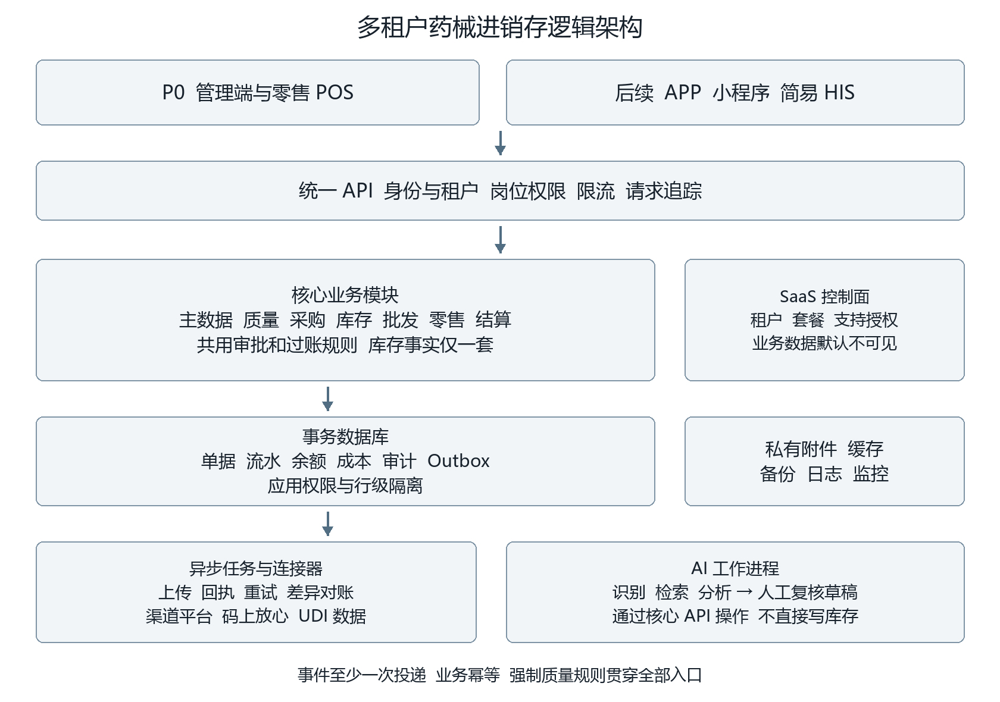

# 药械行业 AI 智能进销存 SaaS 设计规划书

版本 1.0　基线日期 2026 年 10 月 8 日　适用对象 产品 研发 测试 实施 质量管理

本规划用于确定产品范围、统一业务规则并指导开发。产品面向多家企业提供 SaaS，同时支持药品和医疗器械的批发与零售。首期完成主体进销存，后续分期接入 AI、第三方平台、APP、小程序及简易 HIS。工期、预算和性能指标均为待验证的规划基线，不是实测结果或供应商报价。

首期交付闭环为：租户开通 → 企业和岗位配置 → 资质与商品建档 → 采购收货与验收 → 批次库存 → 批发出库或零售销售 → 退货及结算 → 报表与追溯核查。AI 和第三方接口必须使用同一套业务服务，不能直接修改库存或绕过质量审批。真实经营所必需的追溯上传等能力，应在对应租户投产前完成。

阅读建议：项目发起人先评审第 01 至 03 章和第 23 至 25 章，明确首期范围、投产条件及投入；产品和实施人员重点核对第 04 至 12 章的实际流程；研发与测试人员依据第 15 至 18 章和第 21 至 22 章建立技术契约和验收证据。

首期决策基线：批发和零售共用一套库存事实，多租户安全从第一天实施；采用模块化单体起步；支付先支持现金及外部收款登记，AI、渠道和多端逐步上线。必需的质量、处方及追溯责任随具体经营范围落实。

研发启动材料：本规划书、配套的 51 个工作包、真实脱敏单据和商品样例、试点所在地要求、现有系统及接口授权资料。前两周优先完成经营范围、规则矩阵和库存事务原型评审，再进入大规模页面开发。

计划基线：P0 以 28 至 32 周、60 至 80 人月测算，正式承诺在团队、样例、试点范围和外部依赖确认后形成。文中指标需通过试点、压测和恢复演练证明，不能仅凭文档宣布达标。

## 01 产品定位与建设原则

### 1 目标用户

目标客户包括药品批发企业、器械经销商、单体药店、连锁药房和批零兼营企业。一个租户代表一个签约客户的数据及管理边界，租户内可包含多个法律主体、门店、仓库和部门。首期试点优先覆盖同一法律主体的批零业务；数据模型从第一天保留主体标识，跨法律主体交易按买卖处理，不能按普通调拨处理。

运营方负责软件服务和技术安全，租户负责其经营资质、质量管理、审方及业务记录。共享商品参考库与各租户经营商品库分开；采购价、客户、订单、库存和处方默认不跨租户共享。软件开通不代表获得经营许可。

### 2 成功标准

| 维度 | P0 验收目标 | 验证方法 |
| --- | --- | --- |
| 业务闭环 | 采购到付款、销售到收款、退货到冲销均可完成 | 真实样例和用户验收测试 |
| 库存正确 | 无非法负库存、重复过账、无法解释的余额差异 | 并发测试与流水重算 |
| 行业能力 | 批号效期、资质、验收、冻结和追溯有效执行 | 质量负责人按场景验收 |
| 租户隔离 | 数据、附件、导出、缓存和后台任务全部隔离 | 自动越权测试及安全评审 |
| 经营连续 | 仓库和门店可作业，故障后可恢复 | 试营业及恢复演练 |
| 扩展能力 | AI 和模拟渠道复用现有业务命令 | 契约测试和事件重放 |

采用模块化单体和事务型数据库起步。已过账单据不得物理删除或直接改关键字段，差错通过关联原单的更正、退货、红冲或补差处理。审批、库存过账、收付款是不同事实，必须分别记录。交易规则在服务端执行。AI 或外部平台故障不能阻止人工完成基础进销存。

## 02 阶段范围与版本规划

### 1 能力路线

| 阶段 | 交付范围 | 完成标志 |
| --- | --- | --- |
| P0 核心 SaaS | 租户、权限、药械及往来档案、资质、采购、验收、库存、批发、零售 POS、退货、往来、质量记录、追溯采集、规则提醒、审计备份 | 批发与零售试点稳定营业 |
| P1 AI 及追溯增强 | 票据和包装识别、证照识别、复核工作台、AI 帮助、码上放心连接器、UDI 查询适配、首个渠道试点 | 识别到人工批准、上传到回执闭环 |
| P2 多渠道 | 美团、饿了么相关渠道、淘宝、旺店通逐一接入；渠道库存、售后、对账和开放平台 | 每个连接器独立通过验收 |
| P3 多端及分析 | APP、员工小程序、客户订货入口、补货建议和经营分析 | 共用权限和交易规则，通过扫码弱网验证 |
| P4 简易 HIS | 患者、挂号、就诊、处方、收费、药房发药和退药 | 医疗机构、医师、药师职责及记录闭环 |

P1 至 P4 是能力路线，可按客户需要调整顺序。某租户必须使用的监管上传接口应提前到其投产前实现，不能以“接口在后期”为由延后法定义务。

### 2 首期功能深度

| 模块 | P0 交付 | 后续交付 |
| --- | --- | --- |
| SaaS 运营 | 人工开通、套餐与额度、到期提醒、数据导出、支持工单 | 自动扣费、复杂计费 |
| 批发 | 订单、信用控制、预占、拣货、复核、分批发货、回款和退货 | 招投标、返利、寄售、直调 |
| 零售 | 扫码、挂单、基础会员、折扣权限、收款登记、退货、交班 | 储值积分、复杂营销、断网销售 |
| 支付 | 现金及外部收款设备结果登记、交易参考号、日结核对 | 聚合支付直连、自动退款 |
| 处方 | 线下处方留存、药师审核、销售关联和数量控制 | 电子处方互联、在线诊疗 |
| 财务 | 应收应付、预收预付、收付款、核销、开票状态和毛利 | 总账、报税、电子发票开具 |
| 追溯 | 原码、包装关系、来源去向、退货链、导入导出、任务及回执台账 | 全平台实时直连 |
| 质量 | 首营、效期、养护记录、冻结、召回、不合格处置和投诉 | 全量质量体系文控及设备集成 |
| AI | 预留任务、证据、草稿和审批接口 | P0 不以模型服务为投产依赖 |

### 3 首期业务限制

标准包覆盖常规成品药和一般药械经营。特殊管理药品、疫苗、完整冷链运输、中药饮片称量调剂、植入类器械专门业务、寄售及第三方货权仓储不直接开放。商品必须标识限制类别，系统阻止未启用且未验收的业务。若试点经营这些品种，先补齐人员、设备、记录及适用规则后启用。

医保结算与药品追溯上传是不同能力。P0 可不做医保结算，但不能免除适用的追溯义务。上传可以由已验证的现有系统承接，必须有单据映射、导出、回执、差错对账和责任人；不能只保留“已经上报”的手工勾选。

## 03 行业依据与规则中心

### 1 已核实依据

修订后的药品管理法实施条例已于 2026 年 5 月 15 日施行，规则评审应按现行法律法规整体核定。[S18](https://www.beijing.gov.cn/zhengce/zhengcefagui/qtwj/202605/t20260513_4649507.html) 以下依据截至 2026 年 10 月 8 日核实。适用条件由所在地、经营方式、商品类别和业务日期共同决定；实施时由质量负责人完成法规适用清单。

| 依据 | 核实要点 | 设计要求 |
| --- | --- | --- |
| 药品经营质量管理规范 | 全过程质量控制、授权操作、真实可追溯记录和备份 | 首营、验收、养护、审计、追溯及备份 [S1](https://www.samr.gov.cn/zw/zfxxgk/fdzdgknr/bgt/art/2023/art_bc07ffdb7a1c4e46be371ac5a4a65f9c.html) |
| 器械经营质量管理规范 2023 年第 153 号 | 2024 年 7 月 1 日施行；第三类器械系统包括 UDI 采集、效期控制和外部交互要求 | 分类规则、UDI、质量锁定和接口台账 [S2](https://sjj.ganzhou.gov.cn/c102441/202402/cc3882494b91412fbca052e1e0f8d94a.shtml) |
| 医保发 2025 年第 7 号及后续官方说明 | 追溯码采集上传已进入全面实施阶段 | 投产核定上传责任、覆盖率、回执和补报 [S3](https://www.nhsa.gov.cn/art/2025/3/19/art_104_16045.html) |
| UDI 2026 年第 21 号公告 | 2027 年 6 月 1 日起生产的全部第二类器械及第一类体外诊断试剂纳入；2029 年 6 月 1 日起生产的全部第一类器械纳入 | 按类别、生产日期及例外判断，不能一刀切 [S4](https://udi.nmpa.gov.cn/toDetail.html?CatalogId=2&infoId=80) |
| UDI 2026 年第 15 号公告 | 特定情形存在免于实施或简化要求 | 例外配置有依据和审批，不强求所有器械逐件序列号 [S5](https://udi.nmpa.gov.cn/toDetail.html?CatalogId=2&infoId=81) |
| 网络销售办法及 2026 年处方药网络零售指南 | 网络处方来源、实名、审方有专门要求，AI 不得替代最终处方审核 | 后期线上业务单独验收，审方权归执业药师 [S6](https://www.samr.gov.cn/zw/zfxxgk/fdzdgknr/fgs/art/2023/art_27f2fba302ab48239dfde1a5b5095156.html) [S7](https://www.nmpa.gov.cn/xxgk/fgwj/gzwj/gzwjyp/20260525142536103.html) |

UDI 产品数据库查询、企业经营流向记录和药品追溯平台上传是不同用途。UDI-DI 标识产品，UDI-PI 表示适用的批号、序列号或日期信息；DI 不能直接作为每件实物的唯一序列号。[S8](https://udi.nmpa.gov.cn/toDetail.html?infoId=43)

### 2 规则和证照

规则中心按租户、法律主体、地区、经营类型、商品类别、渠道、生效时间组织。规则保存编号、来源、版本、强制或提示级别、触发环节、责任岗位、例外条件及测试用例。普通管理员不能关闭强制质量规则。

首营企业、首营品种、购货单位及授权人员分别建档。材料包括营业执照、经营或生产许可、器械注册或备案信息、授权书和质量协议等实际适用证照。旧规范文本中的 GMP 或 GSP 认证证书不得直接作为当前所有客户的新办必填项，应结合认证制度调整处理。[S9](https://mpa.gd.gov.cn/zwgk/gzwj/content/post_2716635.html)

经营方资格与产品资格分开校验。经营方失去资格时阻断新发生的相关业务；产品证照变更对历史库存的影响结合生产日期、证照历史及具体规定判断，不自动等同于实物失效。每次审批保存当时证照快照。

### 3 留存和隐私

一般药品记录及凭证以至少 5 年为规范基础，特殊类别另行适用。[S1](https://www.samr.gov.cn/zw/zfxxgk/fdzdgknr/bgt/art/2023/art_bc07ffdb7a1c4e46be371ac5a4a65f9c.html) 器械、处方、医疗记录等按类别及地区规则分别设定，不能统一使用一个删除年限。保存 retention_until，召回、争议或调查记录设置 legal_hold，到期后经审核处置。

租户停用或退出不触发经营记录立即删除。身份证明、处方、健康和金融账户等敏感信息采用必要性判断、加密、字段级权限及用途限制。个人权益请求与依法必须留存的记录分开处理，AI 默认不接收完整患者身份资料。[S10](https://www.cac.gov.cn/2021-08/20/c_1631050028355286.htm)

## 04 用户角色与权限

| 角色 | 主要职责 | 限制 |
| --- | --- | --- |
| 平台运营 | 租户开通、套餐、版本及资源管理 | 默认不可见租户业务明细 |
| 平台支持 | 故障诊断和工单 | 临时授权、限定租户及时段、全程审计 |
| 租户管理员 | 组织、账号及参数 | 管理员身份不自动获得质量审批或审方资格 |
| 质量人员 | 首营、冻结解冻、召回、不合格处置 | 按岗位资格授权，关键决定留证 |
| 采购员 | 订单、供应商申请、到货跟踪 | 不能自行代替独立质量审核 |
| 收货及验收员 | 到货、批次和验收 | 操作者、岗位、时间分别保存 |
| 仓管与复核员 | 上架、拣货、复核、盘点、调拨 | 不直接修改库存余额 |
| 批发销售员 | 客户、报价、订单、回款登记 | 成本查看及折扣独立授权 |
| 店长及收银员 | 销售、交班、退货申请 | 越限折扣及特殊退款需审批 |
| 执业药师 | 处方审核和药学记录 | 账号、资格和实际审核行为绑定 |
| 财务人员 | 付款、收款、核销及关账 | 不修改库存和质量结论 |
| 审计员 | 查看台账及历史 | 只读，导出另行授权 |

权限由操作权限、组织范围、敏感字段及人员资格共同决定。范围最小到法律主体、门店、仓库、部门和本人单据。角色拆分查看、创建、提交、审批、过账、冲销、打印、导出、查看成本及查看患者资料。

租户上下文来自服务端验证的登录信息，不能信任请求体里的 tenant_id。用户跨租户任职时显式切换上下文并刷新令牌和缓存。岗位分离按适用规则执行，实际操作人必须留存，不能只存角色名称。平台支持不能通过模拟登录代替业务审批。

## 05 商品及往来单位

### 1 商品结构

采用公共参考目录、租户产品、库存 SKU、包装、批次及可追踪实例六层。公共目录仅供建档参考，确认后生成租户独立版本。同名不等于同一商品，需综合生产企业、规格、剂型、批准或注册信息。

| 对象 | 关键字段 | 校验 |
| --- | --- | --- |
| 通用商品 | 内部编码、类别、名称、规格、生产企业、品牌、状态、来源 | 租户内编码唯一，批准后启用 |
| 药品扩展 | 通用名、剂型、批准文号、持有人、处方属性、储存条件、特殊管理标记 | 不靠模糊名称合并 |
| 器械扩展 | 分类、分类编码、注册或备案号、注册人、型号、UDI 策略、效期策略 | 批号、序列号、效期按适用性要求 |
| 库存 SKU | 基本单位、计量精度、批次及序列策略、价格策略 | 影响历史的变更必须版本化 |
| 包装 | 层级、上级包装、换算比例、条码或 DI、拆零规则 | 保留精确换算和历史快照 |
| 批次 | SKU、生产企业、批号、生产日期、失效边界、原始日期文本 | 日期冲突转质量核查 |
| 实例或追溯包装 | 原码、码制、DI、PI、序列号、包装层级、生命周期 | 不强求所有器械有逐件序列号 |

GTIN、企业码、药品追溯码、UDI、医保编码用独立映射表区分用途。编码可能对应某一包装层级，不塞进单一全局条码字段。扫码多候选时必须选择。追溯原串保留前导零和控制字符，不能用数字类型存储。

换算采用整数比例或定点数，禁止浮点累积误差。首期未启用拆零时只能整单位出入库。后续拆零保存来源包装、剩余量及去向分配，不伪造新的监管码。公共商品更新仅生成差异建议，不能覆盖已审核的租户数据。

### 2 往来单位

party 表示法人实体，party_role 区分供应商、批发客户、承运商等。同一企业可兼具客户和供应商角色，法人身份可复用，应收应付与协议仍独立，未经批准不自动对冲。

字段包括名称、社会信用代码、地址、联系人、经营范围、许可证、银行账户、开票资料、账期、信用额度和资质附件。自然人零售客户与企业客户强类型区分，普通非会员交易不额外强制采集身份证；处方等业务依适用规则处理。

首营状态为草稿、待审核、补充资料、已批准、暂停、失效。合并重复档案只改变索引关系，历史交易保留原快照。证照更新关联受影响订单与批次，并形成到期任务。

## 06 采购收货与验收

采购申请可选 → 采购订单 → 审批 → 到货登记 → 收货核对 → 待验实物登记 → 验收 → 合格入库上架 → 应付确认 → 付款核销。

订单行保存 SKU、采购单位、数量、含税或未税价格、税率、折扣、交期和最低剩余效期要求。供应商资格在下单、收货和过账时重复校验。支持分次到货、分批验收、部分关闭，超收要审批。

收货记录实到数量、包装、运输信息、批号、日期、随货单、检验资料和追溯码。待验品仅进入待验实物台账，不增加可销售库存。验收按批次及必要实例执行，记录合格、不合格、待处理或拒收。合格品正式入账，不合格品保留隔离实物及处置记录，不能进入正常经营库存。

| 异常 | 处理 | 完成条件 |
| --- | --- | --- |
| 无订单到货 | 暂存并补采购依据 | 采购和质量审核完成 |
| 数量价格不符 | 按实到记录，价差另处置 | 差异确认及审批 |
| 批号效期缺失 | 锁定该行 | 取得可信材料并复核 |
| 同业务重复扫码 | 去重报警 | 核实包装层级及历史 |
| 同码已在库 | 阻止重复入库 | 正式差错处理 |
| 部分合格 | 拆分合格及隔离数量 | 按结果分别流转 |
| 识别失败 | 保存图片转人工 | 仍执行全部校验 |

采购退货引用原入库和原批次，可退数量受实际可用量限制。已售数量不能直接退给供应商。退货出库生成应付调整，退款到账另记。拒收、退货和财务红冲具有不同含义，不能合并为“删除采购”。

## 07 库存与成本

### 1 数量口径

库存定位键为租户、法律主体、货主、仓库、库位、SKU、批次和互斥质量状态；逐件管理时关联实例。待验及拒收实物单独登记。首期货主默认为本企业，预留不代表开放第三方仓储业务。

合格、不合格、待处理和召回隔离是质量状态。冻结保存独立限制记录，不能重复扣减。过期同时由定时任务标记和服务端实时判断，任务延迟不能导致放行。

可销售合格数量 E 是通过质量、效期和经营规则过滤后的实物量。可分配量 A = E − 有效预占 R − 额外冻结 F。F 仅包含尚未从 E 排除且未被 R 占用的数量，分配关系保证 R 与 F 不重叠。看板中各种原因可能重叠，不能直接相加减充当库存算法。

预占不减少实物库存，发货同时减少在库和对应预占，取消释放预占。调拨发出进入在途，收货后才进入目的仓；在途仍是同主体货权库存，但两端都不可销售。跨主体用购销，不用调拨。

### 2 分配及日期

默认近效期先出 FEFO，同效期按入库顺序。客户最低剩余效期、包装完整、库位、质量和序列号先过滤，再排序。人工换批必须留理由并重新校验。

同 SKU 加批号不必然代表可无条件合并，生产企业及产品身份冲突转核查。日期保存原始标签和规范化边界。只标月份时按适用规则解释并留依据，未确定前不得擅自补月初或月末。无效期产品使用明确的“不适用”策略，不能填虚假远期日期。

### 3 盘点与调整

盘点包括计划、范围冻结或快照、盲盘、复盘、差异审批、调整过账和结束。P0 采用库位或商品范围短时冻结，禁止无记录改基准。动态盘点在后期处理盘点期间流水差。

调拨支持部分发收、短缺、破损和拒收，差异生成专门处理单。报损报溢需要原因、证据、权限与审批。报损先冻结后处置。所有调整必须生成流水，余额表没有普通业务可调用的直接修改接口。

### 4 并发与过账

单次过账在一个数据库事务中完成状态权限校验、库存与预占锁定、不可变流水、余额更新、成本及必要往来、单据状态和 Outbox 事件。任一步失败全回滚。余额服务查询，流水支持重建；每日核对流水、余额、预占及追溯实例。

扣减使用行锁及条件更新，多批次按稳定顺序加锁，死锁有限重试。幂等键与业务过账唯一约束双重防重。Redis 只缓存或辅助协调，不能决定最终库存正确性。

### 5 成本

P0 建议按法律主体、货主、SKU、批次归集移动加权经营成本。FEFO 决定实物顺序，成本方法独立。高值序列化器械后续可用个别计价。财务须确认成本税口径，不硬编码统一税率。

数量、单价及成本建议 NUMERIC(20,6)，本币最终金额 NUMERIC(20,2)，禁止浮点。每行保留交易价、税额、未税金额、成本和税率快照，尾差明确分配。

示例：同批次入 100 盒，每盒成本 10 元；再入 50 盒，每盒 12 元。总成本 1600 元、数量 150 盒。发出 30 盒的成本 320 元，剩余 120 盒和 1280 元。销售退货恢复原发货成本。采购退货关联原入库，涉及已耗用数量或价差时以成本调整解释，不改历史数量。

关账后禁止回填过往过账日期重算历史。迟到发票和运费以本期调整引用原单。客户要求其他会计成本法时专项实施或对接财务，不能同期间随意切换。

## 08 批发销售

客户核验 → 报价合同 → 订单 → 价格及信用审核 → 预占 → 拣货 → 复核扫码 → 发货过账 → 运输交接签收 → 应收 → 收款核销。

订单、预占、拣货、发货、签收和退货数量分别保存。支持部分发货和余量关闭；一个订单固定法律主体。价格优先级为有效合同价、客户等级价、标准价，超授权降价、逾期或信用超限按规则阻断或审批。

信用占用覆盖已确认应收和待履约订单风险，预收抵减必须分配，不能重复使用。复核核对名称、规格、批号、效期、数量及追溯或序列信息。发货记录承运方、方式、交接、地址和时间，生成随货同行单。

销售退货关联原发货及可退数量，退回实物先待验，质量判定后回合格、隔离或报损。退款成功不代表商品可再销售。非原单退货需来源核查、特殊权限和质量审核。

## 09 零售与门店

### 1 销售流程

开班 → 选择门店收银台 → 扫码购物车 → 商品批次确认 → 处方及经营检查 → 确认价格 → 预占 → 收款登记 → 出库及追溯事件 → 小票 → 交班对账。

普通条码一般只能定位 SKU 或包装，不能保证识别批次。优先扫描追溯码关联实物；无批次码时显示 FEFO 候选并确认实物，不能静默假设柜台批次等于推荐批次。

P0 支持搜索、数量修改、挂单取单、会员、折扣、组合付款登记、原单退货、补打和交班。挂单默认不占库存，结算才短期预占。结算超时释放前检查付款状态。

### 2 支付及异常

现金当场确认。外部设备支付由收银员确认并记参考号，显示“人工确认”，每日与渠道账单核对。P0 不把人工结果标作支付机构验签结果。

已收款但过账失败时保存恢复任务、预占及收款证据，禁止要求顾客重复付款。由操作员恢复履约或受控退款。未来支付直连使用独立支付意图、支付交易和退款交易；超时先查询，不直接认定失败，重复回调不得重复扣库存。

### 3 处方 退货及交班

处方药销售前关联有效处方及药师审核，保存来源、审核人、资格、时间、结论、实际调配药品和已使用数量。处方修改或药品替换须重新审核；药师不在岗或资料缺失时阻断相关销售。AI 可整理材料和提示缺项，不能签署审核结论。

处方与会员资料分离，收银员仅见本次履约必要信息。药品退换货遵守适用规则和门店制度，不直接套用普通商品退货政策。

交班包括备用金、现金收入退款支出、理论余额、实点余额和差额，非现金按通道核对。差额留原因与处理人，不能回改交易凑平。P0 不做完整断网收银；断网提供清晰停用及应急说明，恢复后的草稿同样经过库存、处方和追溯校验。

## 10 往来结算与经营报表

### 1 业务往来账

P0 提供业务子账，不替代完整会计总账。供应商应付以验收合格且形成约定结算义务的入库为默认确认依据；客户应收以已发货且形成约定结算义务为默认依据。合同另有约定时配置确认时点并在实施时冻结，不能同租户混用而无标识。

收付款单与库存单分开。收款分配到具体应收项目，付款分配到具体应付项目，支持一款多单、一单多款、预收预付和退款；未分配余额独立展示。核销金额不得超过单据未结金额，撤销核销生成记录而不是删除历史。

期初应收应付按客户或供应商及原单号导入，不能为了产生期初余额虚构当期采购销售。账期从约定日期计算，逾期采用自然日或约定工作日且明确时区。跨币种、自动汇兑和财务合并首期不开放，本币默认为人民币。

### 2 指标口径

| 指标 | 推荐口径 | 说明 |
| --- | --- | --- |
| 销售净额 | 已过账销售未税金额减已过账销售退回未税金额 | 批发与零售分列，折扣按行分摊 |
| 经营毛利 | 销售净额减对应销货成本及明确归属的成本调整 | 不含未归集费用，不等同净利润 |
| 库存金额 | 已验收货权库存成本，含单列在途及隔离部分 | 待验实物另列，不能混入 |
| 库存周转天数 | 平均库存成本除以期间销货成本乘期间天数 | 分母为零时显示不适用 |
| 滞销 | 在库且超过配置天数无有效销售 | 新品、季节品可排除并留依据 |
| 临期损失风险 | 进入预警窗口的可用库存数量及成本 | 提示风险，不等于已发生损失 |
| 回款率 | 指定应收群组截至统计时点的已核销收款除以应收 | 不能混淆本期销售与历史回款 |
| 追溯完成率 | 需上传且已获有效成功回执的事件数除以应上传事件数 | 另报缺码、待传、失败和超时 |
| 接口差异 | 本地状态与平台状态不一致的记录数 | 区分同步延迟与真实异常 |

报表支持主体、门店、仓库、商品、批次、客户、供应商和期间维度，下钻到原单据。所有报表标注业务日期或过账日期、统计截止时间、含税口径、币种及数据更新时间。关账快照与实时报告并存，不用实时变动值冒充已结报表。

## 11 质量管理与提醒

### 1 质量业务闭环

首营审核、验收、养护、效期处理、质量冻结、不合格处置、投诉、召回均是可执行流程，不能只做附件上传。质量人员可按 SKU、批次、实例、供应商或单据冻结，冻结后阻止新分配，并对已有预占及未发订单生成受影响清单。

召回按公告及批次范围立案，查询当前库存、在途、已售去向和退回数量；立即锁定相关库存，生成联系任务、回收记录及处置记录。P0 由人员执行对外联系，系统记录过程；后期消息连接器单独启用。召回关闭要求数量去向可解释且责任人批准，不能只凭“通知已发出”结束。

解冻需质量权限、证据和理由，不恢复已取消的订单预占；客户重新下单时再校验。销毁记录数量、批次、批准人、执行及见证信息、附件和日期，库存扣减仅发生一次。

### 2 规则提醒先行

| 事件 | 触发基线 | 接收角色 | 闭环 |
| --- | --- | --- | --- |
| 临期 | 示例 180 天预警、90 天加强、30 天处置；按商品调整 | 采购、店长、质量 | 生成处理任务及期限 |
| 证照到期 | 示例提前 90、30、7 天 | 资料维护、质量 | 更新并重新审核 |
| 库存不足 | 可用量低于安全库存 | 采购及店长 | 人工生成补货草稿 |
| 库存积压 | 超过设定天数无销售 | 经营负责人 | 调整采购或调拨计划 |
| 逾期应收 | 超过合同到期日 | 销售、财务 | 跟进并记录结果 |
| 追溯上传异常 | 超时、拒绝、待补字段或缺回执 | 追溯专员、质量 | 补正、重试及对账 |
| 系统异常 | 备份失败、交易失败、队列积压 | 运维及负责人 | 工单、升级和复盘 |

这些天数是示例业务参数，不是统一法定阈值。提醒按事件指纹去重，同一问题只升级而不反复刷屏。任务状态为新建、已认领、处理中、待验证、已关闭、逾期。首期站内消息，后期短信、企业微信等按授权开通。强制到期拦截由交易规则完成，不依赖用户是否阅读提醒。

## 12 药品追溯与医疗器械 UDI

### 1 统一追踪模型

保存追溯原串、码制、发码机构、规范化值、解析版本、包装层级及数量、产品映射、批次和序列信息。条码、药品追溯码、UDI、医保分类码分别标记，不用“20 位数字”作为全部药品追溯码识别规则；官方已说明二维 GS1 药品追溯码的采集问题。[S11](https://www.nhsa.gov.cn/art/2025/12/25/art_14_19130.html)

码身份与流转事件分离。同一合法包装可能先采购入库、销售出库、退回再入库；不能用一条“永久已售”记录阻止合法退货。相同码不能同时属于同一租户的多个现存实物，但其历史事件可以多条。跨租户码碰撞检查不能泄露另一租户交易，仅形成受控风险核查线索。

箱、盒、件等父子关系有版本及生效事件。扫描已验证的大包装码时按已知聚合关系展开；未知关系不能猜子码。按扫描码数统计数量时按包装换算去重，混扫父子码不得重复计数。

### 2 事件和回执

事件类型包括采购接收、验收、库存转移、销售发出、零售售出、退回、购进退出、召回、报损及更正。内部完整记录不意味着每个事件都必须上报每个平台，由连接器依据适用规范映射。

每个上传任务保存租户和目标平台、业务事件 ID、原单号、载荷版本、批次号、请求摘要、尝试次数、平台流水号、回执原文、成功或失败时间及下一次重试时间。原上传内容已被接受后需要更正时，发送平台支持的纠正事件或进入人工流程，不能删除本地记录假装未上报。

扫码缺项、包装关系冲突、重复流转和平台未知码进入异常池。关键码未完成核查时阻止相关出入库；是否可先业务后上传按地区、平台和企业规则明确，不能统一默认无限期补传。

### 3 码上放心

官方说明存在追溯上下行对接服务，但具体权限、计费、产品包、SDK 和生产环境须经商务及应用授权确认。[S12](https://www.mashangfangxin.com/help/faq) 对接范围按租户实际合同确定，包括企业及产品映射、码信息查询、出入库上报、包装关系、回执和差错补报。禁止将其描述为所有药品和所有企业都可免费查询的公共 API。

P0 实现采集及导出，并验证既有合规上传路径；P1 原生连接器逐步替换。两条路径切换采用明确切换水位和事件去重，不能同时自动上传同一业务。

### 4 UDI

解析器采用码制插件，优先实施试点实际使用的编码体系。GS1、HIBCC、MA 等候选分别验证，不把 GS1 解析规则套到全部产品。保留原始数据及分隔符，解析错误时展示原串并人工核实。

DI 参考信息与经营批次、序列实例分离。官方数据库用于合法获取的产品信息核验或授权数据同步，不能推断其必然提供面向经销商的流向上传接口。官方已发布数据共享 API 标准文档及下载入口，可作为主数据调研起点，当前版本及权限仍须确认。[S19](https://udi.nmpa.gov.cn/toDataDocking.html) 部署前确认数据使用条款、查询方式、可用字段、更新频率及本地监管平台要求。扫描 UDI 不自动代表该件合格、真品或具有经营资格。

## 13 AI 能力规划与人工复核

### 1 AI 任务清单

| 编号 | 功能 | 输入与输出 | 最终决定者 |
| --- | --- | --- | --- |
| AI01 | 票据辅助入库 | 随货单或发票图片 → 供应商、行项目、数量价格候选 | 采购及验收人员 |
| AI02 | 包装辅助建品 | 多面包装、条码 → 名称规格、厂家、批准信息草稿 | 资料及质量人员 |
| AI03 | 证照辅助建档 | 营业执照、许可、授权书 → 往来及有效期候选 | 首营审核人员 |
| AI04 | 经营分析 | 已授权指标查询 → 解释、趋势和下钻链接 | 经营人员 |
| AI05 | AI 帮助 | 当前功能、角色和知识库 → 操作说明及依据 | 用户自行执行 |
| AI06 | 智能提醒 | 规则事件和历史经营 → 优先级及处理建议 | 任务负责人 |
| AI07 | 补货建议 | 销量、库存、在途、交期 → 数量和原因 | 采购审批人员 |

“识图自动入库”的产品表达应具体为识别、匹配、校验、自动生成入库草稿，并由授权人员验收后过账。后续只有低风险且已批准的业务才可设置自动提交策略，药械验收、资质和处方等必需职责不能由置信度阈值替代。

### 2 技术流程

上传及病毒检查 → 图片质量检查 → OCR 与条码识别 → 文档分类 → 结构化抽取 → 字段标准化 → 本租户档案匹配 → 业务交叉校验 → 人工复核 → 生成业务草稿 → 正常审批和过账。

AI 模型不持有数据库写权限和库存管理凭证。输出遵循 JSON Schema，未知字段返回空值及原因。批号、有效期、批准文号、供应商身份、金额和数量等关键字段逐项展示证据区域。总额校验、单位换算及资格校验由确定性程序执行，不能交给模型自行判断。

复核界面左侧原图及标框，右侧结构化字段；显示原文、识别值、规范化值、候选档案、规则失败和人工修改。整页“高置信”不能掩盖某个关键字段不确定。原图哈希相同只提示潜在重复，是否重复业务还要核对供应商、单号、日期和行明细。

### 3 安全与评估

图片文字和外部文档一律视为数据，不能把其中的“忽略规则”“导出客户”等指令作为工具命令。模型访问工具使用白名单，绑定租户、用户、用途及时间范围，默认只读；产生业务操作先生成具体草稿再经授权步骤执行。

知识库按租户、文档权限、版本和生效期检索，过期制度不作为现行操作答案。回答附材料位置；缺依据时说明不足并转人工。经营分析使用受控指标服务或只读语义层，禁止直接运行模型任意生成的生产 SQL。敏感字段在检索前过滤，不能仅在答案末尾脱敏。

首轮评估至少包含 500 份脱敏且具有授权的真实样本，覆盖模糊、反光、倾斜、多页、手写、盖章遮挡、不同版式及伪造提示。按供应商或模板分组隔离训练、调参和测试，防止相同模板泄漏。建立人工双标注的关键字段金标准。

验收指标包含关键字段精确匹配率、整单关键字段全部正确率、漏检率、需修改比例、平均复核用时和每单成本。建议首轮目标为清晰印刷票据关键字段精确匹配率不低于 98%，复核时间较全手工减少 30%；需先建立手工基线再确认目标。该数值不适用于模糊照片，不作为免复核依据。

模型版本、提示词版本、解析规则、原证据、输出、人工修订及审批全链记录。供应商评估覆盖数据驻留、训练使用、保留期限、删除能力、成本、延迟和退出替换；无合适授权的数据不送外部模型。优先比较国内可合规部署服务与私有部署方案，基于业务数据评测后定型。

### 4 智能补货及分析

P0 采用规则式再订货点：预计交期需求 + 安全库存 − 当前可用 − 可靠在途，并按最小采购量及包装倍数取整。P3 再评估预测模型，对新品、间歇性销量、缺货造成的销量截断和季节变化分别处理。建议展示预测区间、销量窗口、交期、库存及采购限制，用户能追溯推荐原因。

AI 分析先计算确定指标再生成解释，金额和数量来自指标服务。预测与事实明确区分，不把相关性写成因果。试运行期间只建议不自动下单，并用缺货率、周转、临期损失及人工采纳率判断是否产生价值。

## 14 第三方平台与通用接口

### 1 平台事实和待确认事项

| 平台 | 已核实信息 | 接入前必须取得 |
| --- | --- | --- |
| 美团 | 官方技术服务合作中心列有医药健康及接入、测试、授权流程 [S13](https://tscc.meituan.com/) | 对应医药业务的应用类型、商家授权、接口权限、测试环境及验收规则 |
| 饿了么相关渠道 | 当前官方入口显示淘宝闪购服务商平台，不能沿用旧餐饮文档直接定案 [S14](https://open.shop.ele.me/) | 当前医药或零售业务入口、订单商品权限、回调及商业条件 |
| 淘宝和天猫 | 官方说明支持商家 ERP 对接及商家授权；类目和权限存在限制 [S15](https://developer.alibaba.com/docs/doc.htm?articleId=118848&docType=1) | 应用资质、类目权限、数据安全要求、实际 API 清单 |
| 旺店通 | 企业版有开发者审核及自助对接流程，产品版本需区分 [S16](https://open.wangdian.cn/open/guide?path=guide_kfzn) | 企业版或旗舰版、商家授权、字段和库存主控权、费用 |
| 码上放心 | 提供追溯对接服务，需按服务包与授权实施 [S12](https://www.mashangfangxin.com/help/faq) | 追溯权限、企业映射、字段、频控、补报规则 |
| UDI 和本地监管 | 官方公开产品数据及各地要求承担不同用途 | 合法数据接口、区域监管协议与测试流程 |

公开入口存在不等于当前账号拥有全部 API 权限。规划不虚构平台 endpoint、签名算法、配额、审核天数或收费，研发前以获得的正式文档建立版本化契约。

### 2 库存主控权

每个“租户 + 门店或仓库 + 渠道”必须唯一指定库存主控系统。采用本系统主控时，外部订单进入本系统预占，库存变化由本系统推送。采用旺店通主控时，本系统按约定承担药械质量、追溯及所需镜像，不再独立对同一货权作相反扣减。主控变更需停同步、对账及水位切换。

P2 优先选择本系统主控的一种模式试点。门店若同时直连美团又由旺店通转接相同订单，必须明确唯一入口；以平台、店铺、外部订单及行号去重，防止一单两扣。外部系统的批号或追溯字段不足时，在本系统补充采集，不凭空生成。

渠道可售量基于核心可分配量、渠道配额、安全缓冲和包装取整计算。采用硬配额时，各渠道未售配额加线下预算不得超过可分配量；动态共享时保留风险缓冲并实时校验。渠道异步同步存在时间窗口，不能承诺“绝不超卖”，需设置拒单、调货和通知策略。

### 3 连接器工作方式

平台回调 → 验签及防重放 → 持久化 Inbox → 快速确认已接收 → 异步解析映射 → 调用核心命令 → 写处理结果。回调确认只代表可靠接收，不代表订单已完成。失败进入异常池，有限指数退避重试，权限失效等永久错误停止盲目重试并通知。

外发数据由 Outbox 产生，通过租户独立限流的工作进程发送。使用至少一次投递及消费幂等，不能宣称网络环境下全链路天然恰好一次。无回调平台采用增量轮询和水位，分页、时间边界及补拉窗口都需测试。乱序消息对比平台版本或主动查询最新状态，不允许旧消息回退已完成状态。

每日核对订单、库存、发货、取消、退货和资金摘要，异常可下钻原始报文。原始报文加密保存并限制敏感内容和期限，日志中不写密钥、完整身份证或付款凭据。

### 4 通用开放接口

P0 建立内部版本化 REST API、OpenAPI 描述、应用身份、幂等、分页、错误结构和事件信封。对外先开放经审核的商品与库存只读接口、订单草稿导入及事件订阅试点，默认不开放直接过账。P2 建开发者门户、沙箱、凭证轮换、调用量、限流及回调管理。

认证采用按场景选定的 OAuth2 客户端模式或签名应用凭证，授权范围细到租户、主体、门店和资源动作。密钥只显示一次并保存在密钥服务中。服务端签名回调包括事件 ID、时间戳、正文摘要和密钥版本，接收方检查重放；提供重投和回执查询。

所有写接口支持 Idempotency-Key。幂等作用域包含租户、应用、命令及业务目标，保存请求摘要和原始结果；同键同内容返回原结果，同键不同内容返回冲突。幂等记录的清理不能使同一过账再次生效，业务唯一约束永久保留。

## 15 系统架构与技术路线

### 1 逻辑结构

客户端包括 PC 管理端、PC 零售收银端，以及后续 APP、小程序和 HIS 端。统一网关完成身份、租户识别、限流及请求追踪。核心应用按身份组织、主数据、质量、采购、库存、批发、零售、结算、追溯、报表模块划分。

关系数据库存交易事实，私有对象存储保存附件，缓存用于字典和短期查询。后台工作进程执行报表、提醒、Outbox 发送、上传和导入。连接器及 AI 工作进程独立资源池运行，避免图片识别或平台故障占满核心服务。

架构图见后文附录。P0 可同仓库、同代码库构建多个部署进程，但不同模块通过公开应用服务访问，禁止随意跨模块写表。库存和结算过账保留本地事务，外部调用不能放在长数据库事务内。

### 2 技术建议

| 层次 | 推荐基线 | 原因及边界 |
| --- | --- | --- |
| PC 前端 | Vue 3、TypeScript、成熟企业组件库 | 适合表格单据和中文业务录入 |
| 后端 | Java LTS、Spring Boot 受支持稳定分支 | 事务、权限、工作流和工程生态适配 |
| 数据库 | PostgreSQL 受支持稳定版 | 事务、约束、分区及 RLS 能力 |
| 数据访问 | 明确 SQL 或成熟 ORM，关键库存 SQL 人工审查 | 避免隐式更新破坏条件扣减 |
| 缓存 | Redis 或兼容服务 | 非账本、不存唯一交易事实 |
| 附件 | 私有对象存储及短时签名 URL | 大文件与事务数据分离 |
| 后台任务 | 数据库任务表和 Outbox 起步 | P0 降低运维复杂度 |
| AI 工作进程 | 独立 Python 或 Java 服务 | 按模型 SDK、OCR 能力选定 |
| 部署 | 容器化应用和托管数据库优先 | 初期无需强制 Kubernetes |
| 观测 | 结构化日志、指标、链路追踪 | 关联用户请求、单据和任务 |

具体版本在立项时核验支持期、许可证、安全公告和云供应商兼容性后锁定；本文不将某个版本号当作多年不变的承诺。团队如以 .NET 为主，可等价替换后端技术，必须保留相同事务、权限及契约约束，首个迭代前统一选择。

### 3 何时拆服务

P0 不按表拆微服务。当独立模块出现明显不同的吞吐、可靠性、发布节奏或团队责任需求时，优先拆连接器、AI、报表和通知；库存交易核心最后评估。拆分前先形成事件契约、幂等、版本及补偿机制，不能仅因“将来规模大”提前引入全链路分布式事务。

## 16 SaaS 租户和安全架构

### 1 隔离方案

P0 建议共享应用、共享数据库、所有业务表带 tenant_id，并结合应用层强制作用域和 PostgreSQL RLS。高隔离客户后续迁移独立数据库或独立部署，保持同一业务版本。

RLS 并非自动生效：应用数据库账号不得拥有 SUPERUSER、BYPASSRLS 或表所有者绕过能力，迁移账号与运行账号分离；按表启用并验证必要的 FORCE ROW LEVEL SECURITY。每次事务设置来自可信身份的租户上下文，连接池归还必须清理，任务和导出也必须设置上下文。官方文档说明超级用户、BYPASSRLS 和通常的表所有者存在绕过行为。[S17](https://www.postgresql.org/docs/current/ddl-rowsecurity.html)

跨表引用使用包含 tenant_id 的复合唯一约束及复合外键，避免 A 租户单据引用 B 租户商品。平台控制面使用独立权限和数据库角色，不给通用业务进程全租户查询权限。用户输入不得指定任意存储路径、租户或密钥标识。

### 2 非数据库隔离

对象存储按租户前缀及私有访问策略管理，每次下载重新鉴权；仅靠难猜 URL 不足以隔离。缓存键含租户及必要权限版本。搜索索引、向量库、异步任务、邮件通知、导出文件和打印任务均有租户作用域。

备份采用受控的全库恢复环境进行单租户提取，不能直接覆盖生产恢复某个租户。导出包含主数据、单据、台账、附件清单、追溯和审计的约定内容，并记录下载者。数据迁移与注销执行合同及保留规则。

### 3 安全基线

关键管理员启用 MFA，禁止共享药师或质量账号。登录限流、异常登录告警、短期访问令牌、会话吊销、密码安全哈希、密钥轮换、TLS、敏感字段加密和审计从 P0 实施。开发测试环境使用脱敏样本，生产密钥禁止进入代码库和日志。

平台支持访问采用工单关联的限时授权，用户可以查看访问记录。审计保存在受限追加写库或归档存储中，记录哈希和批次签名可用于检测篡改，但不能宣称仅凭哈希已满足所有电子签名效力要求。

互联网备案、网络安全等级保护、个人信息保护及医疗数据要求，按具体部署与服务形态由责任人定级核定；不在未评估前统一承诺“已通过某等级认证”。网络药品交易平台、药店 SaaS 与医疗服务提供者的责任边界分别评估。

## 17 核心数据模型

### 1 公共规范

业务主键建议 UUID 或统一生成的 64 位 ID。每张租户表包含 tenant_id、created_at、created_by、updated_at、updated_by 和 version；交易表另有 legal_entity_id、business_date、posted_at、source_system。时间戳存带时区标准时间，业务日按租户所在地，默认 Asia/Shanghai。

字段区分未知、不适用和空值；对数量和金额设合法范围 CHECK。已过账记录只追加更正引用，不采用普通软删除来掩盖历史。附件保存 SHA-256、原文件名、媒体类型、大小、私有对象键、来源和保留策略。单据保存品名、规格、单位和证照的历史快照，防止档案修改改变旧票据。

### 2 表组清单

| 领域 | 建议表 | 关键关系 |
| --- | --- | --- |
| 平台 | tenant、subscription、entitlement、support_grant | 套餐与授权不混入业务角色 |
| 组织 | legal_entity、org_unit、store、warehouse、location | 门店仓库必须属于明确主体 |
| 身份 | user、tenant_member、role、permission、role_binding、qualification | 人员资格独立于角色 |
| 主数据 | product、drug_profile、device_profile、sku、packaging、product_code | 一个产品多个库存或包装映射 |
| 往来 | party、party_role、contact、credential、first_trade_review | 资质版本与首营审批关联 |
| 采购 | purchase_order、purchase_line、receipt、receipt_line、inspection | 到货与验收可一对多 |
| 库存 | lot、serial_instance、stock_balance、stock_ledger、reservation | 流水为事实，余额为可重建投影 |
| 库内 | transfer、transfer_line、stock_count、count_line、adjustment | 调拨在途及差异单独记录 |
| 批发 | sales_order、sales_line、allocation、shipment、shipment_line | 订单行可以多次发货 |
| 零售 | retail_sale、retail_line、cashier_shift、payment_record | 交班不修改销售事实 |
| 处方 | prescription、prescription_line、prescription_review、dispense_link | 审核与用量、销售关联 |
| 退货 | return_order、return_line、return_inspection | 关联原行、原批次和已退量 |
| 往来 | receivable、payable、receipt_payment、settlement_allocation | 多对多核销 |
| 成本 | cost_ledger、cost_adjustment、period_close | 成本与数量关联但独立变更 |
| 质量 | quality_hold、maintenance_record、recall、disposal、complaint | 冻结范围和处置证据 |
| 追溯 | trace_identity、trace_relation、trace_event、trace_submission、trace_receipt | 一个身份多事件，一个事件多目标 |
| 接口 | integration_app、connection、external_mapping、inbox、outbox、sync_checkpoint | 按租户及连接实例隔离 |
| AI | ai_job、ai_field_candidate、evidence_anchor、review_action | 每个字段追溯原证据及人工决策 |
| 通用 | attachment、audit_event、approval_instance、notification、task | 关联资源和权限范围 |

### 3 关键表字段

| 表 | 字段及类型示意 | 约束 |
| --- | --- | --- |
| stock_balance | tenant_id、entity_id、owner_id、warehouse_id、location_id、sku_id、lot_id、quality_status、qty NUMERIC、version BIGINT | 维度唯一；不得出现非法负数；空批次按明确策略处理 |
| stock_ledger | id、tenant_id、document_id、line_id、event_type、dimension_key、qty_delta、cost_delta、posted_at、reversal_of | 过账业务键唯一；只能追加；反向记录引用原流水 |
| reservation | id、tenant_id、source_line_id、stock_dimension、qty、state、expires_at | 有效预占受可分配量约束；释放和消耗幂等 |
| lot | id、tenant_id、sku_id、manufacturer_id、lot_no、mfg_date、expiry_boundary、raw_expiry、source_id | 批次身份与日期冲突不能静默合并 |
| trace_identity | id、tenant_id、scheme、issuer、canonical_hash、raw_code、di、pi_json、package_level | 租户内规范身份唯一；原码保留原始形式 |
| trace_event | id、tenant_id、trace_id、type、document_line_id、qty、occurred_at、previous_event_id | 事件合法转移；同单同行同码同操作防重 |
| outbox | event_id、tenant_id、aggregate_id、aggregate_version、type、payload、created_at、delivery_state | 与业务事务一起写入；重放使用相同 event_id |
| inbox | id、tenant_id、connection_id、external_event_id、payload_hash、received_at、state | 连接与外部事件联合唯一；冲突报警 |
| audit_event | id、tenant_id、actor、action、resource、before_hash、after_hash、reason、request_id、timestamp | 敏感变更留上下文；日志脱敏且受限访问 |

事务库不以 JSON 存全部业务字段。核心关联、状态、数量、金额和检索条件是结构化列，JSON 用于扩展属性、外部报文及解析结果。索引优先 tenant_id 和业务过滤字段；大流水按时间分区前先验证查询和唯一约束方案，禁止用分区破坏防重复账约束。

## 18 状态机与接口契约

### 1 状态分离

| 对象 | 状态或转换 | 禁止事项 |
| --- | --- | --- |
| 通用单据 | DRAFT → SUBMITTED → APPROVED → POSTED；驳回回草稿；过账后经冲销关联原单 | POSTED 直接编辑或删除 |
| 采购履约 | 未到货、部分到货、全部到货、剩余关闭 | 将取消当成已到货 |
| 验收 | 待验、部分结论、全部结论、差异处理完成 | 不合格数量进入可销售库存 |
| 销售履约 | 待分配、部分分配、待拣、待复核、部分发货、全部发货、关闭 | 用一个状态表示付款和发货 |
| 支付 | 待支付、确认中、成功、失败、已撤销；退款另建状态 | 超时直接认定失败并重复收款 |
| 追溯上传 | 待发送、发送中、待回执、成功、可重试失败、需人工处理 | 已接收等于平台业务成功 |
| AI 任务 | 上传、识别、校验、待复核、已确认、已拒绝、失败 | 识别成功直接过账 |

审批状态、履约状态、支付状态、质量状态和上传状态分列。关闭单据只结束余量，已发生事实不消失；原单红冲后如需重新录入，创建新单并关联链路。

### 2 首期 API 清单

| 方法与路径示意 | 功能 | 写入限制 |
| --- | --- | --- |
| GET /api/v1/products | 查询已授权商品 | 过滤租户和字段权限 |
| POST /api/v1/products | 创建商品草稿 | 独立首营审核 |
| POST /api/v1/purchase-orders | 建采购订单 | 资质与价格规则 |
| POST /api/v1/receipts | 登记到货 | 不增加可销售库存 |
| POST /api/v1/inspections | 登记验收结论 | 资格和证据必填 |
| POST /api/v1/receipts/{id}/post | 合格入库过账 | 幂等、状态版本、库存事务 |
| GET /api/v1/inventory/availability | 可分配量查询 | 不是占用承诺 |
| POST /api/v1/reservations | 原子预占 | 可用量和质量校验 |
| POST /api/v1/shipments/{id}/post | 复核后发货 | 消耗有效预占并写流水 |
| POST /api/v1/retail-sales | 创建零售草稿 | 处方及门店规则 |
| POST /api/v1/retail-sales/{id}/complete | 完成收款确认和出库 | 已收款失败走恢复流程 |
| POST /api/v1/returns | 退货申请 | 原单、已退量、审批 |
| POST /api/v1/settlements/allocations | 核销收付款 | 不得超核销 |
| GET /api/v1/trace-events | 查本租户追溯事件 | 依法和按权展示来源去向 |
| POST /api/v1/trace-submissions/{id}/retry | 上传重试 | 仅允许可重试任务 |
| POST /api/v1/ai/jobs | 后期识别任务 | 附件权限、用途和额度 |
| POST /api/v1/ai/jobs/{id}/confirm | 后期确认草稿 | 字段复核完成且有权限 |

以上为本系统建议契约，不是第三方平台真实地址。返回结构统一包含 data、request_id，失败含 code、message、field_errors、retryable。常用错误为 INSUFFICIENT_STOCK、LOT_EXPIRED、QUALITY_BLOCKED、CREDENTIAL_INVALID、RX_REVIEW_REQUIRED、VERSION_CONFLICT、IDEMPOTENCY_CONFLICT。权限不足返回 403 或避免泄露资源存在性的 404；业务冲突为 409；字段错误为 422；限流为 429。

### 3 过账示例

客户端向 POST /api/v1/receipts/rcp_1001/post 提交 Idempotency-Key 以及 expected_version、inspection_id。tenant_id 和 actor 由身份服务注入。服务端校验当前 version、验收及证照后执行事务，返回 posted_document_id、new_version、ledger_ids 和 event_id。

若客户端超时重试同一请求，返回同一组已提交结果。若更换内容仍使用相同幂等键，返回冲突。若第一次事务未提交，允许重新执行；若已提交而响应丢失，通过业务唯一约束恢复结果。没有“先加库存、后标单据”的分裂窗口。

事件信封至少含 event_id、tenant_id、aggregate_type、aggregate_id、aggregate_version、event_type、schema_version、occurred_at、correlation_id 和 payload。公共事件避免携带整张处方或身份证，订阅者只能获取其授权范围内的最小数据。接口变更优先新增字段，破坏性变更使用新版本并提供迁移期。

## 19 页面结构与交互规范

### 1 信息架构

管理端导航包括工作台、基础资料、采购、库存、批发销售、零售门店、往来财务、质量管理、追溯中心、报表、接口中心及系统设置。平台运营后台独立入口，避免平台管理员和租户操作混淆。AI 助手后期以侧栏和业务页面按钮出现，不另建一套重复业务表单。

| 页面 | 关键内容 | 关键操作 |
| --- | --- | --- |
| 工作台 | 待办、临期、缺货、上传失败、今日业务 | 按岗位进入任务并下钻 |
| 商品中心 | 类型、规格、资质、包装、编码、版本 | 建档、审核、停用、导入 |
| 采购单 | 供应商、主体、商品行、价格、到货进度 | 保存、提交、审批、收货 |
| 验收工作台 | 原单、批次、追溯、数量、证据 | 合格、隔离、拒收及部分处理 |
| 库存台账 | 在库、可用、预占、在途、质量状态 | 流水、冻结、调拨和盘点 |
| 销售履约 | 订单、信用、预占、拣货、复核 | 分批发货、关闭余量 |
| POS | 大扫码输入、购物车、实物批次、应收 | 收款、挂单、退货、交班 |
| 质量中心 | 首营、证照、冻结、召回、处置 | 审核、解冻、核查和导出 |
| 追溯中心 | 扫码、事件、目标平台、回执、异常 | 查询、补正、重试、对账 |
| 接口中心 | 应用授权、映射、任务、额度、错误 | 连接测试、停用、重投 |
| AI 复核 | 原图标框、候选字段、验证和修改 | 逐项确认、生成草稿 |

单据顶部显示主体、门店或仓库、业务日、编号及各维状态；主体变更后清空不兼容数据并要求确认。表格支持键盘操作、扫码连续输入、列配置、保存筛选和合计。批号、效期、数量和状态不能只靠颜色区分。

错误提示指出具体行、原因和处理入口，例如“第 3 行批次已冻结，联系质量人员查看冻结单”，避免只显示“操作失败”。提交过程防重复点击，但后端仍须幂等。所有审批展示将影响的数量、金额和业务范围。

打印首期覆盖采购单、验收入库单、随货同行单、销售单、退货单、盘点单及零售小票。模板版本、打印者、次数和时间留痕；已过账票据补打仍使用原业务快照。核验实际扫码枪、热敏打印机和 A4 打印机，不能只在浏览器 PDF 上验收。

## 20 APP 小程序和简易 HIS

### 1 多端职责

APP 优先服务仓管、店长及采购人员，提供相机扫码、盘点、收货、拍照草稿、审批和经营摘要。员工小程序用于低频轻量操作，不承担首期全部仓储高频扫码。客户订货端与消费者购药端分开：前者执行客户资质、协议价和账期，后者涉及更完整的网络销售及处方规则。

设备能力抽象为扫码、相机、打印和本地队列，避免核心服务依赖某个前端框架。APP 选型在扫码密度、蓝牙打印、系统权限和离线需求验证后确定，不提前承诺一次开发适配所有硬件。

弱网先支持缓存只读字典和保存未提交草稿，不允许本地余额成为最终可售依据。后期离线业务采用预分配额度、设备身份、加密存储、重放幂等和冲突处理；处方、质量锁定与追溯时效要求仍须满足。离线许可必须单独验收。

### 2 简易 HIS 边界

简易 HIS 服务具有相应资质的医疗机构，首期目标为门诊挂号、患者档案、接诊记录、医师处方、收费、药房审核发药及退药。住院、复杂电子病历评级、LIS、PACS、手术、临床路径、完整医保结算不默认包含。

新增 patient、encounter、practitioner、clinical_order、prescription、charge_order 和 dispense 等领域。患者不得直接等同于零售会员，医师签署、药师审核和收银分别授权，病历修改留版本与原因。门店管理员不能默认访问病历。

HIS 通过库存分配、发药、退药命令复用同一库存账，不复制另一套药库余额。临床开方不立即扣库存，完成审核并实际发药才过账。退费和退药分别处理，部分发药及部分退药保持药品数量对应。AI 不自动做最终诊断、处方签署或审方决定。

外部医疗信息标准按目标机构和接口要求选择，不把“支持某标准”视为已可连接全部医院。患者数据、处方流转、医保和电子签名另立范围、预算及专门验收。

## 21 非功能指标与运维

### 1 容量和性能基线

以 100 个试点及早期客户租户、500 家门店、200 个仓库、单租户最多 5 万 SKU、全平台每日 5 万张单据和 50 万次扫描作为首轮压测假设。并发 300 会话、其中 50 个持续交易写请求每秒作为容量验证点，不代表系统已达到这些数值。需结合每单行数、追溯码量及保留年限估算存储。

| 项目 | P0 建议目标 | 测试条件 |
| --- | --- | --- |
| 商品扫码查询 | 服务端 P95 不高于 300 毫秒 | 已建索引、正常网络之外单独统计 |
| 常规单据查询 | 服务端 P95 不高于 1 秒 | 分页和限定时间范围 |
| 50 行内交易过账 | 服务端 P95 不高于 2 秒 | 不含外部平台及打印耗时 |
| 报表和导出 | 大任务异步，显示进度和取消 | 不占用在线交易线程池 |
| 核心可用性 | 月度目标 99.9% | 明确纳入统计的服务及计划维护规则 |
| 恢复点 RPO | 不超过 15 分钟 | 数据库持续归档与备份演练验证 |
| 恢复时间 RTO | 不超过 4 小时 | 指定故障类型和容量下实测 |
| 数据正确 | 库存、往来及跨租户泄漏严重缺陷为零 | 正确性优先于单次响应目标 |

单张超大单据、上万追溯码和大导入采用异步分块，但业务过账原子边界明确。一个采购单可分验收批次；不能把一笔原子出库拆成多个不透明部分成功。大客户单独限流，防止一个租户导出挤占其他租户收银。

### 2 部署和发布

开发、测试、预生产、生产环境独立。至少两实例承载核心应用，数据库有可恢复备份及明确高可用方案，附件存储启用受控版本和备份。首期容量以负载测试选机器，不能仅凭规划人数购买固定规格。

数据库迁移采用版本化脚本，先扩展兼容字段，再迁移数据，最后收缩旧结构。滚动发布期间兼容前后版本。应用可回滚不代表数据库可随意回滚，已发生交易禁止通过全库回退抹除。恢复优先前向修复或受控补偿。

发布流水线执行静态检查、单元和集成测试、依赖及镜像安全扫描、数据库迁移演练和核心冒烟。按租户灰度开关发布新增能力，但强制规则不能由试用开关绕过。

### 3 运维和支持

监控交易失败率、过账延迟、库存不一致、预占超时、处方拦截、跨租户异常、备份新鲜度、接口积压及识别成本。日志用 request_id、document_id、event_id 关联，访问记录敏感字段脱敏。

每季度进行全量恢复演练，并在重大架构变更后补充。备份包括数据库、附件、配置、密钥恢复方案和外部事件水位。恢复后核对缺失期间业务、支付结果和外部回执，不能把“数据库启动成功”当作业务恢复完成。

租户欠费先提醒并按合同进入受限状态，提供必要查询和数据导出；不要在未告知时中断进行中的收银或删除记录。客服工单分业务、质量、接口与技术故障，建立严重故障值守、升级和事后复盘流程。

## 22 测试方案与验收用例

### 1 测试分层

库存、单位换算、成本、状态机和权限是单元及集成测试重点。使用真实数据库验证锁、事务、唯一约束和 RLS，不能只用内存 Mock 证明正确。UI 端到端测试覆盖从档案到结算主流程，接口采用提供方与消费方契约测试。外部联调使用正式提供的沙箱或批准的试点账户。

### 2 核心验收案例

| 编号 | 场景 | 必须出现的结果 |
| --- | --- | --- |
| T01 | 供应商资质过期后采购 | 新业务被拦截，显示依据，历史记录可查 |
| T02 | 收货 100 件，其中 10 件不合格 | 正常库存增加 90，10 件留隔离实物及处置 |
| T03 | 同采购分三次到货 | 累计数量正确，余量和关闭状态正确 |
| T04 | 扫箱码后又扫其中盒码 | 重复包装识别，不重复计数 |
| T05 | 批号相同但生产日期冲突 | 转质量核查，不覆盖已存日期 |
| T06 | 过期任务尚未运行时销售过期批次 | 实时过账检查仍阻断 |
| T07 | 可用库存 10，同时两个订单各要 8 | 最多一个完整成功，另一冲突或明确部分履约，无负数 |
| T08 | 已过账响应丢失后重复提交 10 次 | 只有一组库存、成本和事件事实 |
| T09 | 已预占后批次被召回 | 阻止发货，产生受影响订单及替代处理任务 |
| T10 | 调拨发出 20，目的仓收到 18 | 在途及差异保留 2，不自动填满 |
| T11 | 已关账月份发生迟到采购价差 | 本期补差关联原单，不回写历史 |
| T12 | 销售后成本发生变化再退货 | 按原发货成本恢复，并可解释 |
| T13 | 已付零售单出库事务失败 | 不重复收费，形成恢复或退款任务 |
| T14 | 未经药师审核的处方药销售 | 阻断完成销售，并保留待办 |
| T15 | 已使用处方再次全量购买 | 累计用量控制生效 |
| T16 | 销退实物未验收但已退款 | 不自动进入可销售库存 |
| T17 | 超额核销收付款 | 原子阻断，不产生超核销 |
| T18 | A 租户猜 B 租户单据或附件 ID | API、下载、导出及后台任务均拒绝 |
| T19 | 池化连接先处理 A 再处理 B | 不继承 A 上下文，不泄漏数据 |
| T20 | 回调重复、乱序、丢失 | 业务不重复，旧消息不回退，补拉可恢复 |
| T21 | 平台授权失效或持续超时 | 核心人工流程可用，任务有明确异常状态 |
| T22 | 同渠道订单经直连和旺店通同时送达 | 唯一映射及入口规则阻止重复扣减 |
| T23 | 退回后同一追溯码合法再次入库 | 保存生命周期和原链路，非永久封死 |
| T24 | AI 图片内含导出客户的恶意指令 | 不执行越权工具，仅抽取许可字段 |
| T25 | AI 单价准确但数量错误导致总额不符 | 确定性校验提示并强制复核 |
| T26 | 备份恢复后平台仍有新订单和已付款 | 根据水位、业务键和对账补齐，无重复收费 |
| T27 | 停用租户发起数据导出 | 按授权及合同提供留存数据，不泄漏其他租户 |
| T28 | 不支持的特殊品种导入并尝试销售 | 分类识别并阻断，不能用导入绕过准入 |
| T29 | 门店真实扫码枪及热敏机连续作业 | 无吞码、乱码、焦点丢失及关键字段截断 |
| T30 | 召回从供应商批次查到客户去向 | 库存、在途、已售、退回及处置数量可核对 |

T01 至 T19、T23、T26 至 T30 为适用 P0 必测；T20 至 T22 按已开连接器测试，T24 至 T25 在 P1 测试。模拟渠道测试在 P0 验证接口基础。测试样例覆盖整盒、箱盒换算、无效期器械、批号型及序列型器械，不只测试普通商品。

### 3 上线判定

全部必需业务链路通过；严重缺陷为零；库存与往来账差异为零或全部以合法调整单解释并签字；越权及数据泄漏问题清零；恢复演练通过；监管上传路径及责任人确认；硬件、培训、操作规程和应急流程齐备。产品、研发、测试、实施、试点负责人及质量负责人共同签署。

非阻断缺陷需有清单、风险说明和修复版本，不能用“整体完成率 95%”掩盖一个会导致错误发药或错误库存的缺陷。上线判定只代表本次功能及实施验收，不等同监管部门认证。

## 23 开发组织与排期

### 1 团队与周期假设

P0 建议 9 至 11 人配置：产品 1、技术负责人 1、后端 3、前端 2、测试 2，质量及实施专家和运维安全按阶段参与。预计 28 至 32 周，以 30 周主计划组织；总投入预估 60 至 80 人月，含设计、实现、测试、实施和试点。并非承诺固定交付日，实际从人员到位、首批样例及业务基线确认后计时。

如只有 3 至 4 人，应先做受限试点并重排计划，不能维持同样范围和周期。处方、追溯上传、冷链或特殊业务若需新增原生对接，按独立工作包调整关键路径。开发任务详见配套任务清单。

### 2 三十周基线

| 周次 | 里程碑 | 可评审交付物 | 验收责任 |
| --- | --- | --- | --- |
| 1 至 2 | 业务与准入基线 | 样例、经营范围、规则矩阵、流程图、P0 范围 | 产品、质量、试点客户 |
| 3 至 6 | SaaS 和技术骨架 | 租户隔离、权限、组织、建档、CI、API、事务原型 | 技术、测试 |
| 7 至 12 | 采购及库存闭环 | 首营、收货验收、流水、余额、预占、调拨盘点 | 仓储、质量、测试 |
| 13 至 18 | 批发与零售 | 订单履约、POS、线下审方记录、收款、退货 | 销售、药师、门店 |
| 19 至 22 | 结算质量及追溯 | 往来核销、成本、召回、提醒、采集导出回执 | 财务、质量 |
| 23 至 26 | 系统验证 | 并发、安全、恢复、硬件、迁移演练及 UAT | 测试、运维、客户 |
| 27 至 30 | 试点投产 | 逐租户切换、陪跑、差异修复、稳定报告 | 实施及各责任人 |
| 额外 2 周 | 受控缓冲 | 已识别的缺陷及外部联调风险 | 项目负责人 |

批发与零售在完成共同库存骨架后可由不同开发人员推进，仍共用同一份库存和状态契约。测试从第 3 周开始，不集中在最后四周。平台应用申请和监管路径调研从第 1 周启动，即使连接器计划后期开发。

P1 预计增加 8 至 12 周完成首批识别和一类追溯连接器；P2 每个平台按权限获取、字段、沙箱和验收分别估算，通常需要专门的完整迭代，不能按“加一个 URL”计时。P3、P4 在前期稳定后重新立项，避免把未知医疗业务计入首期固定报价。

### 3 开发纪律和完成定义

每个需求必须有编号、角色、前置条件、正常及异常流程、字段规则、权限、接口、测试和版本归属。一个工作包完成意味着代码评审、迁移脚本、自动测试、日志、文档及验收全部具备，而非只有页面可点击。

需求变更记录原因、影响模块、数据迁移、法规影响、工期和验收调整。开发期间保持两周演示，展示可执行链路而不是仅汇报页面数量。重要架构选择记录 ADR，尤其是租户隔离、成本法、库存主控、支付和追溯上传路径。

## 24 数据迁移与上线实施

### 1 迁移对象及顺序

先组织、角色和仓库，再往来资质、商品包装编码、批次及期初库存，最后期初往来、未完成订单和必要历史记录。所有导入先预检查、预览错误和生成导入批次，再执行；提供错误行文件及幂等重试。不能逐行静默跳过失败而显示全部成功。

期初库存包括仓库、库位、SKU、批次、数量、单位、成本、质量状态和适用追溯码。质量不明或来源不明不能直接导入合格。期初应收应付保存原单号及余额，不伪造本期收入成本。历史数据迁移范围按留存及检索要求确定，未迁移部分保留受控只读访问。

### 2 切换步骤

1. 至少两轮迁移演练，统计字段错误、重复、数量金额差异和耗时。
2. 试点先选 1 家批发企业和 1 至 2 家零售门店，范围明确且负责人到位。
3. 确定业务冻结时点，停止旧系统新增相关交易，提取增量及渠道水位。
4. 导入正式数据，按商品批次核对库存，按往来单位及原单核对余额。
5. 核对追溯已上传水位及待处理事件，避免双系统重复报送。
6. 配置账号、打印扫码和支付登记，执行核心冒烟与当班培训。
7. 正式营业，记录每笔切换后的交易，次日逐项对账。
8. 连续至少 10 个营业日无关键差异，再逐租户扩展。

并行期旧系统原则上只读对比，不能双系统都独立扣库存。紧急退回旧系统时先冻结新系统、导出切换后全部交易，完成受控回补及追溯支付对账，不能直接恢复旧备份抹去已营业事实。

### 3 交付清单

研发交付源代码、构建和部署说明、数据库迁移、OpenAPI、字段字典、权限矩阵、业务规则、测试报告、备份恢复手册、监控告警和故障预案。实施交付导入模板、对账报告、用户手册、培训签到、质量流程配置、硬件清单和上线签署记录。

所有正式环境凭证通过密钥服务或受控交接移交，不写入普通用户手册。每个租户留存“已启用能力、禁止范围、上传责任、支持联系方式和应急流程”清单。

## 25 投入估算与风险

### 1 估算口径

预算采用工作量乘团队综合人月成本，不把推测的市场报价作为事实。P0 的 60 至 80 人月若按每人月 2.5 万元作为财务测算参数，则研发实施人工约 150 至 200 万元；按 3.5 万元测算则为 210 至 280 万元。参数须由实际招聘、外包或内部成本替换。

另计云计算与数据库、对象存储备份、短信、扫码打印硬件、测评、平台接口商业费用、OCR 和模型调用、试点差旅及持续支持。为已识别风险预留 15% 至 25% 项目缓冲，但不能同时在每项和总价重复累计。

AI 单据成本按 OCR 页数、模型输入输出量、失败重试和复核人工共同计算。一次模型调用便宜不代表整单成本低。SaaS 套餐建议按门店、用户、存储及扩展模块分级，AI 按用量单列；核心质量及审计能力不作为可关闭的低价选项。

### 2 风险登记

| 风险 | 影响 | 应对及责任 |
| --- | --- | --- |
| 批零与品类范围持续增加 | 工期失控 | 产品和质量冻结首期清单，变更单立项 |
| 跨租户泄漏 | SaaS 严重事故 | 技术及安全负责人把隔离测试作为发布门槛 |
| 库存成本不一致 | 无法营业或结算 | 库存负责人维护不可变流水、日对账及恢复测试 |
| 上传通道未获授权 | 业务不能合法投产 | 实施提前核实资质、合同和替代合规路径 |
| 外部接口字段缺失 | 无法完成批号追溯 | 连接器负责人设计人工补采和阻断 |
| AI 错识别被直接采纳 | 错误建档或入库 | AI 负责人强制关键字段证据和业务校验 |
| 药师资格及流程不匹配 | 处方销售不可用 | 质量负责人在试点准入核定 |
| 旧系统数据不完整 | 期初账不可信 | 实施清洗和双轮演练，差异签署 |
| 支付与库存状态错位 | 重复收款或少货 | 交易负责人实现恢复任务、幂等及对账 |
| 初期过度拆微服务 | 交付和运维成本增加 | 技术负责人按实际瓶颈决定拆分 |
| 监管及平台版本变化 | 已有规则失效 | 指定规则和连接器维护人，版本回归 |

### 3 开发前决策登记

| 决策 | 当前基线 | 最晚确认 | 责任人 |
| --- | --- | --- | --- |
| 商业模式 | 多租户 SaaS | 已确认 | 产品负责人 |
| 经营方式 | 批发和零售并存 | 已确认 | 产品负责人 |
| 试点省市及企业 | 选 1 家批发及 1 至 2 家门店 | 第 1 周 | 业务与实施 |
| 品类和特殊范围 | 常规药械，特殊业务默认不启用 | 第 2 周 | 质量负责人 |
| 库存主控 | 本系统主控优先 | 第 2 周 | 客户与架构 |
| 追溯上传路径 | 原生或经验证现有平台承接 | 第 2 周确认，投产前验收 | 质量与实施 |
| 成本税口径 | 批次移动加权经营成本 | 第 2 周 | 财务 |
| 支付与医保 | 首期外部收款登记，医保结算独立 | 第 2 周 | 业务与财务 |
| 云及数据区域 | 以境内合规部署为基线 | 第 3 周 | 技术与安全 |
| 技术栈 | Vue、Java、PostgreSQL | 第 3 周 | 技术负责人 |
| 硬件与网络 | 客户实际型号验证 | 第 4 周 | 实施 |
| 首期预算及团队 | 60 至 80 人月测算 | 立项时 | 项目发起人 |

这些未决项不妨碍原型和通用模块设计，但会影响生产功能的开启。首次需求评审应以本表逐项形成负责人、结论和日期。

## 26 架构图与研发首轮行动

### 1 架构图

核心交易在数据库事务内完成，外部同步和 AI 异步执行。图中后续端和连接器按阶段启用，均通过既有权限及业务规则。

### 2 首轮行动

第 1 周收集各 10 份采购、验收、销售、退货、处方、交班及追溯回执样例，要求来源合法并脱敏；记录实际岗位、扫码方式、单位换算和异常处理。建立 20 个以上真实商品样本，覆盖不同包装、批次、效期策略及器械序列管理。

第 2 周完成采购、销售、退货、库存及支付状态的联合评审，用三张真实单据验证数量、金额和追溯链。同步完成租户 A 无法访问租户 B 的隔离原型，以及两个并发订单竞争同一库存的事务原型。

第 3 周起按配套工作包进入迭代。先实现“采购入 10 件 → 合格验收 → 批发出 3 件 → 零售出 2 件 → 销退 1 件 → 收付款核销 → 账账核对”的最小完整链路，再扩展大量页面。此链路必须能给出每一步的操作者、单据、库存流水、成本和追溯证据。

## 27 资料来源与适用说明

以下资料用于核实行业要求与平台接入条件；业务流程、架构、容量、排期及预算为本规划的设计建议。访问基准为 2026 年 10 月 8 日。引用的政府转载全文与平台官方文档按主题标注，平台实际权限及版本以签约和联调时的正式资料为准。

[S1] 市场监管总局 药品经营质量管理规范。用于计算机系统、质量记录、备份及一般药品记录留存设计。
[S1 市场监管总局 药品经营质量管理规范](https://www.samr.gov.cn/zw/zfxxgk/fdzdgknr/bgt/art/2023/art_bc07ffdb7a1c4e46be371ac5a4a65f9c.html)

[S2] 医疗器械经营质量管理规范 2023 年第 153 号 赣州市市场监管局转载全文。用于器械计算机系统、UDI 采集及质量控制。
[S2 医疗器械经营质量管理规范 2023 年第 153 号 赣州市市场监管局转载全文](https://sjj.ganzhou.gov.cn/c102441/202402/cc3882494b91412fbca052e1e0f8d94a.shtml)

[S3] 国家医保局 医保发 2025 年第 7 号及 2026 年 7 月官方落实说明。用于追溯采集上传的投产条件。
[S3 国家医保局 医保发 2025 年第 7 号及 2026 年 7 月官方落实说明](https://www.nhsa.gov.cn/art/2025/3/19/art_104_16045.html)
[S3 国家医保局 医保发 2025 年第 7 号及 2026 年 7 月官方落实说明](https://www.nhsa.gov.cn/art/2026/7/13/art_14_21413.html)

[S4] 国家药监局等 后续品种实施 UDI 公告 2026 年第 21 号。
[S4 国家药监局等 后续品种实施 UDI 公告 2026 年第 21 号](https://udi.nmpa.gov.cn/toDetail.html?CatalogId=2&infoId=80)

[S5] 国家药监局 特定情形实施 UDI 公告 2026 年第 15 号。具体豁免按商品条件实施。
[S5 国家药监局 特定情形实施 UDI 公告 2026 年第 15 号](https://udi.nmpa.gov.cn/toDetail.html?CatalogId=2&infoId=81)

[S6] 市场监管总局 药品网络销售监督管理办法。
[S6 市场监管总局 药品网络销售监督管理办法](https://www.samr.gov.cn/zw/zfxxgk/fdzdgknr/fgs/art/2023/art_27f2fba302ab48239dfde1a5b5095156.html)

[S7] 国家药监局 处方药网络零售合规指南 2026 年及政府转载说明。用于在线处方审核与 AI 职责边界。
[S7 国家药监局 处方药网络零售合规指南 2026 年及政府转载说明](https://www.nmpa.gov.cn/xxgk/fgwj/gzwj/gzwjyp/20260525142536103.html)
[S7 国家药监局 处方药网络零售合规指南 2026 年及政府转载说明](https://www.hunan.gov.cn/zqt/zcsd/202605/t20260526_33986667.html)
[S7 国家药监局 处方药网络零售合规指南 2026 年及政府转载说明](https://legalinfo.moj.gov.cn/zhfxfzzx/fzzxyw/202605/t20260526_535600.html)

[S8] 国家药监局 医疗器械唯一标识系统规则解读。
[S8 国家药监局 医疗器械唯一标识系统规则解读](https://udi.nmpa.gov.cn/toDetail.html?infoId=43)

[S9] 广东省药监局 关于执行药品管理法有关事项的通告。用于取消 GMP 和 GSP 认证制度的材料设计说明。
[S9 广东省药监局 关于执行药品管理法有关事项的通告](https://mpa.gd.gov.cn/zwgk/gzwj/content/post_2716635.html)

[S10] 中华人民共和国个人信息保护法 国家网信办转载全文。用于敏感信息、用途与权限设计。
[S10 中华人民共和国个人信息保护法 国家网信办转载全文](https://www.cac.gov.cn/2021-08/20/c_1631050028355286.htm)

[S11] 国家医保局 一文读懂 GS1 码 二维药品追溯码采集指南。
[S11 国家医保局 一文读懂 GS1 码 二维药品追溯码采集指南](https://www.nhsa.gov.cn/art/2025/12/25/art_14_19130.html)

[S12] 码上放心官方帮助中心 开放对接服务说明。
[S12 码上放心官方帮助中心 开放对接服务说明](https://www.mashangfangxin.com/help/faq)

[S13] 美团技术服务合作中心 医药健康及接入流程。
[S13 美团技术服务合作中心 医药健康及接入流程](https://tscc.meituan.com/)

[S14] 饿了么官方域名的当前服务商入口 页面标题为淘宝闪购服务商平台。仅核实入口，未据旧餐饮文档推定药店接口权限。
[S14 饿了么官方域名的当前服务商入口 页面标题为淘宝闪购服务商平台](https://open.shop.ele.me/)

[S15] 淘宝开放平台 商家 ERP 对接说明。
[S15 淘宝开放平台 商家 ERP 对接说明](https://developer.alibaba.com/docs/doc.htm?articleId=118848&docType=1)

[S16] 旺店通企业版开放平台 接入指南。
[S16 旺店通企业版开放平台 接入指南](https://open.wangdian.cn/open/guide?path=guide_kfzn)

[S17] PostgreSQL 官方 Row Security Policies。用于行级安全及账号绕过边界。
[S17 PostgreSQL 官方 Row Security Policies](https://www.postgresql.org/docs/current/ddl-rowsecurity.html)

[S18] 药品管理法实施条例 国务院令第 828 号 政府转载全文。修订条例自 2026 年 5 月 15 日施行，实施评审须以现行法规体系结合所在地要求核定。
[S18 药品管理法实施条例 国务院令第 828 号 政府转载全文](https://www.beijing.gov.cn/zhengce/zhengcefagui/qtwj/202605/t20260513_4649507.html)

[S19] 国家 UDI 数据库 数据对接与下载入口。官方可检索数据共享 API 标准文档 V2.2，实施前核验当前版本。
[S19 国家 UDI 数据库 数据对接与下载入口](https://udi.nmpa.gov.cn/toDataDocking.html)
[S19 国家 UDI 数据库 数据对接与下载入口](https://udi.nmpa.gov.cn/download.html)
